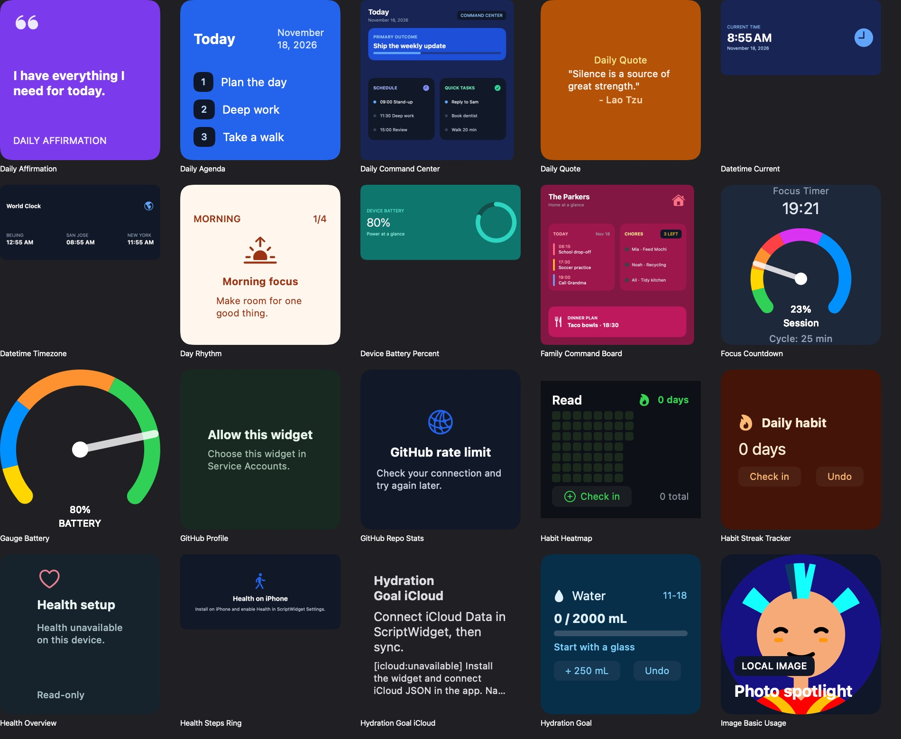
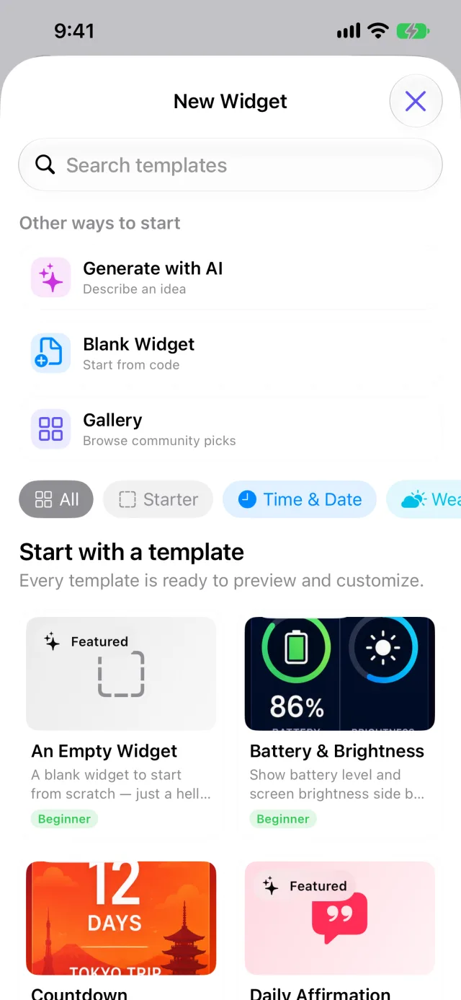
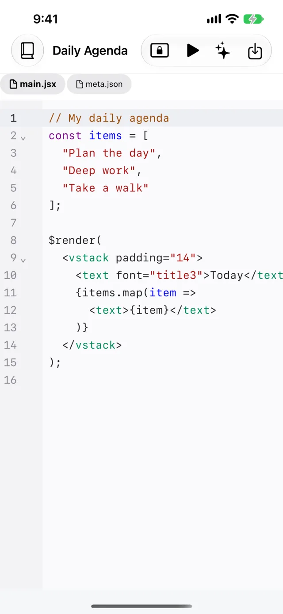

# ScriptWidget 🎨

Website: <https://atomsprout.com/scriptwidget/>

<div align="center">

[](https://github.com/everettjf/scriptwidget/stargazers)
[](https://github.com/everettjf/scriptwidget/network)
[](LICENSE)
[](#-platforms)
[](https://apps.apple.com/app/id1555600758)
[](https://github.com/everettjf/scriptwidget/actions/workflows/release-readiness.yml)

**Create widgets for iPhone, iPad, Mac, Android, Windows and Linux with JavaScript, JSX, and AI**

[English](README.md) | [简体中文](README_CN.md) | [Español](README_ES.md) | [日本語](README_JA.md) | [한국어](README_KO.md) | [Français](README_FR.md) | [Deutsch](README_DE.md) | [Português](README_PT_BR.md) | [Русский](README_RU.md) | [العربية](README_AR.md)

</div>

> ✨ *One widget package for iPhone, iPad, Mac and Android, and in preview for Windows and Linux—without writing Swift or Kotlin.*

**Get it:** [iPhone and iPad](https://apps.apple.com/app/id1555600758?platform=iphone) · [Mac](https://apps.apple.com/app/id1555600758?platform=mac) · [Android (APK)](https://github.com/everettjf/scriptwidget/releases?q=%22ScriptWidget+for+Android%22&expanded=true) · [Windows preview (Microsoft Store)](https://apps.microsoft.com/detail/9MVR97B9C938) · [Linux preview for Omarchy (archive or PKGBUILD)](https://github.com/everettjf/scriptwidget/releases?q=%22ScriptWidget+for+Linux%22&expanded=true) · [Web Studio in your browser](https://asp.run/scriptwidget/studio/)

Open **Learn** in Web Studio for five hands-on tutorials, from Hello World and
an event countdown to an interactive to-do list, a weather forecast, and a
calendar agenda. [Read the Web Studio guide](docs/web-studio-browser.md#learn-by-building).

## Create with your Agent — scriptwidget-creator

**Describe a widget in Claude Code. Generate it, validate it, and open it directly in Web Studio.** Use your own Agent and model with the [scriptwidget-creator Skill](docs/agent-quickstart.md#install-the-skill).

```sh
brew install everettjf/tap/scriptwidget-cli
mkdir -p ~/.claude/skills
# First installation; preserve any existing customized Skill.
test ! -e ~/.claude/skills/scriptwidget-creator && cp -R "$(brew --prefix scriptwidget-cli)/libexec/ScriptWidgetCLI.app/Contents/Resources/scriptwidget-creator" ~/.claude/skills/
```

In Claude Code: `/scriptwidget-creator Create a reading habit widget and show it in Web Studio`.

```sh
scriptwidget preview ./MyWidget # opens Web Studio and loads your widget automatically
scriptwidget render ./MyWidget --output ./artifacts --format json # native macOS verification
```

Preview links carry the validated package in a URL fragment and load a separate project; no upload server or model hosting is required. Links support up to 45 KB of compressed package data. Keep links private when code/resources are private. Larger packages can use native previews or explicit `.swt` import. Import `.swt` on iPhone through the existing App; adding a Home Screen widget is a separate user action.

[Install the Skill and get started](docs/agent-quickstart.md) · [Creator website](https://atomsprout.com/scriptwidget/creator/) · [CLI details](docs/mac-cli.md)


---

## 🎯 What is ScriptWidget?

ScriptWidget is an open-source widget development platform for building native widgets with **JavaScript** and **JSX-like syntax**: WidgetKit on iPhone, iPad, and Mac, App Widgets on Android, and desktop widgets on Windows 11 and Linux (Omarchy), both previews. Write once, preview on Mac or in the browser, and install the same package on all of them—without requiring Swift or Kotlin for widget authoring.

It combines a JavaScriptCore runtime with native SwiftUI rendering on Apple platforms, a QuickJS-NG runtime with one shared renderer on Android, Windows and Linux, a desktop development environment, a browser studio, secure package sharing, AI-assisted generation, and a GitHub-backed community catalog.

The Android app (Android 13 or later) is available as an [APK on GitHub Releases](https://github.com/everettjf/scriptwidget/releases?q=%22ScriptWidget+for+Android%22&expanded=true). On Google Play it is in closed testing: to join, become a member of the [Atomsprout Testers group](https://groups.google.com/g/atomsprout), then [become a tester](https://play.google.com/apps/testing/com.atomsprout.scriptwidget) and install from Google Play. See [ScriptWidget for Android](docs/android/README.md) for what differs from iOS.

The Windows and Linux apps are previews: [Windows](https://apps.microsoft.com/detail/9MVR97B9C938) needs Windows 11 (21H2, build 22000) or later (see [ScriptWidget for Windows](docs/windows/README.md)), and [Linux](https://github.com/everettjf/scriptwidget/releases?q=%22ScriptWidget+for+Linux%22&expanded=true) is for [Omarchy](https://omarchy.org) 4.5 (see [ScriptWidget for Linux](docs/linux/README.md)). Both run the same widget packages. See [Platform support](docs/platform-support.md) for data and rendering differences.

The source on `main` includes [Mac Desktop Tools](docs/five-minute-tutorial.md#mac-desktop-tools) and the new desktop templates. See the [changelog](CHANGELOG.md#unreleased) for changes awaiting an app release.

[Build an interactive to-do widget](Shared/ScriptWidgetRuntime/Resource/Script.bundle/template/To-do%20List%20iCloud/README.md) to learn local storage, button actions, and opt-in iCloud sync.


---

## ✨ Features

| Feature | Description |
|---------|-------------|
| 🖥️ **Cross-Platform** | One widget package for iPhone, iPad, Mac and Android, and in preview for Windows and Linux |
| 🎨 **JSX Support** | Declarative UI with JavaScript XML syntax |
| ⚡ **Native Rendering** | JSX elements are rendered as native SwiftUI views on Apple systems, and by one shared renderer on Android, Windows and Linux |
| 🔧 **Versioned Runtime API** | Storage, files, networking, device, location, health, system, and data sources; which API runs where is in [Platform support](docs/platform-support.md) |
| 📱 **Interactive Widgets** | Links, buttons, toggles, App Intents, Live Activities, and Control Widgets |
| 🎨 **Custom Styling** | Full control over appearance |
| 📦 **Template Gallery** | Built-in templates, component and API examples, and community widgets |
| 🌐 **Community Gallery** | Verified, one-click Widget and AI Skill installs |
| 🧰 **ScriptWidget Studio** | Build on Mac with CodeMirror, diagnostics, console, and multi-size preview |
| ✨ **AI Generation** | Generate, run, diagnose, and refine widgets with an OpenAI-compatible model |
| 🧠 **Skills 1.0** | Import, author, export, and share focused AI instructions |
| 📦 **Package 2.0** | Versioned `widget.json`, permissions, host allowlists, migration, and hardened imports |
| 🔌 **Data Source Plugins** | Declarative third-party API connectors with a Mac request lab |

### ScriptWidget Studio for Mac

Studio is the primary place to build widgets:

- project file tree with multiple JavaScript/JSON files and package resources;
- CodeMirror 6 editing, schema completions, diagnostics, formatting, autosave, and crash recovery;
- live preview for one or every supported widget family, plus runtime console and timing information;
- Config panel for `widget.json`, families, permissions, network domains, plugins, and preview parameters;
- AI generation with provider profiles, iterative run/diagnose/refine, and reusable Skills;
- verified Widget & Skills Gallery and a Data Source Lab for testing plugin operations.

The first-launch guide can create a complete tutorial widget and walk a new user from editing through adding it to the desktop in about five minutes.

---

## 🚀 Quick Start

### 1. Download

```bash
# Clone the repository
git clone https://github.com/everettjf/scriptwidget.git
cd ScriptWidget
```

### 2. Open in Xcode

```bash
# iOS app + widget + share extension
open iOS/ScriptWidget.xcodeproj

# macOS app + widget
open macOS/ScriptWidgetMac.xcodeproj
```

For Android, build with Gradle instead (JDK 17 or later and the Android SDK; the app needs Android 13 or later):

```bash
cd Android && ./gradlew :app:assembleDebug
```

### 3. Run & Explore

1. Select a scheme (`ScriptWidget` / `ScriptWidgetWidget` for iOS, `ScriptWidgetMac` for macOS)
2. Enable the `iCloud.ScriptWidget` container and `group.everettjf.scriptwidget` app group so script storage works
3. Press `Cmd + R` to build and run
4. Browse the bundled example scripts under `Shared/ScriptWidgetRuntime/Resource/Script.bundle/` (`api/`, `component/`, `template/`)

---

## 📁 Project Structure

```
ScriptWidget/
├── Shared/
│   └── ScriptWidgetRuntime/   # Core runtime: JavaScriptCore host, JSX→SwiftUI
│       ├── AI/                # Provider settings, agent loop, evals, Skills
│       ├── Common/            # Script storage, Package 2.0, cache & imports
│       ├── Gallery/           # Verified GitHub catalog, cache & installer
│       ├── Plugin/            # Declarative Data Source Plugin runtime
│       ├── Widget/Runtime/    # JS engine setup, Babel transform, execution
│       ├── Widget/API/        # JS APIs ($device, $file, $storage, ...)
│       ├── Widget/Component/  # Element → SwiftUI view mapping
│       └── Resource/          # Babel bundle + bundled example scripts
├── iOS/
│   ├── ScriptWidget/          # iOS app (editor, settings)
│   ├── ScriptWidgetWidget/    # Widget, Live Activity, Control Widget
│   └── ScriptWidgetShare/     # Share extension
├── macOS/
│   ├── ScriptWidgetMac/       # macOS app
│   └── ScriptWidgetMacWidget/ # macOS widget
├── Android/
│   ├── core/                  # QuickJS runtime, native APIs, renderer, package store
│   ├── app/                   # Compose app, widget providers, Studio editor
│   └── play/                  # Google Play listing kit
├── Windows/                   # Windows 11 app (preview): C# runtime, desktop host, management window
├── Linux/                     # Linux app (preview, Omarchy): Rust runtime, service, command line, management window
├── Web/
│   ├── preview-engine/        # Browser preview engine; its kernel and renderer also run on Android, Windows and Linux
│   └── studio/                # Web Studio (React + TypeScript)
├── Editor/editorfe/           # Vite + CodeMirror 6 editor frontend
├── Gallery/                   # Curated Widget & Skills Gallery index
├── Tests/                     # Shared runtime, execution, cache & security tests
├── docs/                      # User, API, package, Skills & release documentation
├── Resource/                  # Marketing assets, screenshots
└── README.md
```

---

## 💻 Example Widgets

A script's entry point is the `$render(...)` call, which takes a JSX tree built from
runtime tags (`vstack`, `hstack`, `zstack`, `text`, `image`, `gauge`, `chart`, ...).

### Hello World

```jsx
$render(
  <vstack frame="max">
    <text font="title">Hello, ScriptWidget! 👋</text>
  </vstack>
);
```

### Fetch remote data

```jsx
const result = await fetch("https://jsonplaceholder.typicode.com/todos/1");
const model = JSON.parse(result);

$render(
  <vstack>
    <text font="title">{model.title}</text>
  </vstack>
);
```

Package 2.0 widgets using network access must declare the `network` permission and matching hosts in `widget.json`.

### Use a Data Source Plugin

```jsx
const weather = await $dataSource.request(
  "app.scriptwidget.datasource.open-meteo",
  "forecast",
  { latitude: "37.7749", longitude: "-122.4194" }
);

$render(
  <vstack frame="max" padding="16">
    <text font="caption">San Francisco</text>
    <text font="largeTitle">{weather.current.temperature_2m}°</text>
  </vstack>
);
```

The package must declare the plugin identifier, `network` permission, and the plugin host. Plugins are declarative HTTPS request mappings—not executable native extensions.

### Persist values with `$storage`

```jsx
$storage.setString("greeting", "Hello ScriptWidget");
const greeting = $storage.getString("greeting");

$render(
  <vstack frame="max" background="#0f172a">
    <text font="caption" color="#94a3b8">Storage</text>
    <text font="title3" color="#e2e8f0">{greeting}</text>
  </vstack>
);
```

---

## 🛠️ Development

### Prerequisites

- **Xcode** 27+ for the current development branch
- **JDK 17** or later and the **Android SDK** (API 37 platform) for the Android app, which needs Android 13 or later
- **macOS** 26+ for ScriptWidget Studio
- **iOS** 16+ (for iOS widgets)

### Build from Source

```bash
# Clone and setup
git clone https://github.com/everettjf/scriptwidget.git
cd ScriptWidget

# Open in Xcode (pick the platform you want)
open iOS/ScriptWidget.xcodeproj      # iOS
open macOS/ScriptWidgetMac.xcodeproj # macOS

# Build and run (Cmd + R)
```

The editor frontend (React + CodeMirror) lives in `Editor/editorfe`:

```bash
cd Editor/editorfe
npm install
npm start   # dev server at http://localhost:3000
npm test
npm run build
npm run release # rebuild and copy StudioEditor.bundle into both apps
```

Run the same repository gates used by CI:

```bash
./Scripts/release-readiness.sh
./Scripts/ipad-icloud-tests.sh
```

The Android app has its own build and tests (the gate above does not cover it):

```bash
node Android/scripts/build-shared-js.mjs   # after changing Web/preview-engine/src
cd Android && ./gradlew :core:testDebugUnitTest :app:assembleDebug
sh scripts/device-test.sh core             # instrumented tests on a connected device
sh scripts/device-test.sh app
```

See [ScriptWidget for Android](docs/android/README.md), its [test notes](docs/android/testing.md) and [to-do](docs/android/TODO.md).

Windows and Linux have their own builds and tests too: see [ScriptWidget for Windows](docs/windows/README.md#building) and [ScriptWidget for Linux](docs/linux/README.md#building).

### Create Your Own Widget

1. Open **ScriptWidget Studio** on Mac (or ScriptWidget on iPhone/iPad) and create a script from a template, AI prompt, or blank project
2. Write your widget in `main.jsx` and call `$render(...)` with a JSX tree
3. Use the live preview to iterate, then add the widget from the Home Screen

On Android use the in-app editor; on Windows and Linux use the management window (My widgets, Templates, Components, APIs).

On Apple systems each widget is stored under `Scripts/<PackageName>/` and synced through iCloud/app-group storage. New projects use Package 2.0:

```text
My Widget/
├── widget.json
├── main.jsx
├── lib/
│   └── format.js
└── image/
    └── background.png
```

`widget.json` is the authoritative, versioned manifest. It declares the entry point, supported families, permissions, allowed network hosts, and Data Source Plugins. Legacy `main.jsx`/`meta.json` packages remain readable and migrate during supported import/export flows.

---

## 📚 Documentation

Start with the **[documentation hub](docs/README.md)** or build **[your first widget](docs/getting-started.md)** in ScriptWidget Studio.

### Core Concepts

- **Entry point** - call `$render(<tree/>)` to draw the widget
- **Components** - `vstack`, `hstack`, `zstack`, `text`, `image`, `gauge`, `chart`, shapes, ...
- **Styling** - element attributes such as `font`, `color`, `background`, `frame`, `padding`
- **Widget sizes** - read `$getenv("widget-size")` (small / medium / large / accessory…)
- **Interactions** - buttons and links via App Intents

### APIs

| API | Description |
|-----|-------------|
| `fetch()` | HTTP requests (`fetch`/`$fetch`) |
| `$storage` | Persisted key/value store (string & JSON) |
| `$file` | Read/write files in the script package |
| `$device` | Device info (model, battery, screen, dark mode, …) |
| `$location` | Location & geocoding |
| `$health` | HealthKit data (steps, heart rate, …) |
| `$system` | System info (timezone, app version, …) |
| `$import` | Import another file from the package |
| `$dataSource` | Call a declared Data Source Plugin operation |
| `$runtime` | Runtime API version and enforced resource limits |
| `console` | Logging (`console.log` / `console.error`) |

The native JSX component switch is the runtime authority. Studio keeps static completion metadata in [`scriptWidgetAPI.js`](Editor/editorfe/src/scriptWidgetAPI.js), checks it against the native switch, and generates the [Runtime API reference](docs/scriptwidget-runtime-api.md) from it.

## 🔐 Security model

Widget packages, Gallery content, Skills, and Data Source Plugins are treated as untrusted input:

- Package 2.0 rejects unknown fields and unsupported versions.
- Archive imports reject traversal, absolute paths, symlinks, encrypted entries, case collisions, malformed ZIP metadata, and oversized payloads.
- Package file access remains package-relative; storage is package-namespaced and bounded.
- Package 2.0 networking requires explicit permission and a matching host declaration; generic fetches are limited to public HTTP(S), while Data Source Plugins require HTTPS. Private/local hosts and oversized responses are rejected.
- Gallery files are restricted to the curated GitHub trust root and verified by exact byte count and SHA-256 before installation.
- Skills are prompt-only and cannot execute code, access secrets, or grant runtime permissions.
- Data Source Plugins are declarative request mappings and cannot load arbitrary native code.

See [Package 2.0](docs/package-format.md), [modern WidgetKit features](docs/widgetkit-modern-features.md), [Skills 1.0](docs/skills.md), [Gallery](docs/gallery.md), and [Data Source Plugins](docs/data-source-plugins.md) for the complete contracts.

---

## 🎨 Gallery

<div align="center">



*Sample widgets created with ScriptWidget*

</div>

---

## 📱 Platforms

| Platform | Support | Notes |
|----------|---------|-------|
| **iOS / iPadOS** | ✅ Full | App on iOS / iPadOS 16 or later. Widgets require iOS / iPadOS 18 or later. |
| **macOS** | ✅ Full | macOS 26+ (Mac) |
| **Android** | ✅ Released | Android 13+; [APK on GitHub Releases](https://github.com/everettjf/scriptwidget/releases?q=%22ScriptWidget+for+Android%22&expanded=true), Google Play in closed testing. Runs the same packages; [differences from iOS](docs/android/README.md) |
| **Windows** | 🧪 Preview | Windows 11 (21H2) or later; desktop widgets and a management window with AI, Gallery and Skills. [Microsoft Store](https://apps.microsoft.com/detail/9MVR97B9C938); an [installer](https://github.com/everettjf/scriptwidget/releases?q=%22ScriptWidget+for+Windows%22&expanded=true) on GitHub Releases; see [ScriptWidget for Windows](docs/windows/README.md) |
| **Linux** | 🧪 Preview | [Omarchy](https://omarchy.org) 4.5; widgets on the desktop, a management window with AI, Gallery and Skills, and a command line. [Archives and a PKGBUILD on GitHub Releases](https://github.com/everettjf/scriptwidget/releases?q=%22ScriptWidget+for+Linux%22&expanded=true); see [ScriptWidget for Linux](docs/linux/README.md) |
| **watchOS** | — | Not in the current roadmap |
| **visionOS** | — | Not in the current roadmap |

Feature-by-feature support is in [Platform support](docs/platform-support.md).

### Screenshots

Real screenshots of each platform. Windows and Linux are previews.

| iPhone | iPad | Mac |
| --- | --- | --- |
|  |  |  |
|  | | |

| Android | Windows | Linux (Omarchy) |
| --- | --- | --- |
|  |  |  |
|  |  |  |

| Web Studio |
| --- |
|  |

---

## 🤝 Contributing

Contributions are welcome! Please read our [Contributing Guide](CONTRIBUTING.md) for details.

### Ways to Contribute

- 🐛 Report bugs
- 💡 Suggest features
- 🔧 Submit pull requests
- 📝 Write documentation
- 🎨 Share your widgets
- 🧠 Share focused AI Skills

See the [public roadmap](ROADMAP.md), [governance model](GOVERNANCE.md), and [Gallery submission guide](docs/gallery.md). Every pull request runs the same release-readiness checks used locally.

---

## 📜 License

The source code in this repository is released under the [Apache 2.0 License](LICENSE).

The ScriptWidget name, logos, screenshots, and App Store marketing materials are not licensed under the Apache 2.0 License. All rights to those brand and marketing assets are reserved by their respective owners.

---

## 🙏 Acknowledgements

Built with:
- [JavaScriptCore](https://developer.apple.com/documentation/javascriptcore) - Apple's JavaScript engine
- [QuickJS-NG](https://github.com/quickjs-ng/quickjs) - the JavaScript engine on Android, Windows and Linux
- [SwiftUI](https://developer.apple.com/xcode/swiftui/) - Modern UI framework
- [Xcode Gen](https://github.com/yonaskolb/XcodeGen) - Project generation

Inspired by:
- [React](https://reactjs.org/) - Component-based UI
- [React Native](https://reactnative.dev/) - Mobile development
- [WidgetKit](https://developer.apple.com/documentation/widgetkit) - Apple's widget framework

---

## 📈 Star History

<div align="center">

[](https://star-history.com/#everettjf/scriptwidget&Date)

</div>

---

## 📞 Support

<div align="center">

[](https://github.com/everettjf/scriptwidget/issues)
[](https://github.com/everettjf/scriptwidget/discussions)
[](https://discord.gg/eGzEaP6TzR)

**有问题？去 [Issues](https://github.com/everettjf/scriptwidget/issues) 提问！**

</div>

---

<div align="center">

**Made with ❤️ by [Everett](https://github.com/everettjf)**

**Project Link:** [https://github.com/everettjf/scriptwidget](https://github.com/everettjf/scriptwidget)

</div>
## System capabilities under development

Runtime 1.6 adds opt-in notifications, HealthKit daily history, owned calendar writes, normalized forecasts, AlarmKit timers, imported JSON/CSV, selected contacts, MapKit places/snapshots and selected HomeKit controls. Native user grants and OS permissions are separate from exported widgets; Web Studio offers isolated editable mocks. See the [contracts, nine examples and device acceptance checklist](docs/system-services-api.md). Physical-device verification is required before release.

## Website ownership

Product information, downloads, support and privacy pages live at https://atomsprout.com/scriptwidget/. Functional Web Studio lives at https://asp.run/scriptwidget/studio/ and is built from this repository on changes to the Web runtime, editor support scripts, templates or Gallery. `.github/workflows/pages.yml` tests and builds Studio, then `Scripts/build-web-site.mjs` assembles its Pages artifact. Company must not keep a compiled Studio copy. The personal `/scriptwidget/` entry offers two explicit choices: open Web Studio or visit the official product website. It does not auto-redirect. Old product-documentation, support and privacy redirect pages are not published here. The entry page, Studio header and browser icons reuse the native App icon.
