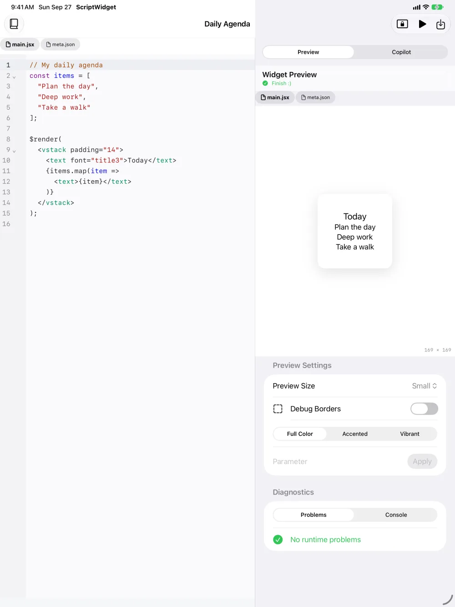

# ScriptWidget 🎨

<div align="center" dir="rtl">

[](https://github.com/everettjf/ScriptWidget/stargazers)
[](LICENSE)
[](https://github.com/everettjf/ScriptWidget/actions/workflows/release-readiness.yml)

**أنشئ أدوات مصغّرة لـ iPhone وiPad وMac وAndroid وWindows وLinux باستخدام JavaScript وJSX والذكاء الاصطناعي**

[English](README.md) | [简体中文](README_CN.md) | [Español](README_ES.md) | [日本語](README_JA.md) | [한국어](README_KO.md) | [Français](README_FR.md) | [Deutsch](README_DE.md) | [Português](README_PT_BR.md) | [Русский](README_RU.md) | [العربية](README_AR.md)

</div>


<div dir="rtl">

ScriptWidget منصة مفتوحة المصدر بترخيص Apache 2.0 لإنشاء الأدوات المصغّرة. لا تحتاج إلى تعلم Swift؛ حرّر `main.jsx` في ScriptWidget Studio على Mac أو iPhone أو iPad، وستحوّل بيئة التشغيل JSX التصريحي إلى واجهات SwiftUI وWidgetKit أصلية.

تطبيق Android (الإصدار 1.0.0، يتطلب Android 15 أو أحدث) متاح كملف [APK على GitHub Releases](https://github.com/everettjf/scriptwidget/releases/tag/android-v1.1.0). على Google Play هو في اختبار مغلق: للانضمام، انضم إلى [مجموعة Atomsprout Testers](https://groups.google.com/g/atomsprout). راجع [ScriptWidget لنظام Android](docs/android/README.md).

نسختا Windows وLinux تجريبيتان: [Windows 0.1.0](https://github.com/everettjf/scriptwidget/releases/tag/windows-v0.1.0) يتطلب Windows 11، راجع [ScriptWidget لنظام Windows](docs/windows/README.md)؛ ونسخة Linux تعمل حاليًا على [Omarchy](https://omarchy.org) 4.5، والأرشيفات متاحة على [GitHub Releases](https://github.com/everettjf/scriptwidget/releases)، راجع [ScriptWidget لنظام Linux](docs/linux/README.md). تشغّل النسختان حزم الأدوات المصغّرة نفسها، لكن لا تتوفر فيهما واجهات بيانات الجهاز مثل الصحة والتقويم والموقع والموسيقى.

### لقطات شاشة من كل منصة

جميعها لقطات شاشة حقيقية. نسختا Windows وLinux تجريبيتان.

| iPhone | iPad | Mac |
| --- | --- | --- |
|  |  |  |

| Android | Windows | Linux (Omarchy) |
| --- | --- | --- |
|  |  |  |
|  |  |  |

| Web Studio |
| --- |
|  |

## لماذا ScriptWidget؟

- تعمل الحزمة نفسها على iPhone وiPad وMac وAndroid، وبنسخة تجريبية على Windows 11 وLinux (Omarchy)، مع تخطيطات متكيفة عبر `$getenv("widget-size")`.
- يدعم الأدوات التفاعلية، وApp Intents، وLive Activities، وDynamic Island، وControl Widgets.
- يتضمن Studio لـ Mac محرر CodeMirror، والإكمال التلقائي، والتشخيص، ووحدة التحكم، ومعاينات بأحجام متعددة.
- يمكنك إنشاء الأدوات وتشغيلها وتشخيصها وتحسينها بنماذج متوافقة مع OpenAI؛ وتُحفظ مفاتيح API في Keychain.
- يتحقق Widget & Skills Gallery من الفهارس والأحجام والمسارات وSHA-256 قبل التثبيت.
- يتضمن قوالب، وRuntime API بإصدارات، وPackage 2.0، وSkills 1.0 مع اختبارات آلية.

## ابدأ خلال خمس دقائق

</div>

```bash
git clone https://github.com/everettjf/ScriptWidget.git
cd ScriptWidget
open macOS/ScriptWidgetMac.xcodeproj
# أو: open iOS/ScriptWidget.xcodeproj
```

<div dir="rtl">

في Xcode، اختر مخطط `ScriptWidgetMac` أو `ScriptWidget`، وهيئ حاوية `iCloud.ScriptWidget` وApp Group بالمعرّف `group.everettjf.scriptwidget`، ثم شغّل المشروع. يمكنك أيضًا اتباع [الدليل ذي الدقائق الخمس](docs/five-minute-tutorial.md).

لنظام Android، استخدم Gradle للبناء (JDK 17 أو أحدث وAndroid SDK؛ ويتطلب التطبيق Android 15 أو أحدث):

</div>

```bash
cd Android && ./gradlew :app:assembleDebug
```

```jsx
$render(
  <vstack frame="max" background="#0f172a">
    <text font="title3" color="#f8fafc">Hello, ScriptWidget!</text>
  </vstack>
);
```

<div dir="rtl">

## الوثائق

- [مركز الوثائق](docs/README.md)
- [أنشئ أول أداة مصغّرة](docs/getting-started.md)
- [ScriptWidget Studio](docs/studio.md)
- [Runtime API](docs/runtime-api.md)
- [الإنشاء بالذكاء الاصطناعي](docs/ai-generate.md)
- [Widget & Skills Gallery](docs/gallery.md)
- [Package 2.0](docs/package-format.md)، و[Skills 1.0](docs/skills.md)، و[خارطة الطريق](ROADMAP.md)

## المساهمة والترخيص

نرحب بالمساهمات. راجع [دليل المساهمة](CONTRIBUTING.md)، و[الحوكمة](GOVERNANCE.md)، و[قواعد السلوك](CODE_OF_CONDUCT.md). أبلغ عن المشكلات الأمنية بشكل خاص وفق [سياسة الأمان](SECURITY.md).

يُنشر الكود المصدري في هذا المستودع بموجب [ترخيص Apache 2.0](LICENSE). لا يشمل ترخيص Apache 2.0 اسم ScriptWidget أو الشعارات أو لقطات الشاشة أو مواد App Store الترويجية؛ وتعود حقوقها إلى أصحاب الحقوق المعنيين.

</div>

[Discord](https://discord.gg/eGzEaP6TzR)
