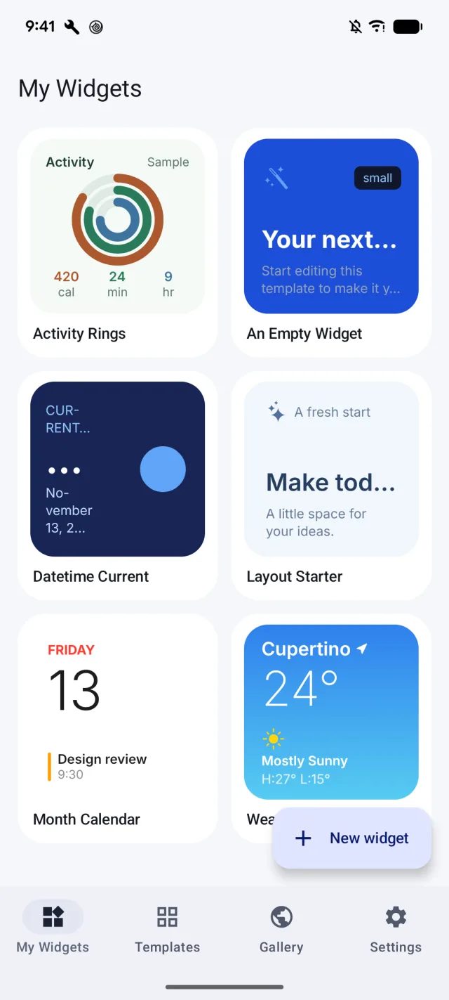
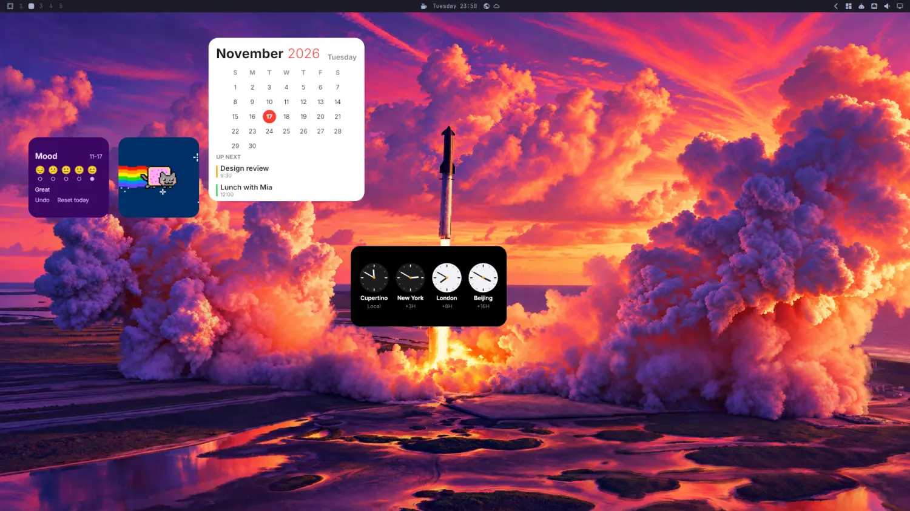

# ScriptWidget 🎨

<div align="center">

[](https://github.com/everettjf/ScriptWidget/stargazers)
[](LICENSE)
[](https://github.com/everettjf/ScriptWidget/actions/workflows/release-readiness.yml)

**使用 JavaScript、JSX 和 AI，为 iPhone、iPad、Mac、Android、Windows 与 Linux 创建 Widget**

**下载：** [iPhone 和 iPad](https://apps.apple.com/app/id1555600758?platform=iphone) · [Mac](https://apps.apple.com/app/id1555600758?platform=mac) · [Android（APK）](https://github.com/everettjf/scriptwidget/releases?q=%22ScriptWidget+for+Android%22&expanded=true) · [Windows 预览版（Microsoft Store）](https://apps.microsoft.com/detail/9MVR97B9C938) · [Linux 预览版（Omarchy，压缩包或 PKGBUILD）](https://github.com/everettjf/scriptwidget/releases?q=%22ScriptWidget+for+Linux%22&expanded=true) · [浏览器里的 Web Studio](https://asp.run/scriptwidget/studio/)

[English](README.md) | [简体中文](README_CN.md) | [Español](README_ES.md) | [日本語](README_JA.md) | [한국어](README_KO.md) | [Français](README_FR.md) | [Deutsch](README_DE.md) | [Português](README_PT_BR.md) | [Русский](README_RU.md) | [العربية](README_AR.md)

</div>

## 用你的 Agent 创作 — scriptwidget-creator

**在 Claude Code 描述组件，让 Agent 生成、校验，并直接打开 Web Studio 查看效果。** 沿用自己的 Agent 和模型，安装[官方 Skill](https://github.com/everettjf/scriptwidget/releases/download/cli-v0.2.0/scriptwidget-creator-0.2.0.zip)到 `~/.claude/skills/scriptwidget-creator/`，使用 `/scriptwidget-creator` 调用。

```sh
brew install everettjf/tap/scriptwidget-cli
scriptwidget preview ./MyWidget
```

生成后自动打开并加载，不需要手动导入。组件通过 URL 片段传递，不需要上传服务器；加载成新项目并清除地址栏中的包数据。链接容量为压缩包 45 KB，大包可使用原生预览或 `.swt` 导入。链接包含代码与资源，私有组件不要分享链接。

[完整安装与使用说明](docs/agent-quickstart.md) · [Creator 专页](https://atomsprout.com/scriptwidget/creator/) · [CLI 文档](docs/mac-cli.md)


ScriptWidget 是一个 Apache 2.0 开源的 Widget 创作平台。你不需要学习 Swift：在 Mac Studio、iPhone 或 iPad 上编辑 `main.jsx`，运行时会把声明式 JSX 映射为原生 SwiftUI/WidgetKit 界面。

Android 版（要求 Android 13 或更高版本）已在 [GitHub Releases](https://github.com/everettjf/scriptwidget/releases?q=%22ScriptWidget+for+Android%22&expanded=true) 提供 APK。Google Play 版正在封闭测试：先加入 [Atomsprout Testers 群组](https://groups.google.com/g/atomsprout)，再[成为测试者](https://play.google.com/apps/testing/com.atomsprout.scriptwidget)，然后从 Google Play 安装。与 iOS 的差异详见 [Android 版 ScriptWidget](docs/android/README.md)。

Windows 版和 Linux 版是预览版：[Windows](https://apps.microsoft.com/detail/9MVR97B9C938) 需要 Windows 11（21H2，版本号 22000）或更高版本，见 [Windows 版 ScriptWidget](docs/windows/README.md)；[Linux](https://github.com/everettjf/scriptwidget/releases?q=%22ScriptWidget+for+Linux%22&expanded=true) 目前支持 [Omarchy](https://omarchy.org) 4.5，见 [Linux 版 ScriptWidget](docs/linux/README.md)。两者运行同样的小组件包，但没有健康、日历、定位等设备数据 API；Linux 版有音乐、通知和你选的文件。

### 各平台截图

都是真实截图。Windows 和 Linux 是预览版。

| iPhone | iPad | Mac |
| --- | --- | --- |
|  |  |  |

| Android | Windows | Linux（Omarchy） |
| --- | --- | --- |
|  |  |  |
|  |  |  |

| Web Studio |
| --- |
|  |


## 为什么选择 ScriptWidget

- 同一个小组件包可在 iPhone、iPad、Mac 和 Android 上运行，并以预览版运行于 Windows 11 和 Linux（Omarchy）；多尺寸布局可通过 `$getenv("widget-size")` 调整。
- 支持交互式 Widget、App Intents、Live Activity、灵动岛与 Control Widget。
- Mac Studio 内置 CodeMirror 编辑器、补全、诊断、Console 和多尺寸预览。
- 可用 OpenAI 兼容模型生成、运行、诊断并迭代 Widget；API Key 保存在 Keychain。
- Widget & Skills Gallery 支持经过索引、大小、路径与 SHA-256 验证的一键安装和离线缓存。
- 92 个内置模板（连同组件与 API 示例共 140 个）、版本化 Runtime API、Package 2.0 与 Skills 1.0 均有自动测试和发布门禁。

## 五分钟开始

```bash
git clone https://github.com/everettjf/ScriptWidget.git
cd ScriptWidget
open macOS/ScriptWidgetMac.xcodeproj
# 或：open iOS/ScriptWidget.xcodeproj
```

在 Xcode 中选择 `ScriptWidgetMac` 或 `ScriptWidget` scheme，配置 `iCloud.ScriptWidget` container 与 `group.everettjf.scriptwidget` App Group，然后运行。也可以直接按照[五分钟教程](docs/five-minute-tutorial.md)创建第一个 Widget。

Android 版改用 Gradle 构建（需要 JDK 17 或更高版本和 Android SDK；应用要求 Android 13 或更高版本）：

```bash
cd Android && ./gradlew :app:assembleDebug
```

最小脚本：

```jsx
$render(
  <vstack frame="max" background="#0f172a">
    <text font="title3" color="#f8fafc">Hello, ScriptWidget!</text>
  </vstack>
);
```

## 文档

- [文档中心](docs/README.md)
- [从零创建第一个 Widget](docs/getting-started.md)
- [ScriptWidget Studio](docs/studio.md)
- [Runtime API](docs/runtime-api.md)
- [AI 生成](docs/ai-generate.md)
- [Widget & Skills Gallery](docs/gallery.md)
- [Package 2.0](docs/package-format.md) 与 [Skills 1.0](docs/skills.md)
- [公开路线图](ROADMAP.md)

## 参与贡献

欢迎提交 Runtime、各平台体验、模板、Gallery Widget、AI Skill、测试与文档。请先阅读[贡献指南](CONTRIBUTING.md)、[治理规则](GOVERNANCE.md)和[行为准则](CODE_OF_CONDUCT.md)，并在提交前运行：

```bash
./Scripts/release-readiness.sh
```

Android 应用有独立的构建和测试，上面的门禁不包含它：

```bash
node Android/scripts/build-shared-js.mjs   # after changing Web/preview-engine/src
cd Android && ./gradlew :core:testDebugUnitTest :app:assembleDebug
sh scripts/device-test.sh core             # instrumented tests on a connected device
sh scripts/device-test.sh app
```

详见 [Android 版 ScriptWidget](docs/android/README.md)、[测试说明](docs/android/testing.md)和[待办事项](docs/android/TODO.md)。

Windows 版和 Linux 版同样有独立的构建和测试，见 [Windows 版 ScriptWidget](docs/windows/README.md#building) 和 [Linux 版 ScriptWidget](docs/linux/README.md#building)。

安全问题请按照[安全政策](SECURITY.md)私下报告，不要在公开 Issue 中披露利用细节或个人数据。

ScriptWidget 仓库中的源代码使用 [Apache 2.0 License](LICENSE) 发布。

ScriptWidget 名称、Logo、截图与 App Store 商店宣传素材不包含在 Apache 2.0 许可范围内；这些品牌及宣传资产的权利归各自权利人所有。

[Discord](https://discord.gg/eGzEaP6TzR)

## 正在开发的系统能力

Runtime 1.6 新增通知提醒、健康历史、日历写入、天气、闹钟、文件导入、联系人、地图和 HomeKit。每个组件独立授权，Web Studio 提供隔离的模拟数据。[API 文档、九个示例及真机验收清单](docs/system-services-api.md)。当前仍需完成真机验收后再发布。
