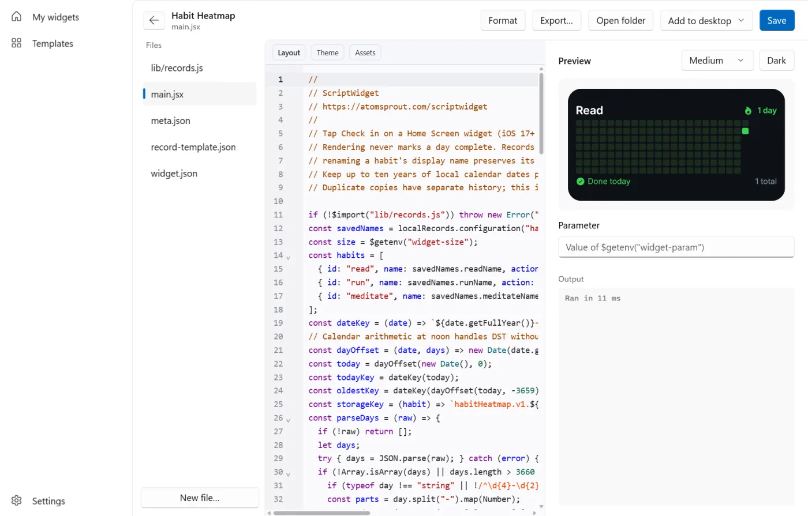

# ScriptWidget 🎨

<div align="center">

[](https://github.com/everettjf/ScriptWidget/stargazers)
[](LICENSE)
[](https://github.com/everettjf/ScriptWidget/actions/workflows/release-readiness.yml)

**Crea widgets para iPhone, iPad, Mac, Android, Windows y Linux con JavaScript, JSX e IA**

[English](README.md) | [简体中文](README_CN.md) | [Español](README_ES.md) | [日本語](README_JA.md) | [한국어](README_KO.md) | [Français](README_FR.md) | [Deutsch](README_DE.md) | [Português](README_PT_BR.md) | [Русский](README_RU.md) | [العربية](README_AR.md)

</div>


ScriptWidget es una plataforma de código abierto con licencia Apache 2.0 para crear widgets. No necesitas aprender Swift: edita `main.jsx` en ScriptWidget Studio para Mac, iPhone o iPad y el entorno de ejecución convertirá el JSX declarativo en interfaces nativas de SwiftUI y WidgetKit.

La app para Android (versión 1.1.0, Android 15 o posterior) está disponible como [APK en GitHub Releases](https://github.com/everettjf/scriptwidget/releases/tag/android-v1.1.0). En Google Play está en prueba cerrada: para participar, únete al [grupo Atomsprout Testers](https://groups.google.com/g/atomsprout). Consulta [ScriptWidget para Android](docs/android/README.md).

Las versiones para Windows y Linux son versiones preliminares: [Windows 0.1.0](https://github.com/everettjf/scriptwidget/releases/tag/windows-v0.1.0) requiere Windows 11, consulta [ScriptWidget para Windows](docs/windows/README.md); la versión para Linux funciona por ahora en [Omarchy](https://omarchy.org) 4.5, los archivos están en [GitHub Releases](https://github.com/everettjf/scriptwidget/releases), consulta [ScriptWidget para Linux](docs/linux/README.md). Ambas ejecutan los mismos paquetes de widgets, pero no tienen las API de datos del dispositivo como salud, calendario, ubicación y música.

### Capturas de cada plataforma

Todas son capturas reales. Windows y Linux son versiones preliminares.

| iPhone | iPad | Mac |
| --- | --- | --- |
|  |  |  |

| Android | Windows | Linux (Omarchy) |
| --- | --- | --- |
|  |  |  |
|  |  |  |

| Web Studio |
| --- |
|  |

## Por qué elegir ScriptWidget

- Un mismo paquete funciona en iPhone, iPad, Mac y Android, y en versión preliminar en Windows 11 y Linux (Omarchy), con diseños adaptables mediante `$getenv("widget-size")`.
- Admite widgets interactivos, App Intents, Live Activities, Dynamic Island y Control Widgets.
- Studio para Mac incluye CodeMirror, autocompletado, diagnósticos, consola y vistas previas en varios tamaños.
- Puede generar, ejecutar, diagnosticar y mejorar widgets con modelos compatibles con OpenAI; las claves API se guardan en Keychain.
- La galería de widgets y skills verifica índices, tamaños, rutas y SHA-256 antes de instalar.
- Incluye plantillas, una Runtime API versionada, Package 2.0 y Skills 1.0 con pruebas automatizadas.

## Inicio en cinco minutos

```bash
git clone https://github.com/everettjf/ScriptWidget.git
cd ScriptWidget
open macOS/ScriptWidgetMac.xcodeproj
# O bien: open iOS/ScriptWidget.xcodeproj
```

En Xcode, selecciona el esquema `ScriptWidgetMac` o `ScriptWidget`, configura el contenedor `iCloud.ScriptWidget` y el App Group `group.everettjf.scriptwidget`, y ejecuta el proyecto. También puedes seguir el [tutorial de cinco minutos](docs/five-minute-tutorial.md).

Para Android, compila con Gradle (JDK 17 o posterior y el Android SDK; la app requiere Android 15 o posterior):

```bash
cd Android && ./gradlew :app:assembleDebug
```

```jsx
$render(
  <vstack frame="max" background="#0f172a">
    <text font="title3" color="#f8fafc">Hello, ScriptWidget!</text>
  </vstack>
);
```

## Documentación

- [Centro de documentación](docs/README.md)
- [Crea tu primer widget](docs/getting-started.md)
- [ScriptWidget Studio](docs/studio.md)
- [Runtime API](docs/runtime-api.md)
- [Generación con IA](docs/ai-generate.md)
- [Galería de widgets y skills](docs/gallery.md)
- [Package 2.0](docs/package-format.md), [Skills 1.0](docs/skills.md) y [hoja de ruta](ROADMAP.md)

## Contribuir y licencia

Las contribuciones son bienvenidas. Consulta la [guía de contribución](CONTRIBUTING.md), el [modelo de gobernanza](GOVERNANCE.md) y el [código de conducta](CODE_OF_CONDUCT.md). Informa de problemas de seguridad de forma privada siguiendo la [política de seguridad](SECURITY.md).

El código fuente de este repositorio se publica bajo la [licencia Apache 2.0](LICENSE). El nombre ScriptWidget, sus logotipos, capturas de pantalla y materiales promocionales de App Store no están cubiertos por la licencia Apache 2.0; sus derechos pertenecen a sus respectivos titulares.

[Discord](https://discord.gg/eGzEaP6TzR)
