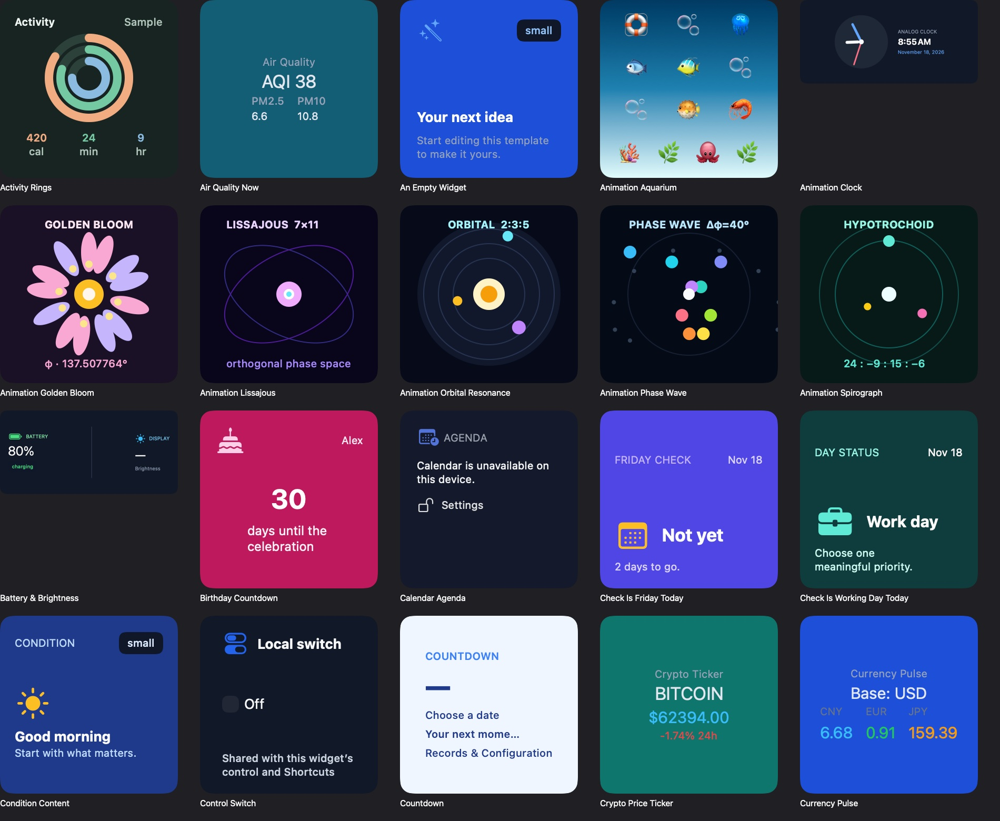
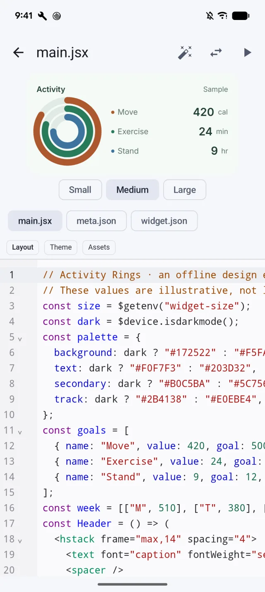

# ScriptWidget 🎨

<div align="center">

[](https://github.com/everettjf/ScriptWidget/stargazers)
[](LICENSE)
[](https://github.com/everettjf/ScriptWidget/actions/workflows/release-readiness.yml)

**JavaScript、JSX、AI で iPhone、iPad、Mac、Android、Windows、Linux 向けのウィジェットを作成**

[English](README.md) | [简体中文](README_CN.md) | [Español](README_ES.md) | [日本語](README_JA.md) | [한국어](README_KO.md) | [Français](README_FR.md) | [Deutsch](README_DE.md) | [Português](README_PT_BR.md) | [Русский](README_RU.md) | [العربية](README_AR.md)

</div>



ScriptWidget は、Apache 2.0 ライセンスのオープンソース・ウィジェット作成プラットフォームです。Swift を学ぶ必要はありません。Mac、iPhone、iPad の ScriptWidget Studio で `main.jsx` を編集すると、ランタイムが宣言的 JSX をネイティブな SwiftUI/WidgetKit UI に変換します。

Android アプリ（バージョン 1.1.0、Android 15 以降）は [GitHub Releases の APK](https://github.com/everettjf/scriptwidget/releases/tag/android-v1.1.0) で入手できます。Google Play ではクローズドテスト中です。参加するには [Atomsprout Testers グループ](https://groups.google.com/g/atomsprout) に参加してください。詳しくは [Android 版 ScriptWidget](docs/android/README.md) をご覧ください。

Windows 版と Linux 版はプレビュー版です。[Windows 0.1.0](https://github.com/everettjf/scriptwidget/releases/tag/windows-v0.1.0) には Windows 11 が必要です（[Windows 版 ScriptWidget](docs/windows/README.md) を参照）。Linux 版は現在 [Omarchy](https://omarchy.org) 4.5 に対応しており、アーカイブは [GitHub Releases](https://github.com/everettjf/scriptwidget/releases) にあります（[Linux 版 ScriptWidget](docs/linux/README.md) を参照）。どちらも同じウィジェットパッケージを実行しますが、ヘルスケア、カレンダー、位置情報、ミュージックなどのデバイスデータ API はありません。

### 各プラットフォームのスクリーンショット

すべて実際のスクリーンショットです。Windows 版と Linux 版はプレビュー版です。

| iPhone | iPad | Mac |
| --- | --- | --- |
|  |  |  |

| Android | Windows | Linux (Omarchy) |
| --- | --- | --- |
|  |  |  |
|  |  |  |

| Web Studio |
| --- |
|  |

## ScriptWidget の特長

- 1 つのパッケージが iPhone、iPad、Mac、Android で動作し、Windows 11 と Linux（Omarchy）ではプレビュー版として動作します。`$getenv("widget-size")` でサイズ別に調整できます。
- インタラクティブウィジェット、App Intents、Live Activities、Dynamic Island、Control Widgets に対応します。
- Mac 版 Studio には CodeMirror、補完、診断、コンソール、複数サイズのプレビューがあります。
- OpenAI 互換モデルで生成・実行・診断・改善でき、API キーは Keychain に保存されます。
- Widget & Skills Gallery は、インデックス、サイズ、パス、SHA-256 を検証してからインストールします。
- テンプレート、バージョン管理された Runtime API、Package 2.0、Skills 1.0 を含みます。

## 5 分で始める

```bash
git clone https://github.com/everettjf/ScriptWidget.git
cd ScriptWidget
open macOS/ScriptWidgetMac.xcodeproj
# または: open iOS/ScriptWidget.xcodeproj
```

Xcode で `ScriptWidgetMac` または `ScriptWidget` スキームを選択し、`iCloud.ScriptWidget` コンテナと `group.everettjf.scriptwidget` App Group を設定して実行します。[5 分間チュートリアル](docs/five-minute-tutorial.md)も利用できます。

Android 版は Gradle でビルドします（JDK 17 以降と Android SDK が必要です。アプリの動作には Android 15 以降が必要です）。

```bash
cd Android && ./gradlew :app:assembleDebug
```

```jsx
$render(
  <vstack frame="max" background="#0f172a">
    <text font="title3" color="#f8fafc">Hello, ScriptWidget!</text>
  </vstack>
);
```

## ドキュメント

- [ドキュメントハブ](docs/README.md)
- [最初のウィジェットを作成](docs/getting-started.md)
- [ScriptWidget Studio](docs/studio.md)
- [Runtime API](docs/runtime-api.md)
- [AI 生成](docs/ai-generate.md)
- [Widget & Skills Gallery](docs/gallery.md)
- [Package 2.0](docs/package-format.md)、[Skills 1.0](docs/skills.md)、[ロードマップ](ROADMAP.md)

## 貢献とライセンス

貢献を歓迎します。[コントリビューションガイド](CONTRIBUTING.md)、[ガバナンス](GOVERNANCE.md)、[行動規範](CODE_OF_CONDUCT.md)をご覧ください。セキュリティ問題は[セキュリティポリシー](SECURITY.md)に従い、非公開で報告してください。

このリポジトリのソースコードは [Apache 2.0 License](LICENSE) で公開されています。ScriptWidget の名称、ロゴ、スクリーンショット、App Store 用宣伝素材は Apache 2.0 ライセンスの対象外であり、それらの権利は各権利者に帰属します。

[Discord](https://discord.gg/eGzEaP6TzR)
