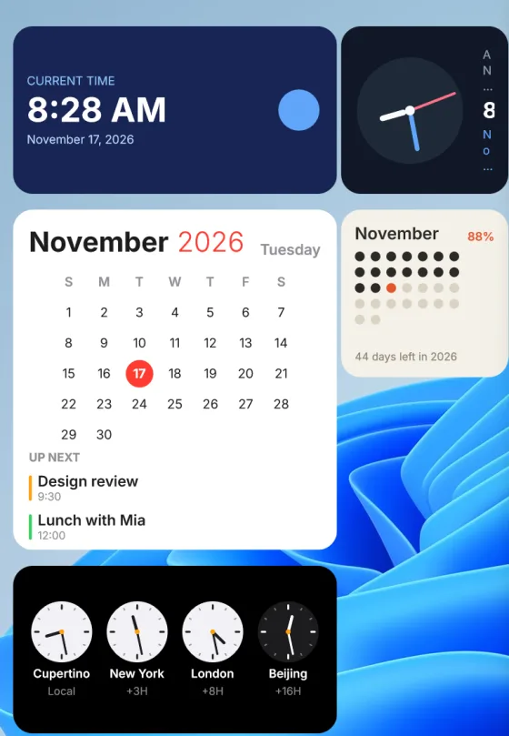

# ScriptWidget 🎨

<div align="center">

[](https://github.com/everettjf/ScriptWidget/stargazers)
[](LICENSE)
[](https://github.com/everettjf/ScriptWidget/actions/workflows/release-readiness.yml)

**JavaScript, JSX, AI로 iPhone, iPad, Mac, Android, Windows, Linux용 위젯을 만드세요**

[English](README.md) | [简体中文](README_CN.md) | [Español](README_ES.md) | [日本語](README_JA.md) | [한국어](README_KO.md) | [Français](README_FR.md) | [Deutsch](README_DE.md) | [Português](README_PT_BR.md) | [Русский](README_RU.md) | [العربية](README_AR.md)

</div>


ScriptWidget은 Apache 2.0 라이선스로 공개된 위젯 제작 플랫폼입니다. Swift를 배울 필요 없이 Mac, iPhone, iPad의 ScriptWidget Studio에서 `main.jsx`를 편집하면 런타임이 선언적 JSX를 네이티브 SwiftUI/WidgetKit UI로 변환합니다.

Android 앱(버전 1.1.0, Android 15 이상)은 [GitHub Releases의 APK](https://github.com/everettjf/scriptwidget/releases/tag/android-v1.1.0)로 받을 수 있습니다. Google Play에서는 비공개 테스트 중입니다. 참여하려면 [Atomsprout Testers 그룹](https://groups.google.com/g/atomsprout)에 가입하세요. [Android용 ScriptWidget](docs/android/README.md)을 참고하세요.

Windows와 Linux 버전은 미리보기 버전입니다. [Windows 0.1.0](https://github.com/everettjf/scriptwidget/releases/tag/windows-v0.1.0)은 Windows 11이 필요하며 [Windows용 ScriptWidget](docs/windows/README.md)을 참고하세요. Linux 버전은 현재 [Omarchy](https://omarchy.org) 4.5를 지원하고 아카이브는 [GitHub Releases](https://github.com/everettjf/scriptwidget/releases)에 있으며 [Linux용 ScriptWidget](docs/linux/README.md)을 참고하세요. 둘 다 같은 위젯 패키지를 실행하지만 건강, 캘린더, 위치, 음악 같은 기기 데이터 API는 없습니다.

### 플랫폼별 스크린샷

모두 실제 스크린샷입니다. Windows와 Linux는 미리보기 버전입니다.

| iPhone | iPad | Mac |
| --- | --- | --- |
|  |  |  |

| Android | Windows | Linux (Omarchy) |
| --- | --- | --- |
|  |  |  |
|  |  |  |

| Web Studio |
| --- |
|  |

## ScriptWidget을 선택하는 이유

- 하나의 패키지가 iPhone, iPad, Mac, Android에서 작동하고 Windows 11과 Linux(Omarchy)에서는 미리보기 버전으로 작동하며, `$getenv("widget-size")`로 크기별 레이아웃을 조정할 수 있습니다.
- 인터랙티브 위젯, App Intents, Live Activities, Dynamic Island, Control Widgets를 지원합니다.
- Mac Studio에 CodeMirror, 자동 완성, 진단, 콘솔, 다중 크기 미리보기가 포함됩니다.
- OpenAI 호환 모델로 위젯을 생성·실행·진단·개선하며 API 키는 Keychain에 보관합니다.
- Widget & Skills Gallery는 인덱스, 크기, 경로, SHA-256을 검증한 후 설치합니다.
- 템플릿, 버전화된 Runtime API, Package 2.0, Skills 1.0과 자동화된 테스트를 제공합니다.

## 5분 안에 시작하기

```bash
git clone https://github.com/everettjf/ScriptWidget.git
cd ScriptWidget
open macOS/ScriptWidgetMac.xcodeproj
# 또는: open iOS/ScriptWidget.xcodeproj
```

Xcode에서 `ScriptWidgetMac` 또는 `ScriptWidget` 스킴을 선택하고 `iCloud.ScriptWidget` 컨테이너와 `group.everettjf.scriptwidget` App Group을 설정한 뒤 실행하세요. [5분 튜토리얼](docs/five-minute-tutorial.md)도 이용할 수 있습니다.

Android는 Gradle로 빌드합니다(JDK 17 이상과 Android SDK가 필요하며, 앱은 Android 15 이상에서 실행됩니다).

```bash
cd Android && ./gradlew :app:assembleDebug
```

```jsx
$render(
  <vstack frame="max" background="#0f172a">
    <text font="title3" color="#f8fafc">Hello, ScriptWidget!</text>
  </vstack>
);
```

## 문서

- [문서 허브](docs/README.md)
- [첫 번째 위젯 만들기](docs/getting-started.md)
- [ScriptWidget Studio](docs/studio.md)
- [Runtime API](docs/runtime-api.md)
- [AI 생성](docs/ai-generate.md)
- [Widget & Skills Gallery](docs/gallery.md)
- [Package 2.0](docs/package-format.md), [Skills 1.0](docs/skills.md), [로드맵](ROADMAP.md)

## 기여 및 라이선스

기여를 환영합니다. [기여 가이드](CONTRIBUTING.md), [거버넌스](GOVERNANCE.md), [행동 강령](CODE_OF_CONDUCT.md)을 확인하세요. 보안 문제는 [보안 정책](SECURITY.md)에 따라 비공개로 제보해 주세요.

이 저장소의 소스 코드는 [Apache 2.0 License](LICENSE)로 공개됩니다. ScriptWidget 이름, 로고, 스크린샷, App Store 홍보 자료는 Apache 2.0 라이선스에 포함되지 않으며 해당 권리는 각 권리자에게 있습니다.

[Discord](https://discord.gg/eGzEaP6TzR)
