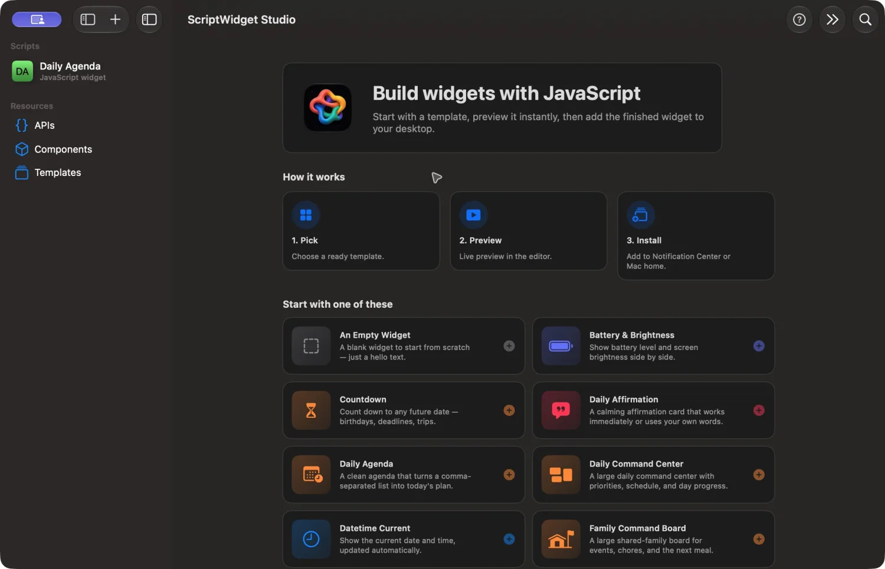
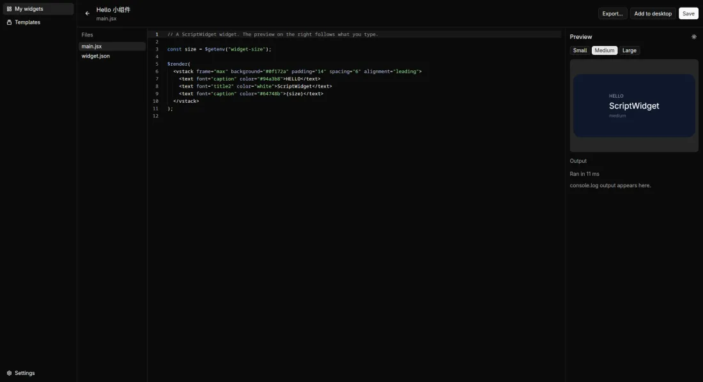
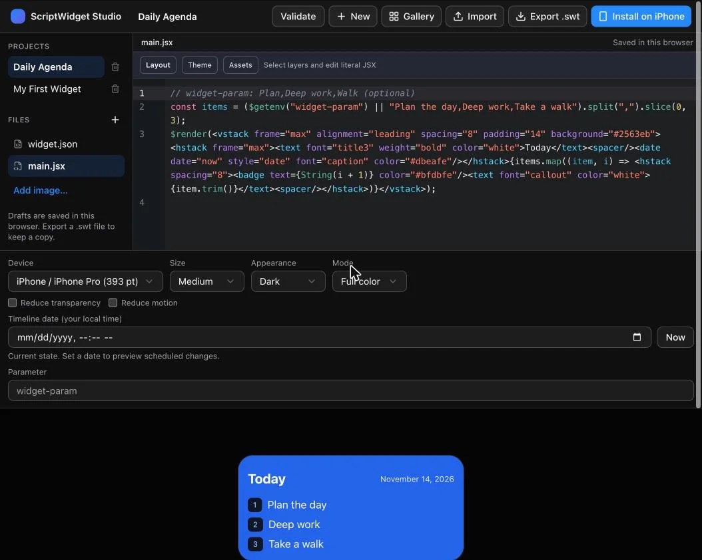

# ScriptWidget 🎨

<div align="center">

[](https://github.com/everettjf/ScriptWidget/stargazers)
[](LICENSE)
[](https://github.com/everettjf/ScriptWidget/actions/workflows/release-readiness.yml)

**Crie widgets para iPhone, iPad, Mac, Android, Windows e Linux com JavaScript, JSX e IA**

[English](README.md) | [简体中文](README_CN.md) | [Español](README_ES.md) | [日本語](README_JA.md) | [한국어](README_KO.md) | [Français](README_FR.md) | [Deutsch](README_DE.md) | [Português](README_PT_BR.md) | [Русский](README_RU.md) | [العربية](README_AR.md)

</div>


ScriptWidget é uma plataforma de código aberto sob a licença Apache 2.0 para criar widgets. Não é preciso aprender Swift: edite `main.jsx` no ScriptWidget Studio para Mac, iPhone ou iPad, e o ambiente de execução transforma JSX declarativo em interfaces nativas SwiftUI e WidgetKit.

O app para Android (Android 13 ou posterior) está disponível como [APK no GitHub Releases](https://github.com/everettjf/scriptwidget/releases?q=%22ScriptWidget+for+Android%22&expanded=true). No Google Play ele está em teste fechado: para participar, entre no [grupo Atomsprout Testers](https://groups.google.com/g/atomsprout). Consulte [ScriptWidget para Android](docs/android/README.md).

As versões para Windows e Linux são prévias: o [Windows](https://apps.microsoft.com/detail/9MVR97B9C938) requer o Windows 11 (21H2, build 22000) ou posterior, consulte [ScriptWidget para Windows](docs/windows/README.md); a versão para Linux funciona por enquanto no [Omarchy](https://omarchy.org) 4.5, os arquivos estão no [GitHub Releases](https://github.com/everettjf/scriptwidget/releases), consulte [ScriptWidget para Linux](docs/linux/README.md). As duas executam os mesmos pacotes de widgets, mas não têm as APIs de dados do dispositivo, como saúde, calendário, localização e música.

### Capturas de tela de cada plataforma

Todas são capturas de tela reais. Windows e Linux são prévias.

| iPhone | iPad | Mac |
| --- | --- | --- |
|  |  |  |

| Android | Windows | Linux (Omarchy) |
| --- | --- | --- |
|  |  |  |
|  |  |  |

| Web Studio |
| --- |
|  |

## Por que escolher o ScriptWidget

- Um único pacote funciona no iPhone, iPad, Mac e Android, e em prévia no Windows 11 e no Linux (Omarchy), com layouts adaptáveis usando `$getenv("widget-size")`.
- Compatível com widgets interativos, App Intents, Live Activities, Dynamic Island e Control Widgets.
- O Studio para Mac inclui CodeMirror, preenchimento automático, diagnósticos, console e visualizações em vários tamanhos.
- Gere, execute, diagnostique e refine widgets com modelos compatíveis com OpenAI; as chaves de API ficam no Keychain.
- A Widget & Skills Gallery verifica índices, tamanhos, caminhos e SHA-256 antes da instalação.
- Inclui modelos, Runtime API versionada, Package 2.0 e Skills 1.0 com testes automatizados.

## Comece em cinco minutos

```bash
git clone https://github.com/everettjf/ScriptWidget.git
cd ScriptWidget
open macOS/ScriptWidgetMac.xcodeproj
# Ou: open iOS/ScriptWidget.xcodeproj
```

No Xcode, selecione o esquema `ScriptWidgetMac` ou `ScriptWidget`, configure o contêiner `iCloud.ScriptWidget` e o App Group `group.everettjf.scriptwidget` e execute o projeto. Você também pode seguir o [tutorial de cinco minutos](docs/five-minute-tutorial.md).

Para Android, compile com o Gradle (JDK 17 ou posterior e o Android SDK; o app requer Android 13 ou posterior):

```bash
cd Android && ./gradlew :app:assembleDebug
```

```jsx
$render(
  <vstack frame="max" background="#0f172a">
    <text font="title3" color="#f8fafc">Hello, ScriptWidget!</text>
  </vstack>
);
```

## Documentação

- [Central de documentação](docs/README.md)
- [Crie seu primeiro widget](docs/getting-started.md)
- [ScriptWidget Studio](docs/studio.md)
- [Runtime API](docs/runtime-api.md)
- [Geração com IA](docs/ai-generate.md)
- [Widget & Skills Gallery](docs/gallery.md)
- [Package 2.0](docs/package-format.md), [Skills 1.0](docs/skills.md) e [roadmap](ROADMAP.md)

## Contribuição e licença

Contribuições são bem-vindas. Consulte o [guia de contribuição](CONTRIBUTING.md), a [governança](GOVERNANCE.md) e o [código de conduta](CODE_OF_CONDUCT.md). Relate problemas de segurança em particular conforme a [política de segurança](SECURITY.md).

O código-fonte deste repositório é publicado sob a [Licença Apache 2.0](LICENSE). O nome ScriptWidget, os logotipos, as capturas de tela e os materiais promocionais da App Store não estão cobertos pela Licença Apache 2.0; seus direitos pertencem aos respectivos titulares.

[Discord](https://discord.gg/eGzEaP6TzR)
