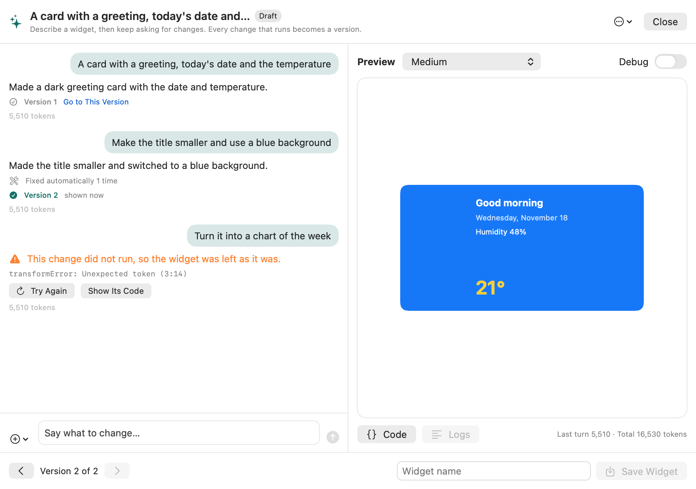
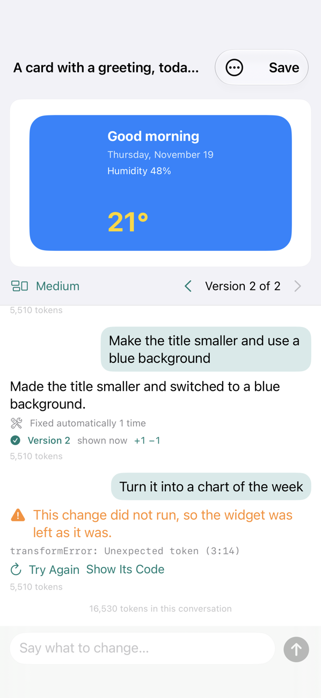
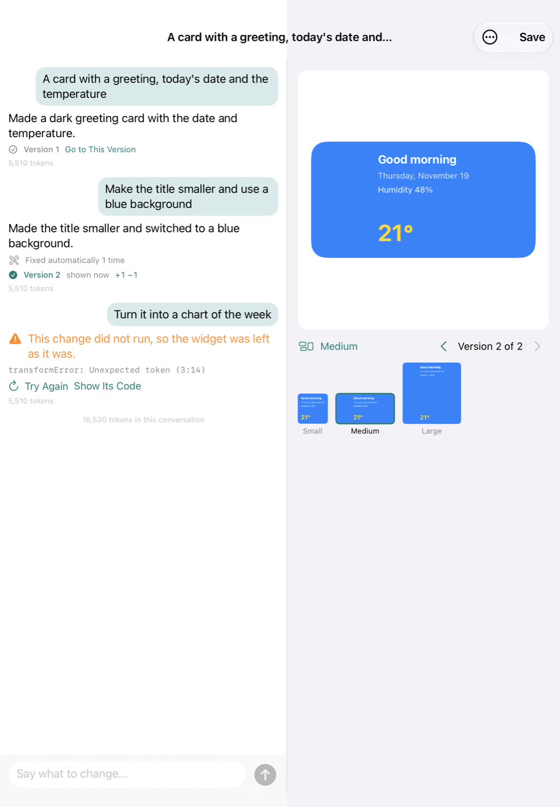

# AI conversation

Making a widget with AI is a conversation about one widget: describe it, look at the preview, ask for a change, look again. The Mac app, the iPhone and iPad app and the Android app all have it. This page describes the Mac window first, then what differs elsewhere; it says what the conversation does, what it sends to the AI provider and what it keeps on the device. Provider setup is in [AI generation](ai-generate.md).




iPhone and iPad have the same conversation, see [On iPhone and iPad](#on-iphone-and-ipad), and so does the Android app, see [On Android](#on-android).

## Using it

1. Open **Generate with AI** from the sidebar menu, the empty window or the File menu.
2. Describe the widget and press Return. The preview on the right shows it as soon as it runs.
3. Ask for a change in your own words, for example "make the title smaller". The preview keeps showing the current widget while the AI works.
4. Every change that runs becomes a numbered version. **Go to This Version** under a turn, or the arrows at the bottom, show an older one. Nothing is sent to the provider when you do that.
5. If you ask for something while an older version is shown, the conversation continues from that version, and the turns after it are marked "left behind" and are no longer sent.
6. **Save Widget** saves the version on screen as a widget.

A version shows how many lines it added and removed against the one it was made from, as **+3 −2**; a click shows those lines with a little of what is around them. The comparison is made on the device.

While the AI writes, the code appears under the request as it arrives. Apple Private Cloud Compute answers in one piece, and a provider that can not stream is asked in the plain way instead; with those the code appears when it is complete.

Under the preview the widget is drawn at the Small, Medium and Large sizes; a click shows that size above. The size picker offers the other sizes. All of this runs on the Mac and costs no tokens. A size larger than the preview area is drawn smaller to fit.


## Widgets that use the network

A widget that fetches data must say which hosts it contacts. The AI is asked to end its reply with a short declaration, the same one the Android app uses:

```json
{"permissions": ["network"], "networkDomains": ["api.example.com"]}
```

- The declaration is the AI's claim and is treated as untrusted. It may name only the network permission and at most 8 hosts, and it passes the same check as any `widget.json`. One that does not is not run; the AI is told why and tries again.
- The preview runs with exactly what was declared: a widget that declares nothing has no network, and a declared widget reaches its declared hosts only. This is what the saved widget will be allowed, so the preview no longer shows something that fails after saving.
- The hosts are shown under the preview. **Save Widget** asks before saving a widget that uses the network, and writes the permission and the hosts into the new widget's `widget.json`.
- Private and local hosts stay blocked by the runtime, whatever is declared.

The **+** button holds Skills and examples. Skills chosen there apply to every turn of the conversation. They are text added to the request and grant nothing; see [Skills](skills.md).

## In the editor

The **Copilot** tab of the editor is the conversation about the open widget. A widget made in the AI window continues the conversation it was made in; any other widget starts one when you first write to it.

- The AI works on a copy of the widget. Each version it makes is drawn small in the panel, and the widget and the editor stay as they are.
- **Apply** writes the version on screen into the open document and saves it. If the document changed since the panel last looked, nothing is written and the conversation continues from the editor's code instead. Undo in the editor restores what was there.
- Code the conversation has not seen (you typed in the editor, or used the Layout panel) is taken over as a version marked "Code from the editor" before your next request, so the AI always changes what you see.
- The copy contains the widget's other files, so a widget that imports its own files or reads its own images runs as it does in the widget. A widget with more than 300 files or 20 MB is too large for this, and the panel says so.
- The copy runs with the widget's own permissions. If a version declares a host the widget may not contact yet, Apply asks first and adds the network permission for that host to the widget.
- **Fix Runtime Error** sends the error the editor's preview last reported.
- The conversation changes the widget's main file. With another file selected, the panel asks you to select the main file.

## On iPhone and iPad



**Generate with AI** under New Widget opens the conversation. It uses the same code as the Mac window and follows the rules on this page, with these differences:

- On an iPhone the preview is on top, the turns are below it and the message field sits above the keyboard. While you type, the preview gets smaller to leave room. In a window at least 720 points wide, an iPad's full screen for one, the conversation is on the left and the preview, with the three sizes under it, on the right; a narrower iPad window gets the iPhone layout.
- **Save** in the top bar asks for a name, and asks again before saving a widget that uses the network. The **…** menu holds a new conversation, the drafts, Skills, the provider, the code, the logs and deleting the conversation.
- Conversations are files in the app's own Application Support folder on the device, as on the Mac.
- The **Copilot** tab of the editor is the conversation about the open widget, with the rules of [In the editor](#in-the-editor): the AI works on a copy, **Apply** writes the version on screen into the document, and a new host is asked about first. It has no Manage Skills entry; Skills are managed in Settings.
- With the device set to Simplified Chinese, the conversation's own texts are in Chinese. The AI's notes are in the language you write in.



## On Android


**Generate with AI** under New widget, and **Improve with AI** on a widget's page, open the conversation. It follows the rules on this page with these differences:

- The preview is on top and the turns are below it. The reply appears when it is complete; code is not written out as it arrives.
- **+1 −1** on a version opens the changed lines, as on the Mac.
- An installed widget is changed with **Apply to widget**, which asks first and names any host the version adds.
- There is no editor panel. Code changed in the editor is taken over as a version the next time the conversation opens.
- Conversations stay in the app's no-backup directory on the device.

More in the [Android notes](android/README.md#ai-conversation).

## When something goes wrong

| What happened | What you see |
|---|---|
| The code did not run | The AI is told the error and tries again, up to three times. A turn that needed that says "Fixed automatically". |
| The code uses a tag, an attribute or a value that does not exist | The same: the AI is told which one and what exists instead. See [Tags and attributes that do not exist](#tags-and-attributes-that-do-not-exist). |
| The AI sent a change that does not fit the code | The same: the AI is told which part did not fit and sends the whole code. See [Changing a part of the code](#changing-a-part-of-the-code). |
| It still did not run | The widget and the preview stay as they were. The turn shows the error, **Try Again** and **Show Its Code**. |
| The provider could not be reached or refused | The turn shows the reason and **Retry**. Everything else stays usable. |
| You pressed Stop (⌘.) | The request ends at once and the widget stays as it was. |
| The app closed during a turn | The turn is shown as interrupted, with **Send Again**. |
| No provider is set up | A notice with a button to the AI settings; nothing can be sent. |

## Changing a part of the code

For a small change the AI may send only the places that change, instead of the whole code:

```
<<<<<<< SEARCH
lines copied from the current code
=======
the lines that replace them
>>>>>>> REPLACE
```

- The app puts each block into the current version. The searched lines have to be in the code exactly once. If they are missing, or there more than once, nothing is applied: the AI is told which block did not fit and sends the whole code instead. The app never guesses where a change belongs.
- What comes out is run and checked like any other reply, with the same limits and permissions. A change that does not run leaves the widget as it was.
- A new widget, and a repair, are always sent whole.

This makes a small change quicker and cheaper, and keeps the AI from rewriting parts you did not ask about. The **+3 −2** on a version shows what a turn really changed.

## Tags and attributes that do not exist

ScriptWidget ignores an attribute it does not know, and a value outside a fixed list, without an error: `<date style="weekday">` runs and shows the time. The AI would never learn of its mistake. So after a reply ran, the app looks through its code for:

- a tag that ScriptWidget does not have;
- an attribute that the tag does not have;
- a tag written inside `<text>`, `<date>`, `<image>`, `<icon>` or `<label>`, which draw no tag inside them;
- a value outside a fixed list, for the attributes that have one (`style` of `<date>`, `fontWeight`, `fontDesign`, `clip`, `backgroundMaterial`, `mode` of `<image>`, `axis`, `style` of `<progress>`).

When it finds one, the AI is told what it wrote and what exists, and tries again; this counts as one of the three repairs. On the last attempt a widget that runs is kept as it is.

The check reads the code loosely and stays silent when unsure. A tag that starts with a capital letter is your own component and is not checked, and a value that is computed is not judged. It grants nothing and blocks nothing when a widget runs: the runtime decides that, as before. Its lists are written by `npm run docs` in `Editor/editorfe` from Studio's API metadata and the web renderer's coverage table, and every template and example in the app passes it. The scrolling `<list>` is a tag on Android only.

## When a conversation has grown

A long conversation sends more with every request. Above the message field a line appears when:

- one request now sends about 30,000 tokens or more;
- the conversation has used 300,000 tokens in all;
- it holds 30 versions, so the oldest are dropped from now on;
- it has more than 12 turns, so the oldest are no longer sent.

**Start New From Here** opens a new draft with the version on screen as its first version, the same size and Skills, and no earlier turn to send. The old conversation stays among the drafts.

## Drafts

A conversation is saved after every change, without asking. One that has not been saved as a widget is a draft: closing the window keeps it, and the window offers it under **Continue a draft** next time. The **…** menu starts a new conversation, opens another draft or deletes the current one.

Conversations are files in the app's own Application Support folder (`ScriptWidget/AIConversations`), one JSON file each. They stay on this Mac: not in iCloud, not in the app group. The 50 most recent are kept, and each keeps its 30 most recent versions.

## What is sent to the provider

Each turn sends one request, plus one for each repair:

- the fixed instructions and API reference, the same in every turn;
- your earlier requests in this conversation with the AI's one-sentence answer to each, shortened, at most the last 12, and never those left behind;
- the current widget source, and the version before it when it is short, so that "put it back" can work;
- the selected Skills, and your new request.

The current widget's network declaration is sent with its source. A repair also sends the error and the ends of the last ten console lines of the failed run, each cut to 300 characters. A widget can print anything it read, so keep that in mind when a widget handles private data.

## What is never sent or stored

- The API key or OAuth token is read from the Keychain for the request header only. It is not written into a conversation file, a prompt, a log, UserDefaults or a widget.
- A conversation file holds your requests, the AI's notes, error summaries and widget sources. It names no provider, server or model.

## Safety

Generated code is untrusted. It runs only through the ScriptWidget runtime, in a temporary package, under the same time, memory and API limits as any widget.

The preview package carries a Package 2.0 `widget.json` with no permission, or with the network permission for the declared hosts, so the code is held to what the saved widget will get. Other permissions (location, calendar, health and the rest) can not be declared in a conversation; a widget that needs one gets it in the editor's configuration after saving, with the usual system approval.

In the editor, the copy runs with the widget's own `widget.json` plus the declared hosts, and a legacy widget without `widget.json` runs as a legacy package, as it does when installed. A `widget.json` that is present but can not be read turns the panel off; it is never treated as absent.

## Limits

| | |
|---|---|
| Attempts per turn | 4: one generation and three repairs (3 in all with Apple Private Cloud Compute) |
| Request length | 4,000 characters |
| Widget source kept per version | 256 KB |
| Versions per conversation | 30 |
| Conversations kept | 50 |

## Not in this version

Code written out as it arrives on Android, an editor panel on Android, and translations of the conversation's own texts on the Mac and on Android (the Mac app has no translation yet; iPhone and iPad have Simplified Chinese). The [plan](ai-conversation-plan.md) (Chinese) says what was done in which order and what is open.

## For contributors

- `Shared/ScriptWidgetRuntime/AI/AIConversation.swift`: the saved model and its limits.
- `AIConversationStore.swift`: the files.
- `AIConversationSession.swift`: the state a view observes; it sends turns through `AgentLoop` in its `turn` mode.
- `PromptBuilder.userPromptTurn` and `parseTurnReply`: the request and reply format. `AINetworkDeclaration` reads and checks the declaration.
- `AISourceEdits.swift`: reads and applies edit blocks. `AIJSXCheck.swift` with the generated `AIJSXSurfaceData.swift`: the check for tags and attributes. `AISourceDiff.swift`: the comparison of two versions and its view. The Kotlin ports are `AiSourceEdits`, `AiJsxCheck` and `AiSourceDiff`; a change to one side belongs in the other too.
- `AIClient.chatStream`: server-sent events, with the fallback to `chat`.
- `macOS/ScriptWidgetMac/AIGenerate/AIGenerateWindowView.swift`: the window. `iOS/ScriptWidget/View/AIGenerate/AIGenerateView.swift`: the iPhone and iPad screen. Both draw the turns with the shared `AIConversationTurnsView.swift`.
- `Tests/ScriptWidgetRuntimeTests/AIConversationTests.swift`: tests against a stub provider. They need no key and make no network request.
- `testThreeTurnsAgainstARealProviderWhenConfigured` sends three turns to a real provider when `ROCKY_OPENAI_APIKEY`, `ROCKY_OPENAI_BASEURL` and `ROCKY_OPENAI_MODEL` are set, as in [AI quality testing](ai-quality-testing.md). It costs tokens and is skipped otherwise. `AI_CONVERSATION_LIVE_DIR` names a folder for the three sources and a short report. Pass the key through the environment; never write it into a command or a file of the repository.
- `Scripts/ai-conversation-quality.sh` runs four small conversations against a real provider and reports what each turn changed, missed and cost; see [AI quality testing](ai-quality-testing.md#several-turns).
- The pictures of the Mac window, the iPhone and the iPad on this page are written by the same test file when `AI_CONVERSATION_SNAPSHOT_DIR` names a folder (prefix it with `TEST_RUNNER_` for `xcodebuild`); the iPhone and iPad ones come from running it on those simulators. They draw the conversation with a prepared one; they do not click through it.
