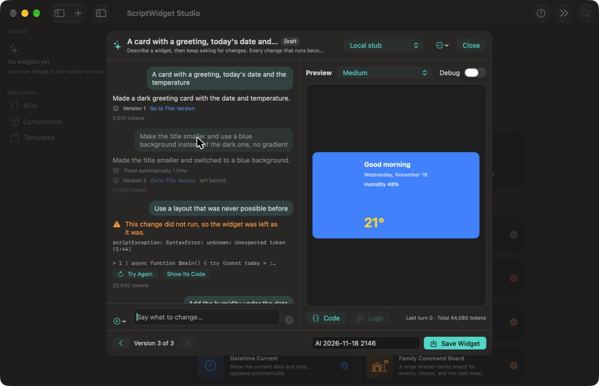
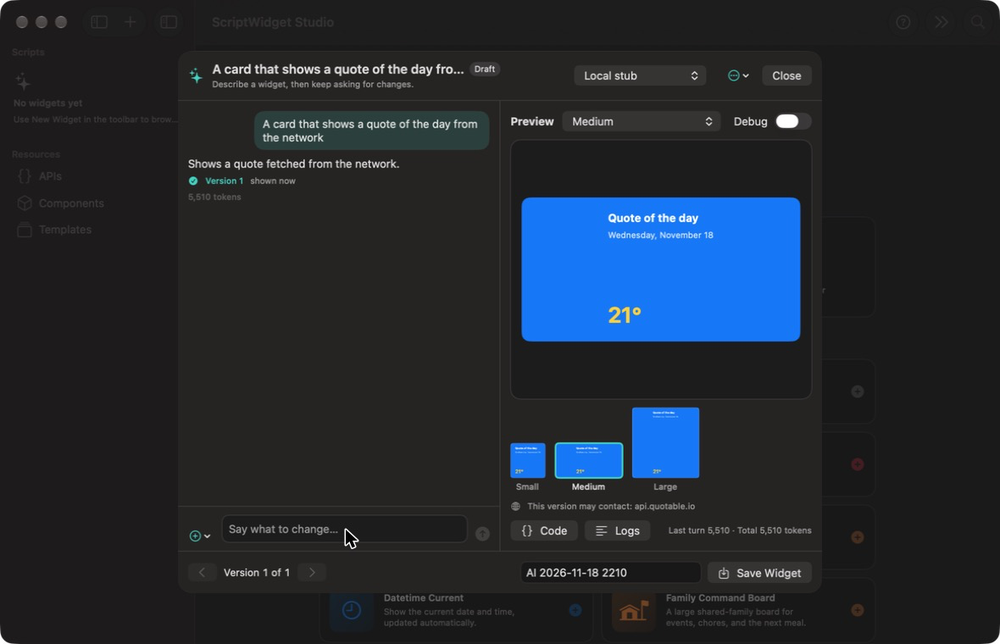
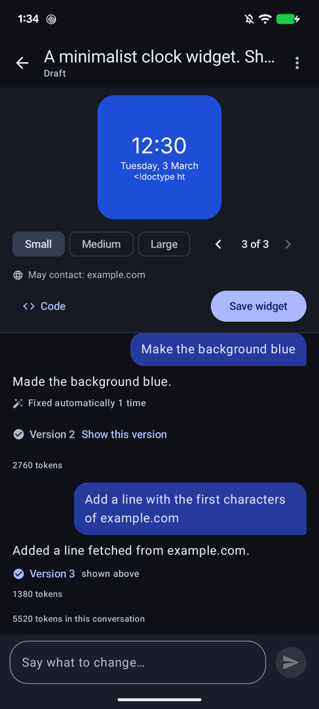

# AI conversation

The AI window of the Mac app is a conversation about one widget: describe it, look at the preview, ask for a change, look again. This page says what it does, what it sends to the AI provider and what it keeps on the Mac. Provider setup is in [AI generation](ai-generate.md).




The Android app has the same conversation on one screen; see [On Android](#on-android). iPhone and iPad still have the earlier single request with a Refine field; the conversation is planned for them and will use the same shared code.

## Using it

1. Open **Generate with AI** from the sidebar menu, the empty window or the File menu.
2. Describe the widget and press Return. The preview on the right shows it as soon as it runs.
3. Ask for a change in your own words, for example "make the title smaller". The preview keeps showing the current widget while the AI works.
4. Every change that runs becomes a numbered version. **Go to This Version** under a turn, or the arrows at the bottom, show an older one. Nothing is sent to the provider when you do that.
5. If you ask for something while an older version is shown, the conversation continues from that version, and the turns after it are marked "left behind" and are no longer sent.
6. **Save Widget** saves the version on screen as a widget.

While the AI writes, the code appears under the request as it arrives. A provider that can not stream is asked in the plain way instead, and the code appears when it is complete.

Under the preview the widget is drawn at the Small, Medium and Large sizes; a click shows that size above. The size picker offers the other sizes. All of this runs on the Mac and costs no tokens. A size larger than the preview area is drawn smaller to fit.



## Widgets that use the network

A widget that fetches data must say which hosts it contacts. The AI is asked to end its reply with a short declaration, the same one the Android app uses:

```json
{"permissions": ["network"], "networkDomains": ["api.example.com"]}
```

- The declaration is the AI's claim and is treated as untrusted. It may name only the network permission and at most 8 hosts, and it passes the same check as any `widget.json`. One that does not is not run; the AI is told why and tries again.
- The preview runs with exactly what was declared: a widget that declares nothing has no network, and a declared widget reaches its declared hosts only. This is what the saved widget will be allowed, so the preview no longer shows something that fails after saving.
- The hosts are shown under the preview. **Save Widget** asks before saving a widget that uses the network, and writes the permission and the hosts into the new widget's `widget.json`.
- Private and local hosts stay blocked by the runtime, whatever is declared.

The **+** button holds Skills and examples. Skills chosen there apply to every turn of the conversation. They are text added to the request and grant nothing; see [Skills](skills.md).

## In the editor

The **Copilot** tab of the editor is the conversation about the open widget. A widget made in the AI window continues the conversation it was made in; any other widget starts one when you first write to it.

- The AI works on a copy of the widget. Each version it makes is drawn small in the panel, and the widget and the editor stay as they are.
- **Apply to Editor** writes the version on screen into the open document and saves it. If the document changed since the panel last looked, nothing is written and the conversation continues from the editor's code instead. Undo in the editor restores what was there.
- Code the conversation has not seen (you typed in the editor, or used the Layout panel) is taken over as a version marked "Code from the editor" before your next request, so the AI always changes what you see.
- The copy contains the widget's other files, so a widget that imports its own files or reads its own images runs as it does in the widget. A widget with more than 300 files or 20 MB is too large for this, and the panel says so.
- The copy runs with the widget's own permissions. If a version declares a host the widget may not contact yet, Apply asks first and adds the network permission for that host to the widget.
- **Fix Runtime Error** sends the error the editor's preview last reported.
- The conversation changes the widget's main file. With another file selected, the panel asks you to select the main file.

## On Android



**Generate with AI** under New widget, and **Improve with AI** on a widget's page, open the conversation. It follows the rules on this page with these differences:

- The preview is on top and the turns are below it. The reply appears when it is complete; code is not written out as it arrives.
- An installed widget is changed with **Apply to widget**, which asks first and names any host the version adds.
- There is no editor panel. Code changed in the editor is taken over as a version the next time the conversation opens.
- Conversations stay in the app's no-backup directory on the device.

More in the [Android notes](android/README.md#ai-conversation).

## When something goes wrong

| What happened | What you see |
|---|---|
| The code did not run | The AI is told the error and tries again, up to three times. A turn that needed that says "Fixed automatically". |
| It still did not run | The widget and the preview stay as they were. The turn shows the error, **Try Again** and **Show Its Code**. |
| The provider could not be reached or refused | The turn shows the reason and **Retry**. Everything else stays usable. |
| You pressed Stop (⌘.) | The request ends at once and the widget stays as it was. |
| The app closed during a turn | The turn is shown as interrupted, with **Send Again**. |
| No provider is set up | A notice with a button to the AI settings; nothing can be sent. |

## Drafts

A conversation is saved after every change, without asking. One that has not been saved as a widget is a draft: closing the window keeps it, and the window offers it under **Continue a draft** next time. The **…** menu starts a new conversation, opens another draft or deletes the current one.

Conversations are files in the app's own Application Support folder (`ScriptWidget/AIConversations`), one JSON file each. They stay on this Mac: not in iCloud, not in the app group. The 50 most recent are kept, and each keeps its 30 most recent versions.

## What is sent to the provider

Each turn sends one request, plus one for each repair:

- the fixed instructions and API reference, the same in every turn;
- your earlier requests in this conversation with the AI's one-sentence answer to each, shortened, at most the last 12, and never those left behind;
- the current widget source, and the version before it when it is short, so that "put it back" can work;
- the selected Skills, and your new request.

The current widget's network declaration is sent with its source. A repair also sends the error and the ends of the last ten console lines of the failed run, each cut to 300 characters. A widget can print anything it read, so keep that in mind when a widget handles private data.

## What is never sent or stored

- The API key or OAuth token is read from the Keychain for the request header only. It is not written into a conversation file, a prompt, a log, UserDefaults or a widget.
- A conversation file holds your requests, the AI's notes, error summaries and widget sources. It names no provider, server or model.

## Safety

Generated code is untrusted. It runs only through the ScriptWidget runtime, in a temporary package, under the same time, memory and API limits as any widget.

The preview package carries a Package 2.0 `widget.json` with no permission, or with the network permission for the declared hosts, so the code is held to what the saved widget will get. Other permissions (location, calendar, health and the rest) can not be declared in a conversation; a widget that needs one gets it in the editor's configuration after saving, with the usual system approval.

In the editor, the copy runs with the widget's own `widget.json` plus the declared hosts, and a legacy widget without `widget.json` runs as a legacy package, as it does when installed. A `widget.json` that is present but can not be read turns the panel off; it is never treated as absent.

The earlier single request on iPhone and iPad still runs its candidate in a package without `widget.json`.

## Limits

| | |
|---|---|
| Attempts per turn | 4: one generation and three repairs (3 in all with Apple Private Cloud Compute) |
| Request length | 4,000 characters |
| Widget source kept per version | 256 KB |
| Versions per conversation | 30 |
| Conversations kept | 50 |

## Not in this version

Targeted edits instead of whole-file replies, a view of what changed between versions, and the iPhone and iPad interface.

## For contributors

- `Shared/ScriptWidgetRuntime/AI/AIConversation.swift`: the saved model and its limits.
- `AIConversationStore.swift`: the files.
- `AIConversationSession.swift`: the state a view observes; it sends turns through `AgentLoop` in its `turn` mode.
- `PromptBuilder.userPromptTurn` and `parseTurnReply`: the request and reply format. `AINetworkDeclaration` reads and checks the declaration.
- `AIClient.chatStream`: server-sent events, with the fallback to `chat`.
- `macOS/ScriptWidgetMac/AIGenerate/AIGenerateWindowView.swift`: the window.
- `Tests/ScriptWidgetRuntimeTests/AIConversationTests.swift`: tests against a stub provider. They need no key and make no network request.
- `testThreeTurnsAgainstARealProviderWhenConfigured` sends three turns to a real provider when `ROCKY_OPENAI_APIKEY`, `ROCKY_OPENAI_BASEURL` and `ROCKY_OPENAI_MODEL` are set, as in [AI quality testing](ai-quality-testing.md). It costs tokens and is skipped otherwise. `AI_CONVERSATION_LIVE_DIR` names a folder for the three sources and a short report. Pass the key through the environment; never write it into a command or a file of the repository.
- The picture on this page is written by the same test file when `AI_CONVERSATION_SNAPSHOT_DIR` names a folder (prefix it with `TEST_RUNNER_` for `xcodebuild`). It draws the window with a prepared conversation; it does not click through it.
