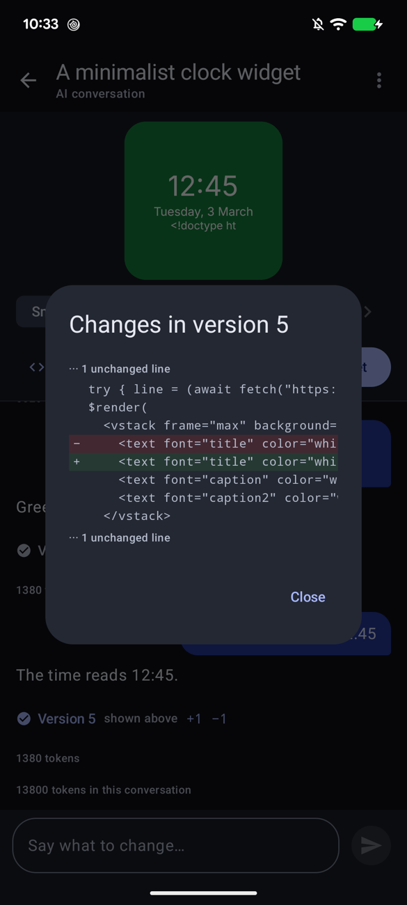

# ScriptWidget for Android

Status: version 1.0.0 (version code 1; called 1.2.0, builds 6 to 8, while it was in development). The APK is on [GitHub Releases](https://github.com/everettjf/scriptwidget/releases/tag/android-v1.0.0); on Google Play it is in a closed test, open to members of the [Atomsprout Testers group](https://groups.google.com/g/atomsprout) (see the [to-do](TODO.md)). The application ID is `com.atomsprout.scriptwidget`; the Kotlin namespace is `com.everettjf.scriptwidget`. Verified on a Pixel 6 running Android 17 and on Android 15 and Android 16 emulators. Other vendors' launchers and background limits have not been tested. See [Android test notes](testing.md).

The Android app runs the same Package 2.0 widgets as iPhone, iPad and Mac. The plan and its decisions are in [Android port research and plan](android-port-research-and-plan.md).

## How it works

```text
package (.swt, same as iOS)
  └─ prepare    Babel + manifest validation from Web/preview-engine, in QuickJS (compile context)
  └─ execute    shared kernel.js in a fresh QuickJS context; Kotlin implements the host and native APIs
  └─ layout     shared renderer.js + layout.js in QuickJS against a recording document
  └─ paint      Kotlin paints the recorded HTML/CSS and SVG subset on a Canvas → Bitmap
  └─ widget     RemoteViews: the bitmap, self-updating timers/clocks, transparent tap targets
```

| Directory | Contents |
| --- | --- |
| `Android/core` | QuickJS-NG and its JNI layer, runtime, native APIs, renderer, package store, Gallery, Skills, plugins, AI client |
| `Android/app` | Compose app, widget providers, configuration, Studio editor WebView |
| `Android/core/src/main/js` | Android host for the shared kernel and renderer |
| `Android/core/src/main/assets/scriptwidget` | Generated from `Web/preview-engine` and the support bundle. Do not edit |
| `Android/scripts` | `build-shared-js.mjs`, `device-test.sh`, `test-results.sh` |

Shared code is not forked. `kernel.js` and `renderer.js` have optional host hooks that only Android sets; the web hosts are unchanged and their tests still pass.

## Build and test

```bash
node Android/scripts/build-shared-js.mjs
```

Run this after changing `Web/preview-engine/src`, the support bundle or `Android/core/src/main/js`. It needs `npm install` in `Web/studio` once (for esbuild). The generated assets are checked in; CI fails when they are stale.

```bash
cd Android && ./gradlew :core:testDebugUnitTest :app:assembleDebug
```

Unit tests cover package and archive hardening, Gallery, Skills, plugins, the AI client and the AI conversation. They run on the JVM.

```bash
Android/scripts/device-test.sh core
```

A debug build has the Play package name, so a phone that has the app from Google Play refuses it (the signatures differ). `-PdevSuffix=.dev` builds a copy that installs beside it with its own data, and `SUFFIX=.dev Android/scripts/device-test.sh app` tests that copy:

```bash
cd Android && ./gradlew -PdevSuffix=.dev :app:installPlayDebug
```

Device tests need a connected device or emulator. They cover the engine, parity with JavaScriptCore on the bundled corpus (`Web/preview-engine/test/parity/native-trees.json`), rendering of every corpus tree, native APIs (including a live HTTPS request) and the timeline planner. Pass a class name to run one suite, for example `device-test.sh core ParityTest`.

Requirements: JDK 21, Android SDK 37, NDK 28.1, Node 24. Create `Android/local.properties` with `sdk.dir=<path to the SDK>`.

## Differences from iOS

The package format, manifest, permissions and runtime API version are the same. A package that uses something Android lacks still installs; the app lists the gaps and the API reports `[unsupported_platform]`.

| Area | Android behavior |
| --- | --- |
| JavaScript engine | QuickJS-NG instead of JavaScriptCore. `Intl` is a subset backed by ICU: `DateTimeFormat`, `NumberFormat`, `PluralRules`, `RelativeTimeFormat`, `Collator`, `ListFormat` and the `toLocale*String` methods |
| Execution limit | A real interrupt at 5 seconds; no cancellation checks are compiled in |
| Fonts | Bundled Inter and Noto Sans SC by default; the device font is a setting. SF Pro and SF Symbols are not available: symbols are drawn with the look-alike Lucide icons the web preview uses |
| Sizes | Small, medium, large and extra-large providers. The launcher decides the real size; cells are not square, so `small` is not always square |
| Theme | A widget carries a light and a dark bitmap when they differ and the launcher picks one. The script runs once per theme only when it calls `$device.isdarkmode()` |
| Refresh | WorkManager, at most every 15 minutes, plus alarms at `timeline.dailyTimes` transitions. Android may delay background work, and alarms are inexact |
| Timeline | The script runs again at each transition as the current entry; there are no pre-rendered future entries |
| `<date>` | `timer` and a `time` of now tick by themselves (system font, `00:36` rather than `0:36`). `relative`, `offset` and `date` are redrawn on refresh |
| `<gif>` | Plays as up to 24 sampled frames at a uniform interval; the first frame when the system removes animations |
| `animation` | Standard clock effects (`clockSecond`, `clockMinute`, `clockHour`) are hands of a system clock view and show the real time. `swing` plays as 16 frames. A custom clock interval plays as rotated frames at the right speed, with a phase that is not tied to the time |
| `backgroundMaterial` | The opaque `background` fallback |
| Rendering modes | Always `fullColor` |
| Network | The manifest allowlist as on iOS, and names that resolve to private addresses are refused |
| Promises | Runtime promises have only `then(resolve, reject)`, as on iPhone |

### System data

| API | Android source | Notes |
| --- | --- | --- |
| `$location` | `LocationManager`, no Play Services | Read while the app is open; widgets see the saved position. Background location is never requested |
| `$calendar` | Calendar Provider | Nothing is shared until calendars are selected in System Access |
| `$photos` | Photo Picker | Individual photos only, no albums; thumbnails are copied when picked |
| `$notifications`, `$alarms` | `AlarmManager` and notifications | Inexact: delivery can be about ten minutes late. No system alarm UI or snooze |
| `$services` | GitHub with a fine-grained token | No OAuth sign-in |
| `$health` | Health Connect | No ring goals or stand time (`null`); background reads need the user's extra consent |
| `$weather` | MET Norway, as on iOS | |
| `$documents` | Storage Access Framework | The user picks files in the app |
| `$contacts` | System contact picker | No contacts permission; fields are stored when picked |
| `$music` | Active media session of any app | Needs notification-listener access; `provider` is `androidMediaSession` |
| `$dataSource` | Data Source Plugin 1.0 | Same as iOS |
| `$maps` | `android.location.Geocoder` | `geocode` and `reverseGeocode` work. `search` finds named places and addresses, not business categories. `snapshot` is not supported |
| `$icloud` | A sync folder the user picks (Storage Access Framework) or a folder on this device only | The same revision file layout as iOS. Syncs between Android devices that share the folder; sharing with an iPhone is not possible today (see below) |

### System surfaces

| iOS | Android |
| --- | --- |
| Control Widgets | Eight Quick Settings tile slots that the user assigns to package `controls` |
| Siri and Shortcuts actions | App shortcuts on the launcher icon for package `actions`, and an [automation entry point](#automation-entry-point) for other apps. No voice entry point |
| Live Activities | A Live Update notification with title, detail, progress and countdown. The package's JSX layout and the Dynamic Island are not drawn |

### Only on Android

Three things exist on Android and not on iPhone. A package that uses them still installs and runs on iPhone; each item says what iPhone shows. `$system.platform()` returns `"android"` here, so a script can choose.

#### Scrolling lists

`<list>` is a vertical stack that scrolls inside the widget. Its children are the rows.

```jsx
const android = $system.platform() === "android";
const rows = items.map((item) => <text>{item}</text>);
$render(
  <vstack frame="max" alignment="leading" padding="14">
    <text font="headline">Inbox</text>
    {android ? <list spacing="4">{rows}</list> : <vstack alignment="leading">{rows.slice(0, 3)}</vstack>}
  </vstack>
);
```

- `spacing` is the gap between rows (default 0). The general props (`padding`, `frame`, `background` and the rest) work as on a stack. The list takes the room its parent offers; rows keep their natural height.
- `<link>`, `linkurl`, `<button>` and `<toggle>` inside a row work as elsewhere in a widget. A tap anywhere else in the list opens the package in the app.
- A list shows at most 100 rows. The rows travel to the launcher as images, a few rows per image, at most about 1.5 MB per widget size and theme; rows past that are left out. Rows with photos reach the limit sooner than rows of text.
- One list per widget scrolls. A second list, or a list inside a rotated or scaled view, is drawn in place and cut off at its bottom edge. The same happens in the app's previews.
- Timers, GIFs and animations inside a row are drawn as a still picture.
- The scroll position is kept when the widget is redrawn.
- On iPhone, and in the web preview, the tag is unknown and shows as `UnknownTagName`. Use the platform check above.

Redrawing a 100-row list took about 1.3 seconds on a Pixel 6 once the app was running. The first drawing after the app process starts is much slower, because nothing is cached yet: 12 seconds was measured with a debug build right after it was installed. A release build was not measured.

#### Wallpaper colors

Android derives a set of Material colors from the wallpaper. A widget names one as `material.<role>` wherever a color is accepted, also with an opacity (`"material.primary,0.5"`) and inside a gradient:

```jsx
<vstack frame="max" background="material.surfaceContainer">
  <text color="material.onSurface">Follows the wallpaper</text>
</vstack>
```

Roles: `primary`, `onPrimary`, `primaryContainer`, `onPrimaryContainer`, the same four for `secondary` and `tertiary`, `background`, `onBackground`, `surface`, `onSurface`, `surfaceVariant`, `onSurfaceVariant`, `surfaceContainerLowest`, `surfaceContainerLow`, `surfaceContainer`, `surfaceContainerHigh`, `surfaceContainerHighest`, `outline` and `outlineVariant`.

- The light bitmap uses the light value and the dark bitmap the dark one. The script does not have to ask which theme is active.
- After the wallpaper changes, widgets are redrawn when the app notices the change (while its process is alive) and otherwise at the next background refresh.
- On iPhone, and in the web preview, the names are unknown and the prop is ignored, so the view keeps its default color.

#### Automation entry point

Other apps, such as Tasker and MacroDroid, can run a package's declared `actions` or redraw its widgets by sending a broadcast. It is off until the user turns it on in Settings → Automation, where the token and the allowed packages are also set.

| Field | Value |
| --- | --- |
| Package | `com.atomsprout.scriptwidget` |
| Class | `com.everettjf.scriptwidget.automation.AutomationReceiver` |
| Action, to run an action | `com.atomsprout.scriptwidget.automation.RUN_ACTION` |
| Action, to redraw widgets | `com.atomsprout.scriptwidget.automation.REFRESH` |
| Extra `package` | The package's name as the Automation screen lists it. Optional for a redraw: without it every allowed package is redrawn |
| Extra `action` | An `actions[].id` from the package's `widget.json`. Not used for a redraw |
| Extra `token` | The token shown in Settings → Automation |
| Extra `value` | Optional `true` or `false`, passed to the action as `action-value` |

Extras are text; a boolean `value` is also accepted. From a shell:

```bash
adb shell "am broadcast -a com.atomsprout.scriptwidget.automation.RUN_ACTION -p com.atomsprout.scriptwidget --es package 'Automation Counter' --es action increment --es token <token>"
```

- A request is refused unless automation is on, the token matches and the package was allowed. It can only select an action the manifest declares; it cannot name a function or carry code.
- The action sees `$getenv("action-source") === "automation"`.
- At most 30 requests a minute are accepted, wrong ones included.
- A sender that asks for a result (an ordered broadcast) gets result code -1 and `OK`, or 0 and the reason.
- The entry point only receives. A script cannot send broadcasts to other apps.
- Android does not deliver broadcasts to an app the user force-stopped until the app is opened again.

The three bundled examples are under Templates → Android only: Scrolling Checklist, Wallpaper Colors and Automation Counter. Their source is in `Android/app/src/main/assets/Script.android`.

### AI conversation

**Generate with AI** and **Improve with AI** open a conversation about one widget, as the Mac app's AI window does: describe it, look at the preview, ask for a change, look again. The rules are in [AI conversation](../ai-conversation.md); this is what is particular to Android.

- One screen: the preview on top with its size and its versions, the turns below, the request field above the keyboard.
- The code of a reply is shown under the request as it arrives. Anthropic and OpenAI-compatible servers are asked for a streamed reply; a server that refuses the streamed form is asked again in the plain way, and the code then appears when it is complete.
- Under the preview the widget is drawn small at the Small, Medium and Large sizes; a tap shows that size above. Every size is run on the phone and costs no tokens.
- The editor has an **Improve with AI** button. It saves the file and opens the conversation about that widget. Coming back, the editor shows what **Apply to widget** wrote.
- **Save widget** makes a new widget from the version on screen. For an installed widget the AI works on a copy in memory, and **Apply to widget** writes the version on screen into it. A version that contacts a host the widget may not reach yet is applied only after you agree, and the network permission for that host is added then. A conversation never removes a host a widget already has.
- A conversation belongs to a widget by its installation, so it follows a rename and is deleted with the widget. Code changed elsewhere (the editor, a Gallery update) is taken over as a version the next time the conversation opens.
- Conversations that are not saved as a widget are drafts, offered under **Continue a draft**. All conversations are files in the app's no-backup directory: they stay on the device and are not part of a device backup. They hold requests, notes and widget sources, never a key or a provider.
- Enabled Skills are read when a request is sent.
- A version shows how many lines it added and removed, and a tap shows them. A small change may arrive as edit blocks, and a tag, attribute or value that does not exist is sent back to the model; both work as described in [AI conversation](../ai-conversation.md#changing-a-part-of-the-code). The check knows `<list>` on Android.
- A conversation that has grown heavy says so above the request field and offers **Start new from here**.


- The Mac app's panel beside the editor and the list of providers are not on Android: the conversation is its own screen, and there is one provider profile at a time, chosen in Settings → AI.

### Synced documents and iPhone

`$icloud` on Android keeps the iOS contract: immutable revisions, both heads preserved on concurrent writes, explicit resolve, and no claim that an upload finished. It cannot exchange data with an iPhone. iOS reads only its iCloud container, which no Android documents provider exposes, and the two platforms encode fractional numbers and some key orders differently, so iOS would reject Android-written revisions. Exchange between two Android devices is covered by unit tests on a plain directory; it also passed on the Pixel through a folder picked with the system picker, but not through a remote cloud provider.

### Not available

`$reminders`, `$home`, accessory (Lock Screen) families, the Dynamic Island, and accented and vibrant rendering modes.

### Push-triggered refresh

`pushUpdates` is implemented with Firebase Cloud Messaging. Only the `play` flavor contains it; the `foss` flavor published on GitHub has no push-triggered refresh (see [Android distribution](distribution.md)). In the `play` flavor it is off until the build is given a Firebase project. Put `projectId`, `applicationId`, `apiKey` and `senderId` in `Android/firebase.properties` (git-ignored). The app then posts `{token, packageID, channel, platform: "android"}` to the package's `registrationURL` for packages that are placed as widgets, under the same rules as iOS: HTTPS, a public host inside the package's `networkDomains`, redirects only to declared hosts. A data message with `packageID` and `channel` redraws that package's widgets. The token is an FCM token, so a push server must send through FCM for Android devices. Delivery was checked once on a Pixel 6 with a message from the Firebase console while the app was on screen; see the [test notes](testing.md) for what is still untested.

## Security notes

- Package code runs only in a per-execution QuickJS context with a memory limit and a time limit. It cannot reach the native bridge functions: they are captured by the host script and removed from the global object first.
- Policy is enforced in Kotlin (manifest permissions, hosts, budgets, storage namespaces). JavaScript checks exist only for early errors, because package code can replace built-ins.
- The compile and layout contexts run trusted code only. The layout context receives the element tree as data.
- The Studio editor WebView loads bundled assets from a private origin, cannot navigate away and has no file access.
- The automation receiver is the app's only exported entry point that runs package code. It is closed by default and needs a 128-bit token that is kept out of backups, compared in constant time and never logged, plus a per-package permission from the user. Requests are rate-limited, and every field is treated as untrusted text.
- A scrolling list uses one mutable tap template, as Android requires for collections. The launcher fills in only a number; the app looks the number up in the taps it saved for that widget, so a launcher cannot supply a link or an action.
