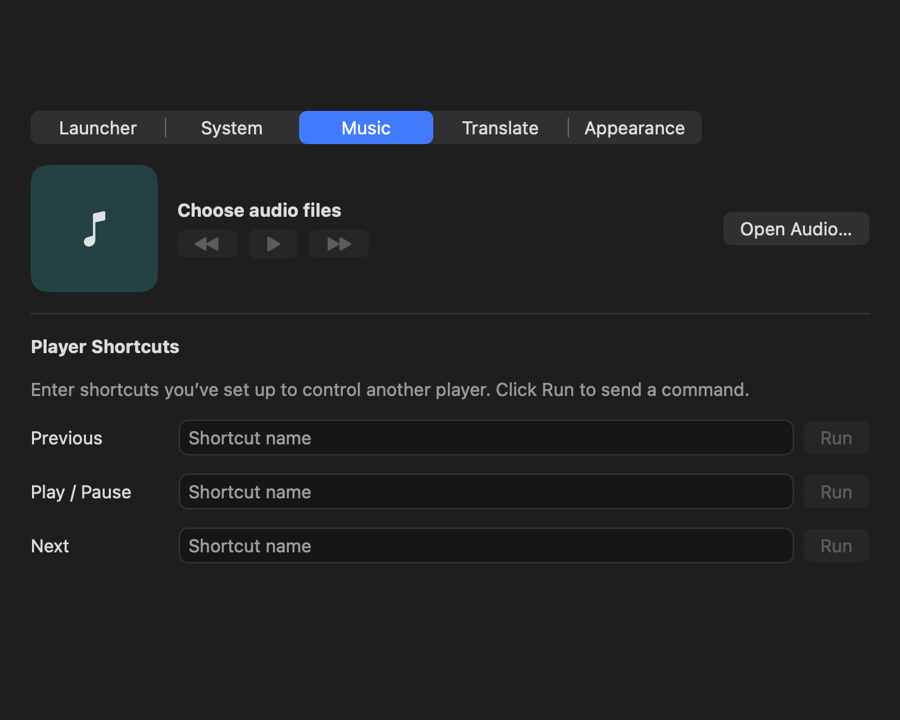

# Five-minute widget tutorial

ScriptWidget for Mac includes an interactive five-step tutorial that appears on first launch. It creates a real local project and walks through the same Studio workflow used for production widgets. You can skip it safely or reopen it later from **Help → Five-Minute Tutorial…** (`⇧⌘?`). Progress resumes at the last viewed step until the tutorial is finished or skipped.

## 1. Understand the workspace

The sidebar contains widget projects and creation shortcuts. Studio combines the project file tree, CodeMirror editor, multi-family native preview, runtime diagnostics, package configuration, and AI Copilot.

## 2. Create the tutorial project

Choose **Create Tutorial Widget**. ScriptWidget creates `My First Widget` (or a numbered name if it already exists) with an offline example and a Package 2.0 manifest. It is an ordinary project and can be edited, renamed, exported, or deleted.

## 3. Make one edit

Finish or move the tutorial aside, select the project in the Scripts sidebar, and open `main.jsx`. Replace `Hello, ScriptWidget!` with your own text and press `⌘S`. Completion and diagnostics use the versioned runtime API contract, so unsupported components and properties are visible while editing.

## 4. Preview before installing

In Studio's Preview pane, switch between small, medium, and large families. Press `⌘R` to evaluate the current source. Use the Config pane for display metadata, parameters, permissions, and `widget.json` rather than hand-editing package metadata.

## 5. Add it to macOS

1. Control-click the desktop and choose **Edit Widgets**.
2. Find ScriptWidget, choose a size, and drag it to the desktop or Notification Center.
3. Control-click the widget, choose **Edit ScriptWidget**, and select the tutorial project.
4. If it is not listed yet, keep ScriptWidget open and choose **File → Update iCloud Scripts**.

Saved changes appear on a subsequent widget refresh. The same project can sync to iPhone and iPad when the configured iCloud container and App Group are available.

## Mac desktop tools

Desktop Tools are in the current Mac source and are listed under [Unreleased](../CHANGELOG.md#unreleased).

Open **File → Desktop Tools…** in ScriptWidget. To reach it from the desktop, create a widget from the **Mac Desktop Tools** template and add it to the desktop using the steps above. A small widget opens one tool. Set its widget parameter to `launcher`, `system`, `music`, `translation` or `appearance`. Larger sizes show links to all five tools.

- **Launcher** opens the apps and folders you pick in the Mac file panel. It saves access on this Mac for up to 12 items, including their system icons. Choose **Edit** to remove an item or re-add one whose access expired.
- **System** updates total CPU and memory usage while this tab is visible. It ranks running apps with readings macOS makes available by CPU or resident memory. Per-app CPU is measured in cores, so an app using two full cores can show 200%.
- **Music** plays audio files you choose, with embedded cover art where available and previous, play/pause and next controls. To control another player, enter the names of shortcuts you configured for it, then click **Run**. The external player's metadata and playback state stay in that player.
- **Translate** uses Apple's on-device translation. Paste or type your text, choose two different languages and click **Translate**. macOS may prompt you to download language files. The text stays in the window for the session.
- **Appearance** offers a frosted window and an independent floating pet. The frosted window follows Reduce Transparency. Drag the pet by its empty border, click it to interact, or close it with its own button.

The tool links open the Mac app. Bookmarks, player shortcuts, process readings and translation text stay in the app. They are unavailable to widget scripts.

For other desktop cards, try **Week Progress**, **Desk Vitals**, **Daily Focus Checklist** and **Daily Pause**. The checklist accepts up to eight comma-separated labels in the widget parameter. Choose Large to see all eight. The quote card accepts a line of your own as its parameter. For weather and water logging, use **Weather Now (MET Norway)** and **Hydration Goal**.
