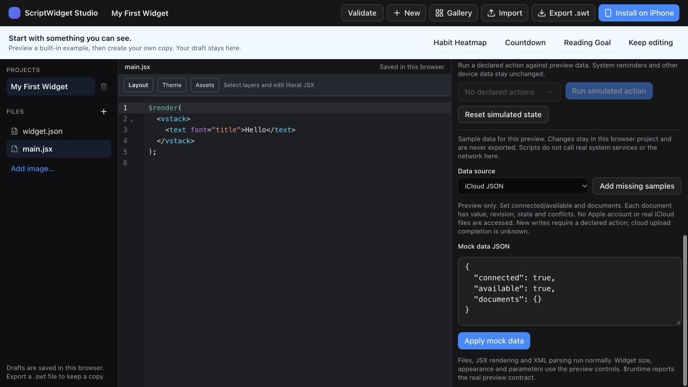

# iCloud JSON API (Runtime 1.5)

`$icloud` is an opt-in JSON revision store in the existing `iCloud.ScriptWidget` iCloud Drive container. It adds no third-party SDK or application server. `$storage` remains local; existing records are never automatically moved. Web Studio uses mocks; native CLI/template previews cannot access real iCloud.

## Explicit native connection

A Package 2.0 manifest must declare `permissions: ["icloud"]` and `minimumRuntimeVersion: "1.5"` (or a supported later API). Older apps fail closed on the new permission/version.

In the native widget list, open the context menu → **iCloud Data**. Create a new store or select an existing folder ID, then confirm read/write access. On another device explicitly connect its installed widget to the same store ID. The manifest, package name, Gallery, backups and JavaScript cannot choose that ID or grant permission. Native rename retains the connection; remix/reinstall does not inherit it. **Disconnect** revokes only this widget’s grant and preserves record files. Connecting a different store preserves the previous store and cache. This feature does not migrate Habit Heatmap automatically.

Grants and caches are bound to a native installation UUID and current iCloud identity. Sign-out/account change denies old-account cached reads and writes. Reconnect explicitly for a new account. A system change to the identity token's archive can require reconnection rather than guessing authority.

## Methods

Every method returns a Promise. `name` is a flat lowercase ASCII filename matching `/^[a-z][a-z0-9_-]{0,58}\.json$/`. No directories, absolute paths, URLs or arbitrary iCloud access.

| Method | Behavior |
| --- | --- |
| `readJSON(name)` | Returns cached `{value,revision,state,conflicts}`. No cached revision returns `value:null, revision:""`; this does not prove remote data is absent. |
| `writeJSON(name, object, expectedRevision)` | Create an immutable local revision, using the token from the latest read. Returns `state:"pending"`, then attempts background exchange. Stale tokens reject without overwriting history. |
| `resolveJSON(name, object, expectedRevision)` | Explicitly create a revision descending from all observed heads after reviewing/merging conflicts. Stale conflict tokens reject. Originals remain. |
| `sync()` | Exchange currently materialized revision files. Returns `{state:"pending",materializedRevisions,downloadedRevisions,uploaded:null}`. |
| `status()` | Returns `{state,store,uploaded:null,uploadState:"unknown",conflictPolicy:"preserveAllVersions"}` or rejects on account/connection errors. |

Reads use `state:"cached"`; writes use `"pending"`. A fork returns `state:"conflict", value:null, conflicts:[{id,value},…]`. Ordinary `writeJSON` rejects conflicts; only `resolveJSON` can explicitly consume all observed heads. **A local save or successful sync is never proof of upload, convergence or a global cross-device compare-and-swap.** Apple controls delivery and background execution.

Writes, resolution and explicit sync require a user-initiated declared action. Normal rendering never changes records. Future timeline and Live Activity presentations cannot use this API. Native calls share the data-query limit (8/execution). Following an authorized local operation, a separate native exchange revalidates the captured installation even after JS ends; it cannot follow a removed/replaced same-name widget. App foreground recovery retries connected stores at most every 15 seconds. Newly received revisions request a WidgetKit reload; the system chooses its timing.

## Example

The complete [iCloud JSON Note package](examples/icloud-json-note) includes a manifest and declared Sync / Save actions. Import it, then connect it through the native menu.

```jsx
const snapshot = await $icloud.readJSON("note.json");
$render(<text>{snapshot.state === "conflict"
  ? "Review conflicting versions"
  : snapshot.value?.text ?? "No cached note yet"}</text>);

async function saveNote() {
  const before = await $icloud.readJSON("note.json");
  if (before.state === "conflict") throw new Error("Resolve the conflict first");
  await $icloud.writeJSON("note.json", {text:"Read a chapter"}, before.revision);
}
```

A cold/offline device can initially read no cached value, then discover remote records later. An independent write becomes a retained fork, not last-writer-wins deletion. To make a habit merge, validate habit IDs/dates, union completed dates across **all** conflicts, and explicitly call `resolveJSON` with the observed token. Counters, deletions, reset and undo need product-specific event/merge rules; unioning arbitrary JSON would lose user intent.

## Files, format and bounds

In Files/Finder: **iCloud Drive → ScriptWidget → WidgetData → <store UUID> → note.json → <SHA-256>.json**. `note.json` is a document directory. Each canonical sorted UTF-8 file contains:

```json
{"formatVersion":1,"name":"note.json","parents":[],"value":{"text":"Read a chapter"}}
```

The filename hashes its exact canonical bytes. Revisions reference parent hashes. Two offline writers create two distinct heads; neither overwrites or deletes the other's file. Exchange is additive/idempotent. Users can inspect/copy these JSON files outside the app. **Direct editing, renaming or deleting revision files is unsupported**: checksum/parent/schema errors preserve the cache and block exchange. To edit, read/copy the value and create a new revision through the API. A removed cloud store is not automatically recreated from cache.

Initial bounded contract: 64 KiB per JSON object, 128 document names, 256 revisions and 2 MiB of encoded revisions per store; discovery lists at most 128 stores. Capacity exhaustion fails without pruning history. Archive/export the previous store and explicitly connect a new store when needed. Automatic compaction and unlimited history are not implemented. These limits bound scans/allocation, not a claim of measured physical extension memory.

The native service uses descriptor-relative no-follow path checks, exact-case names, installation/root receipts and process locks. Revisions publish by atomic **exclusive** rename, never overwriting an existing version. Links, hard links, invalid JSON, unknown fields, invalid parent references and quota excess fail closed. Cloud publication uses `NSFileCoordinator`. Regular Finder `.DS_Store` metadata is ignored without being read or exchanged. Placeholders request download and preserve cached data; missing parents block reliable reads until downloaded. Diagnostics exclude account tokens, file contents, absolute device paths and other widgets' data.

Errors include `notConnected`, `accountChanged`, `unavailable`, `invalidName`, `invalidData`, `limitExceeded`, `staleRevision`, `conflict`, `identityChanged` with prefix `[icloud:…]`. Never clear local records as recovery from a cloud failure. Corrupt remote files need repair/restore rather than discarding cached history.

## Web Studio mock



Mock Data → **iCloud JSON** edits `fixtures.icloud`:

```json
{"connected":true,"available":true,"documents":{"note.json":{"value":{"text":"Sample note"},"revision":"fixture-1","state":"cached","conflicts":[]}}}
```

`connected:false` denies access. `available:false` rejects sync but leaves cache/local writes usable. Seed `state:"conflict"`, `value:null` and two `{id,value}` entries to exercise resolution. Writes enforce manifest permission, action-only mutation, stale tokens, names and JSON size. They affect only the current preview execution, never actual iCloud; mocks are not exported. Preview tokens are opaque model tokens, not native revision hashes.

## Verification and physical release gate

`node Scripts/test-icloud-json.mjs` runs the production service and its XCTest fixtures directly without an App host. It supplements the full application/extension test schemes. Deterministic tests use two separate temporary device caches and one isolated temporary cloud. They cover offline round trips, concurrent forks, explicit resolution, stale writes, retirement, account switch, new same-name installations, malformed/oversized JSON, links and remote-store removal. Browser tests cover permission and action denial and conflict behavior. They never use the user's real iCloud account.

Before release, still verify on two signed-in physical devices: native grant, offline edits/reconnect, conflict resolution, file eviction/download, account switching, foreground retry and extension memory/refresh. Fixture tests and simulator builds are not signed real-container acceptance.

Apple guidance: https://developer.apple.com/documentation/uikit/synchronizing-documents-in-the-icloud-environment
