# ScriptWidget for Linux

Status: preview, for [Omarchy](https://omarchy.org) 4.5. An archive is on [GitHub Releases](https://github.com/everettjf/scriptwidget/releases) (tag `linux-v<version>`). What was tested and on which machine is in [testing.md](testing.md); what is left is in [TODO.md](TODO.md); the plan is in [plan.md](plan.md) (Chinese); the messages between the service and the display are in [protocol.md](protocol.md).

ScriptWidget for Linux puts the same Package 2.0 widgets that run on iPhone, iPad, Mac, Android and Windows on the Linux desktop. It is written in Rust and runs the same shared JavaScript as Android and Windows in the same QuickJS-NG sources. A widget is a picture the background service draws; on Omarchy a small plugin of the Omarchy shell shows it on the desktop layer, below your windows, and passes clicks back.

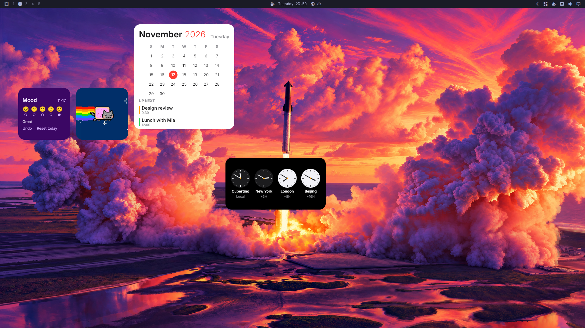

On other desktops the command line and the management window work, but nothing is shown on the desktop yet.

## What is in the archive

| Part | What it does |
| --- | --- |
| `scriptwidget` | The command line, and the background service (`scriptwidget host run`): it runs the scripts on a schedule, draws the pictures and handles clicks. It opens no window |
| `scriptwidget-studio` | The management window: your widgets, the templates, the component examples, the API examples, the code editor with a live preview and the AI conversation, the settings. Closing it frees its memory; the widgets keep running |
| Omarchy plugin `com.atomsprout.scriptwidget` | Shows the pictures on the desktop layer and adds an entry to the bar. It only shows pictures and forwards numbers and coordinates |

## Pictures

The management window on Omarchy 4.5 (screenshots of the real window in the test machine):

| | |
| --- | --- |
| 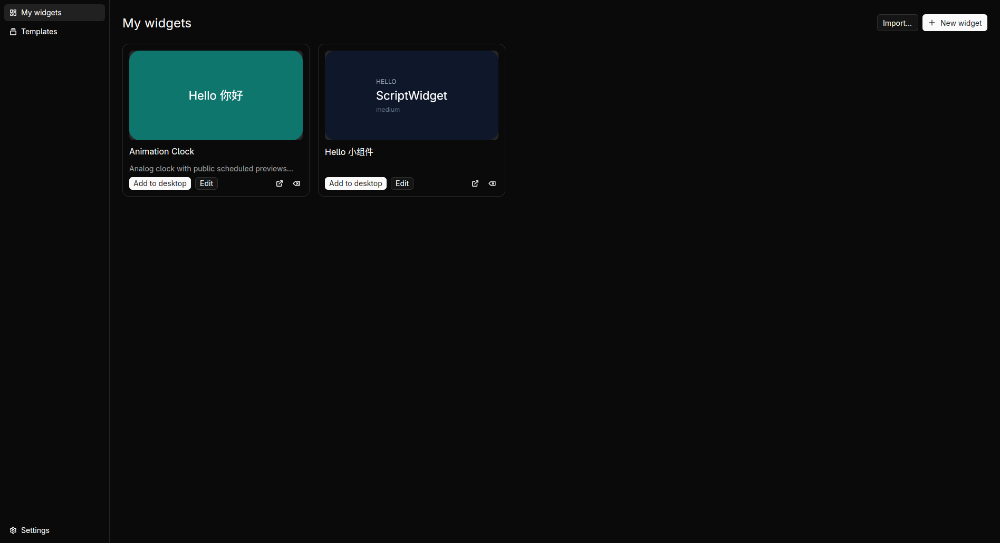 | 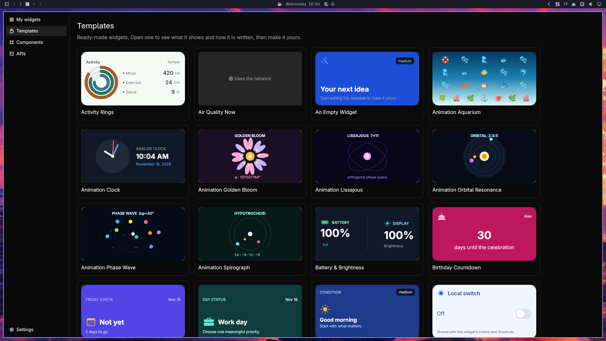 |
| 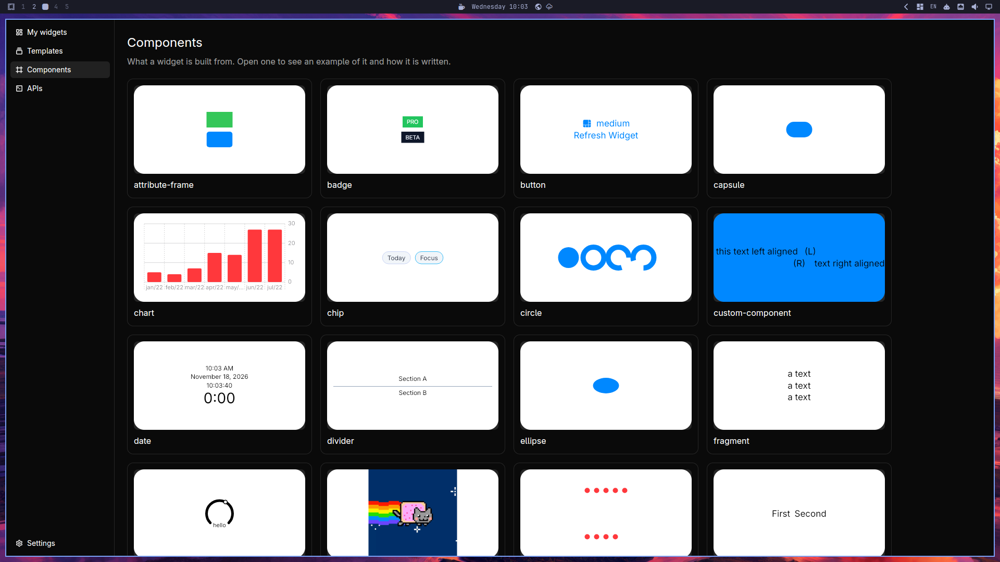 | 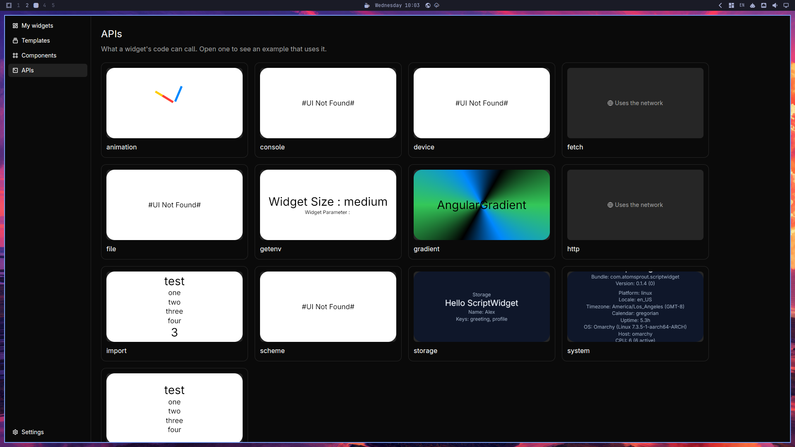 |
| 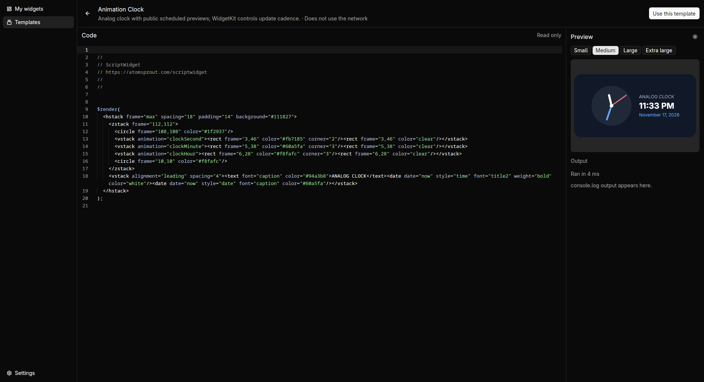 | 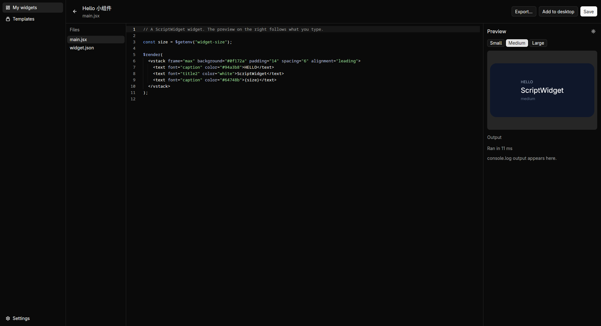 |
| 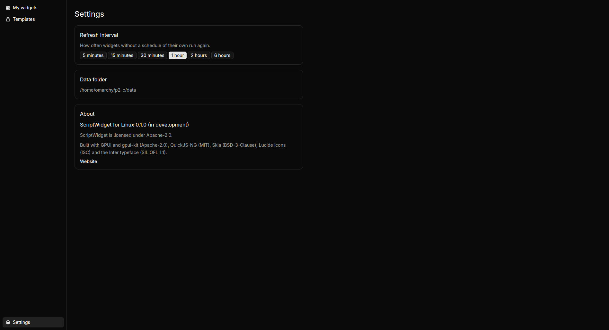 | 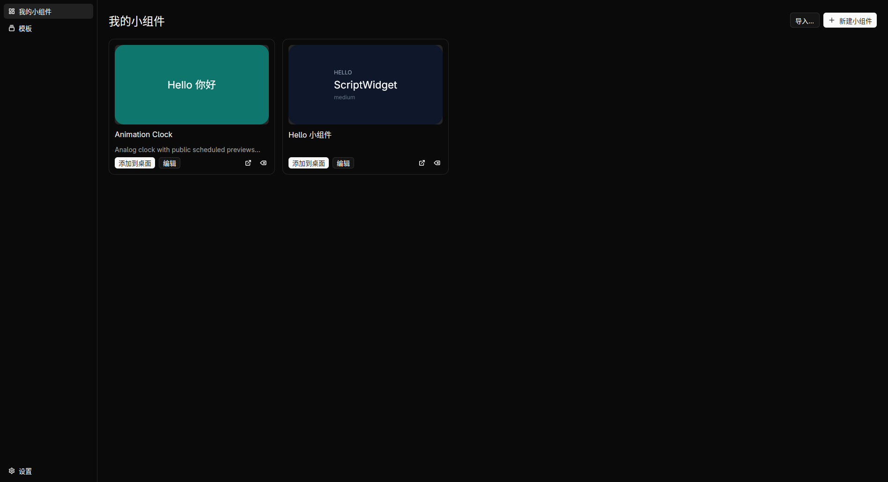 |
| 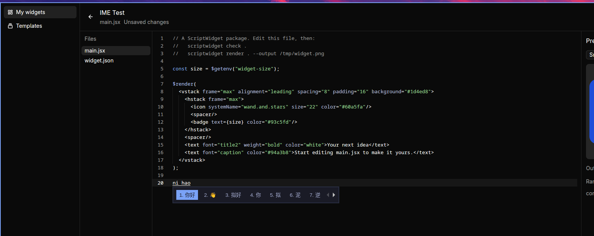 | |

The interface follows the system language when it is English or Simplified Chinese, and is English otherwise.

## Installing it

Needs Omarchy 4.5 (or another Arch-based system with the same libraries: ICU 78, fontconfig, FreeType, and a Vulkan driver for the management window). Download `scriptwidget-<version>-linux-<arch>.tar.gz` from [GitHub Releases](https://github.com/everettjf/scriptwidget/releases), check it against the SHA-256 the release lists, unpack it and run:

```
sh install.sh
```

- **It installs for you only**, without root: programs in `~/.local/bin`, data in `~/.local/share/scriptwidget`, a systemd user unit `scriptwidget.service` that starts with the graphical session, a launcher entry, and on Omarchy the plugin in `~/.config/omarchy/plugins`, enabled.
- **The archive is not signed.** Each release lists the SHA-256 of its files.
- **Which archive.** `aarch64` was built and tested on an Omarchy 4.5 machine. `x86_64` is built on Arch Linux by CI; it was tested there without a desktop, and on the Omarchy 4.5 test machine through instruction emulation, where it showed and operated widgets. It has not been run on an x86_64 computer.
- **It is built against ICU 78.** When the distribution moves to a newer ICU the programs stop starting until a new archive is published; see [TODO.md](TODO.md).
- **Updating.** There is no automatic update. Run `install.sh` of the newer archive; it stops the service, replaces the programs and keeps your widgets.
- **Removing it.** `sh uninstall.sh` keeps your widgets; `sh uninstall.sh --purge` deletes them too.

## Using it

- **Add a widget.** Open ScriptWidget from the launcher or the bar entry, open a template, choose "Use this template", then "Add to desktop". From a terminal: `scriptwidget install <folder or .swt>`, then `scriptwidget add <name> --family medium`.
- **Change its size, edit, refresh or remove it.** Right-click the widget.

  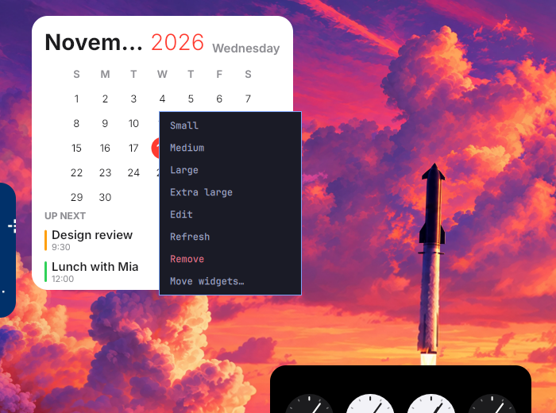
- **Move a widget.** Right-click it and choose "Move widgets…" (or turn on "Arrange widgets" in the bar entry, or run `scriptwidget arrange`). Drag widgets; they snap to the screen edges and stay out of the bar and the dock. Right-click and choose "Done moving" when done.
- **Click.** A left click works on buttons, toggles and links; elsewhere on a widget it does nothing.
- **See widgets above your windows.** "Show widgets on top" in the bar entry, or `scriptwidget peek`; once more puts them back.
- **Edit.** The preview next to the code is drawn by the same painter as the desktop widget. `scriptwidget dev <folder>` watches a folder and refreshes the placed widgets of that package on save.
- **Ask AI.** In Settings, choose a provider and store its API key (it goes to the system keyring). Then "Ask AI" in the editor opens the conversation beside the code: say what the widget should show or what to change; the reply is written out as it arrives, the result is run on this computer, and the changed lines are shown. Nothing changes until "Apply to the widget". From a terminal: `scriptwidget ai new "a clock"` and `scriptwidget ai continue <name> "make the time red"`. See [AI conversation](../ai-conversation.md).

  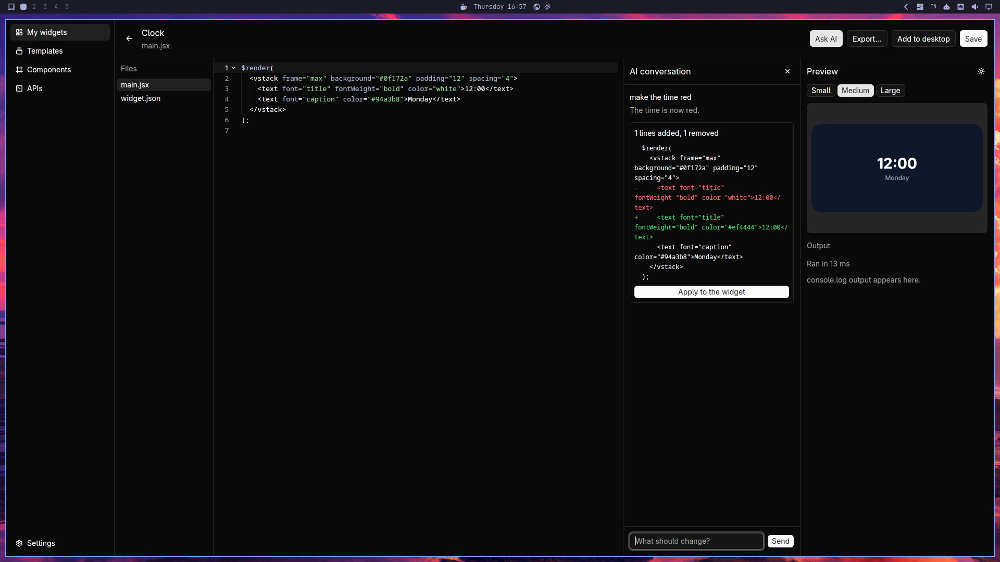
- **Move a widget to another device.** Export it as a `.swt` file and open that file in ScriptWidget on the other device; a `.swt` from another device is imported the same way.

## Parts in the source

| Part | Crate or folder |
| --- | --- |
| Engine: QuickJS-NG behind a safe wrapper | `Linux/crates/sw-quickjs` |
| Runtime: packages, archives, compiler, executor, `Intl`, native APIs, Data Source Plugins, timeline | `Linux/crates/sw-core` |
| Painter: element tree to bitmap and tap regions, on Skia | `Linux/crates/sw-render` |
| Background service | `Linux/crates/sw-host` |
| Command line `scriptwidget` | `Linux/crates/sw-cli` |
| Management window, on GPUI and gpui-kit | `Linux/crates/sw-studio` |
| Omarchy plugin (QML) | `Linux/omarchy-plugin` |
| Archive, installer, systemd unit, desktop entry | `Linux/packaging`, `Linux/scripts/package.sh` |

## Building

Needs Rust 1.85 or later, a C compiler, `pkg-config`, the development files of ICU, fontconfig and FreeType, and Node 24 or later for the shared JavaScript.

```
cd Web/studio && npm ci                      # once, for esbuild
node Linux/scripts/build-shared-js.mjs        # shared JavaScript -> Linux/assets, parity corpus -> Linux/tests/assets
cd Linux
cargo test --locked --workspace
cargo build --locked --release -p sw-cli      # target/release/scriptwidget
cargo build --locked --release -p sw-studio --features ui   # target/release/scriptwidget-studio
sh scripts/asan-test.sh                       # engine binding tests with AddressSanitizer in QuickJS (Linux only)
sh scripts/package.sh                         # Linux/artifacts/scriptwidget-<version>-linux-<arch>.tar.gz
```

The management window is behind the `ui` feature, off by default, so that `cargo test --workspace` needs no graphical libraries; with it the build also needs the development files of libxkbcommon, libxcb, Wayland and Vulkan. The "Linux release archive" workflow builds the x86_64 archive on Arch Linux; the aarch64 archive is built with `package.sh` on an aarch64 Omarchy machine.

Run `node Linux/scripts/build-shared-js.mjs` again after changing `Web/preview-engine/src`, the support bundle or `Android/core/src/main/js`. Those sources are shared with Android and Windows: a change there needs their suites as well.

`Linux/assets`, `Linux/tests/assets`, `Linux/target` and `Linux/artifacts` are generated and not checked in.

### Where the program finds its files

The program reads the generated JavaScript and the bundled templates from a data directory, never from the repository:

```
<prefix>/bin/scriptwidget
<prefix>/share/scriptwidget/runtime/      kernel.js and the other generated files
<prefix>/share/scriptwidget/templates/    template/ component/ api/
```

`sh Linux/scripts/stage-resources.sh <prefix>/share/scriptwidget` assembles it. The first location that holds `runtime/kernel.js` wins: `SCRIPTWIDGET_RESOURCES` if set; `../share/scriptwidget` next to the executable; `scriptwidget` under each entry of `XDG_DATA_DIRS`. For development, `SCRIPTWIDGET_RUNTIME_ASSETS` and `SCRIPTWIDGET_TEMPLATES` override each half.

User data is in `$XDG_DATA_HOME/scriptwidget` (`Packages`, `Storage`, `Plugins`, `Staging`), by default `~/.local/share/scriptwidget`; caches are in `$XDG_CACHE_HOME/scriptwidget`. `SCRIPTWIDGET_DATA` or `--data` names another folder.

## The command line

Every command prints one JSON report on standard output; errors and warnings are repeated on standard error as `error: [code] message`. Color is used only on a terminal and never when `NO_COLOR` is set.

| Command | What it does |
| --- | --- |
| `scriptwidget new <name> [--template <group/name>] [--directory <folder>]` | Creates a package from a template, or from a starter |
| `scriptwidget check <dir> [--fail-on-warning]` | Validates the manifest and compiles; runs nothing |
| `scriptwidget run <dir> [--family F] [--param P] [--dark]` | Executes; reports the element tree, logs and errors |
| `scriptwidget render <dir> --output <png> [--family F] [--scale N] [--now <ms>]` | Executes and draws a PNG; reports size, tap regions and timings. Needs no graphical session |
| `scriptwidget timeline <dir> [--now <ms>]` | Reports the timeline |
| `scriptwidget pack <dir> [file.swt] [--force]` | Exports a `.swt` |
| `scriptwidget install <.swt or dir>`, `list`, `templates` | Installed packages and bundled templates |
| `scriptwidget doctor` | Checks the installation: files, engine, painter, fonts, data folder |
| `scriptwidget host run` | The background service. Normally started by the systemd user unit |
| `scriptwidget add <package> [--family F]`, `remove <id>`, `widgets`, `refresh [id]` | Widgets on the desktop |
| `scriptwidget dev <folder>` | Watches a package folder and refreshes its placed widgets on save |
| `scriptwidget peek`, `arrange` | Toggle "on top" and arrange mode |
| `scriptwidget ai show`, `ai set`, `ai key set`, `ai key remove`, `ai models` | The AI provider: Anthropic, OpenAI or an OpenAI-compatible endpoint, its address (always `https://`) and model, and the API key in the system keyring |
| `scriptwidget ai new <request>`, `ai continue <package> <request>`, `ai apply`, `ai conversations` | The [AI conversation](../ai-conversation.md): makes a widget or changes an installed one. The reply is written to standard error as it arrives (`--events` for JSON lines); the code is run here before it is applied. A new widget that uses the network stays a draft unless `--allow-new-hosts` is given |
| `watch`, `tap`, `move`, `screen`, `theme`, `menu`, `session` | Used by the display; see [protocol.md](protocol.md) |

The commands from `add` on need the background service; without it they exit with 69 and say how to start it.

Families: `small` 170×170, `medium` 329×170, `large` 329×345, `extraLarge` 639×345 points, multiplied by `--scale` (default 2).

| Exit code | Meaning |
| --- | --- |
| 0 | Passed |
| 1 | The package, archive or script is at fault |
| 2 | Usage or environment: missing folder, unwritable or unsafe output, missing runtime files |
| 3 | Internal error |
| 69 | The background service is not running |

Every report has `reportVersion` (1), `command`, `status` (`passed`, `failed`, `error`), `ok`, `tool`, `error` and `diagnostics`. Package commands add `backend` (`linux-native`), `package`, `sourceHash`, `manifest` and `checks` (`package`, `compile`, `execute`, `render`, `export`, each `passed`, `failed` or `notRun`).

Differences from the Mac and Windows command lines: reports are always JSON; `render --output` names one PNG file, as on Windows (the Mac writes a folder with a light and a dark picture); there is no `preview` command and there are no fixtures, the APIs are real; a script error still writes the picture of the error card and exits with 1.

## How it runs a widget

As on Android and Windows:

1. **Compile.** The package's JSX is compiled by the shared Babel bundle inside QuickJS. The manifest is checked by the shared validator.
2. **Execute.** The script runs in a fresh QuickJS context with a 64 MB memory limit, a stack limit and a 5-second deadline. It reaches the system only through host calls, which check the manifest's permissions and network domains first.
3. **Lay out.** The shared renderer runs in a second QuickJS context that only ever sees the element tree, never package code. Text is measured by the Skia paragraph code that later draws it.
4. **Draw.** The laid-out tree is painted with Skia on a CPU surface into a bitmap with per-pixel transparency.

Every bundled package that needs no live data produces the same element tree on Linux as on iPhone, byte for byte; the tests check this.

## Differences from the other platforms

`$system.platform()` returns `"linux"`. Anything not listed is meant to work as on Windows (see [the Windows page](../windows/README.md)).

| Area | On Linux |
| --- | --- |
| Rendering modes | Always `fullColor`; `backgroundMaterial` uses the opaque `background` fallback |
| Fonts | Inter is built into the program. The six display fonts of the other platforms are not shipped, because the repository records no licence for them: text that asks for one is drawn with Inter, unless the font file is put in `~/.local/share/scriptwidget/fonts` (or the folder `SCRIPTWIDGET_FONTS` names). Chinese, Japanese, Korean and emoji use system fonts found through fontconfig; the order of the Chinese, Japanese and Korean faces follows the locale. Monospace and serif are the user's fontconfig choices |
| `animation` | Moves on the desktop. Standard clock hands are redrawn every second (with a second hand) or every minute. Swings and custom intervals are drawn as a cycle of at most 60 pictures, one every 50 ms, through the same frames as a GIF; a motion whose cycle is longer than 60 seconds is redrawn once a second instead. `render` and the previews show one frame: hands at the current time, a swing at rest |
| `<gif>` | Animated on the desktop, at most 60 frames; `render` and the previews show the first frame |
| `<date>` | A running timer is redrawn every second and a clock time every minute |
| Timeline | The script runs again at each transition |
| Links | `http`, `https` and `mailto` links open with `xdg-open`. Other schemes are refused |
| Refresh | Every 15 minutes by default (5 minutes to 24 hours in the settings), at timeline transitions, after the theme or a screen changes, after sleep, and on demand |
| Dark mode | Follows the brightness of the Omarchy theme |
| Where widgets live | On the desktop layer of Omarchy, placed anywhere; not in a panel or dashboard |
| `$device`, `$system` | `model` is `"PC"`, `name` and `hostName` are the host name, `brightness` is `1`, `thermalState` is `"nominal"`; the battery is the first system battery under `/sys/class/power_supply`, and a machine without one reports level 1 and `"full"`; `systemVersion` is `VERSION_ID` from `os-release`, or the kernel release where there is none |
| `$storage`, `$file`, `fetch`, `$http`, `$xml`, `$dataSource`, `$weather` | Yes, with the same permissions, network-domain declarations, private-address refusal and budgets. `$weather` is the MET Norway forecast |
| `$calendar`, `$reminders`, `$health`, `$photos`, `$contacts`, `$documents`, `$home`, `$icloud`, `$alarms`, `$maps`, `$services`, `$music`, `$notifications`, `$location` | No. `isAvailable()` returns `false` and calls reject with `[unsupported_platform]`. Templates that use one are left out of the template list |

## Security

Scripts, imported archives and network responses are untrusted, as on every platform. The Linux-specific parts:

- **Package files** are opened relative to the package folder with `openat2` (`RESOLVE_BENEATH`, no symlinks, no magic links) and must be regular files with one link. Where the kernel has no `openat2` the path is walked one component at a time with `O_NOFOLLOW`. Traversal, absolute paths, backslashes, symlinks, hard links, case collisions and names that are not UTF-8 are refused. Files are created with mode 0600, folders 0700.
- **Archives** are checked whole before anything is extracted (entry count, file size, expanded size, names), extracted through the same reading of the archive that checked them, into a unique staging folder on the same filesystem, and published with a rename that refuses to replace anything.
- **Network.** Requests go over a small HTTP/1.1 client on rustls. It resolves the host itself, refuses private, loopback and link-local addresses, and connects only to the address it checked. Redirects are followed by hand with the same checks at every hop, and a redirect to another origin does not receive the `Authorization` or `Cookie` header the script set. The system proxy is not used. Requests name the client as `ScriptWidget-Linux/<version>` unless the script sets its own `User-Agent`.
- **AI.** The API key is kept in the Secret Service (GNOME Keyring, KeePassXC and others) through `secret-tool` from libsecret, which gets the key on its standard input. It is never written to the settings, a package, a prompt or a saved conversation, and never passed in an argument. Without a keyring nothing is stored; `SCRIPTWIDGET_AI_KEY` gives a key for one run. The provider address is the user's choice and must be `https://`; redirects are not followed. Requests and the widget's code go to that provider and nowhere else. AI output is untrusted like any script: it runs with the permissions its manifest declares, and applying it is the user's step.
- **Engine isolation.** Package code runs inside the program's process, as on the other platforms: QuickJS exposes no system interface, and memory, stack and time are bounded.
- **Service socket.** `$XDG_RUNTIME_DIR/scriptwidget/host.sock` is readable by the user only, and the service checks that the peer is the same user. Requests are single lines that name packages, widget ids, integers and fixed words; nothing received is run as code or used as a path.
- **The display plugin** runs inside the Omarchy shell, unsandboxed like every plugin, so it is kept small: it shows PNG files from the service's own folder, ignores any other path, and sends back only a widget id with a region number or coordinates. Which action a region stands for is looked up in the service.
- **Command line output.** `render --output` and `pack` write a private temporary file and rename it; they refuse a symlink at the output name and any output inside the package.
