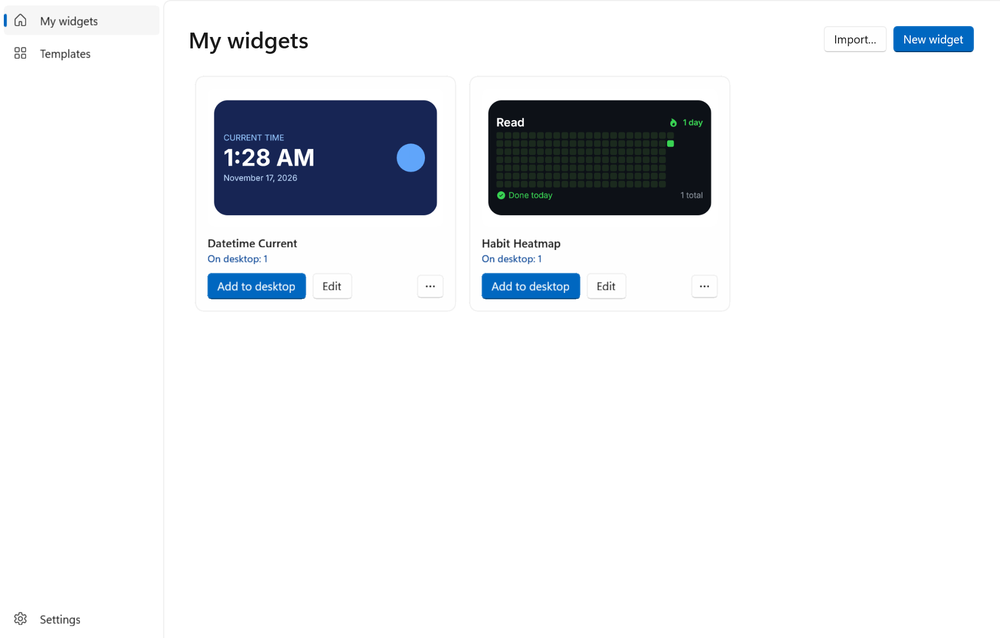
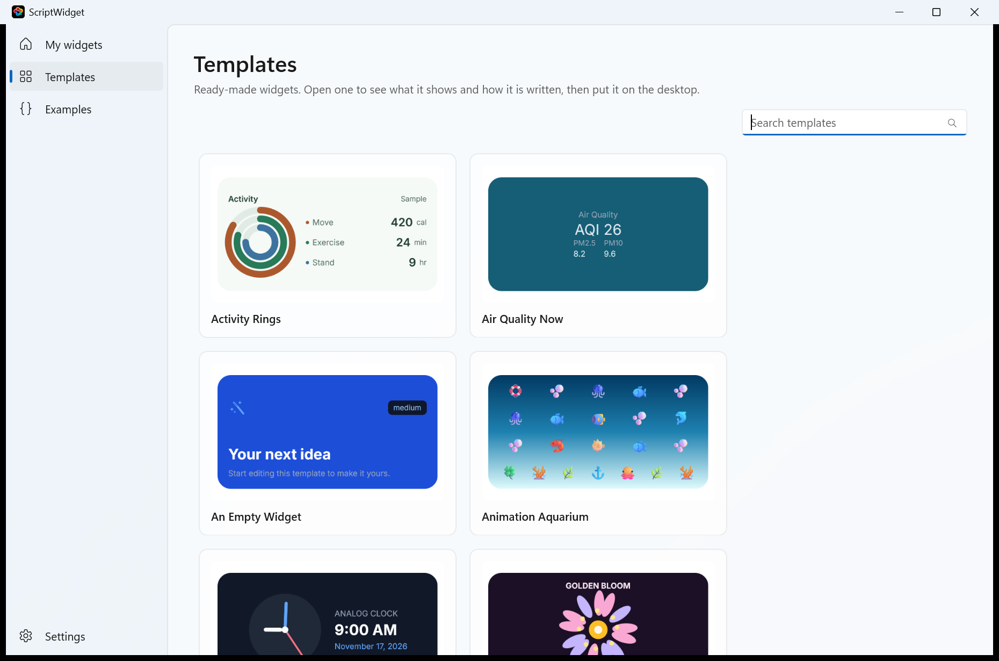
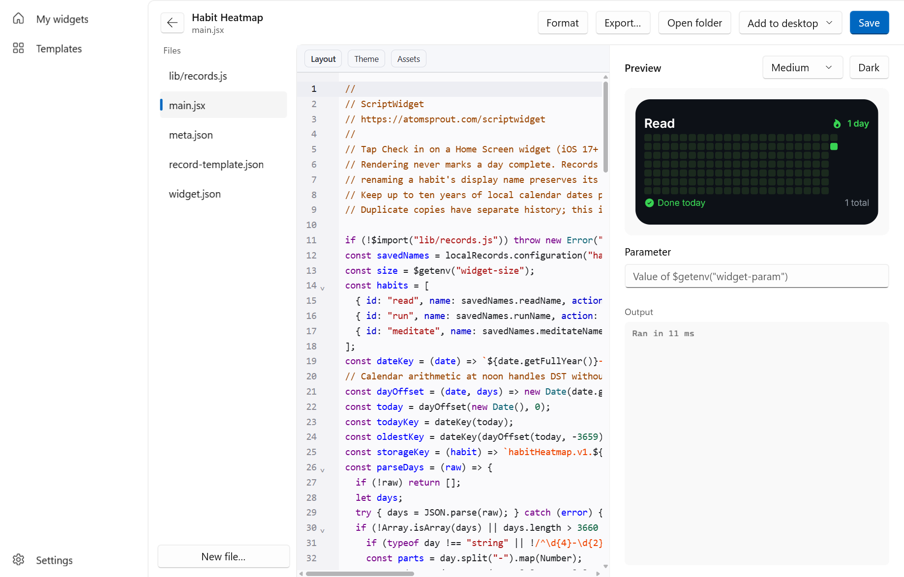
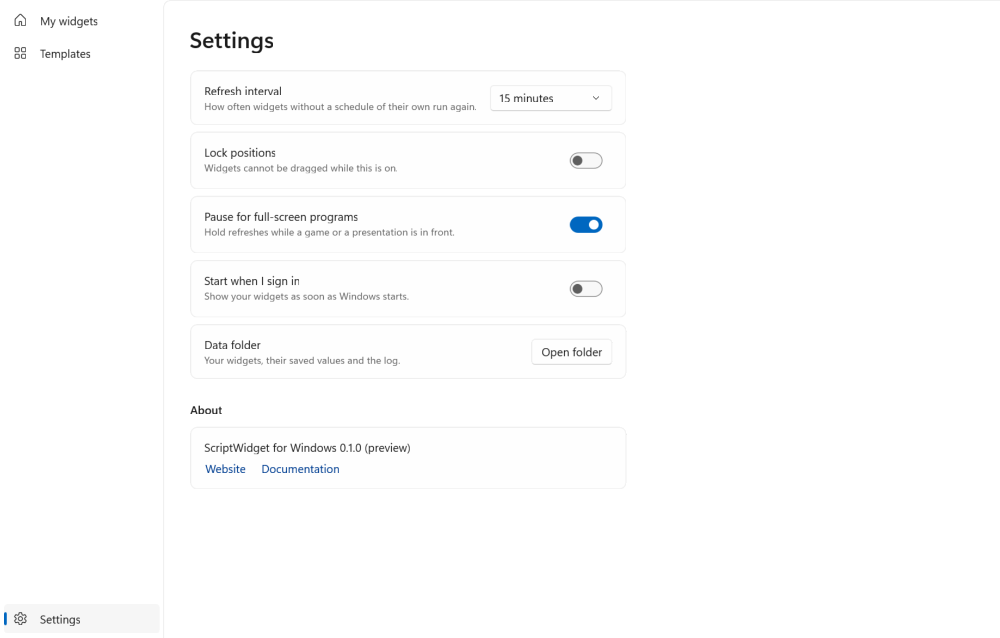
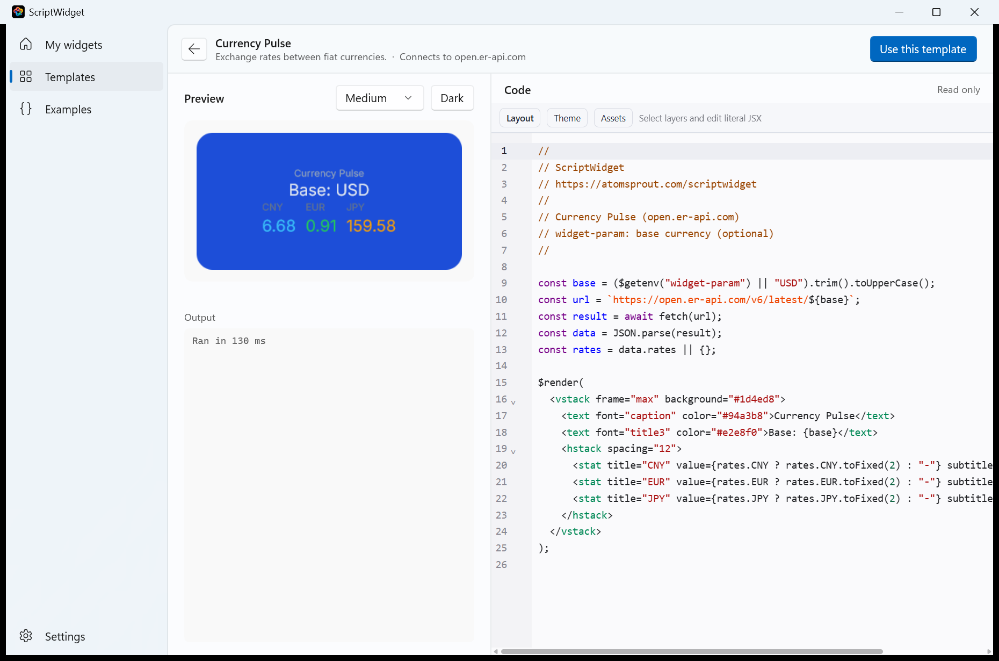
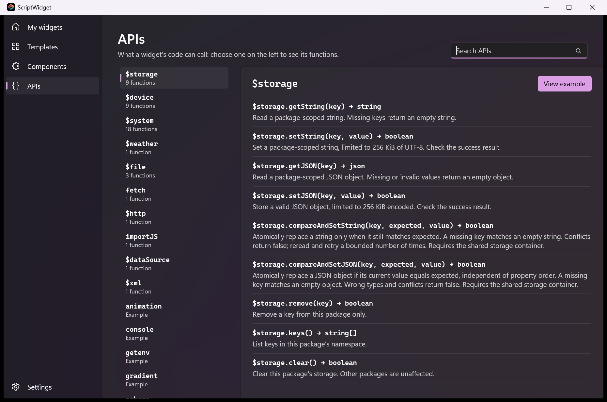
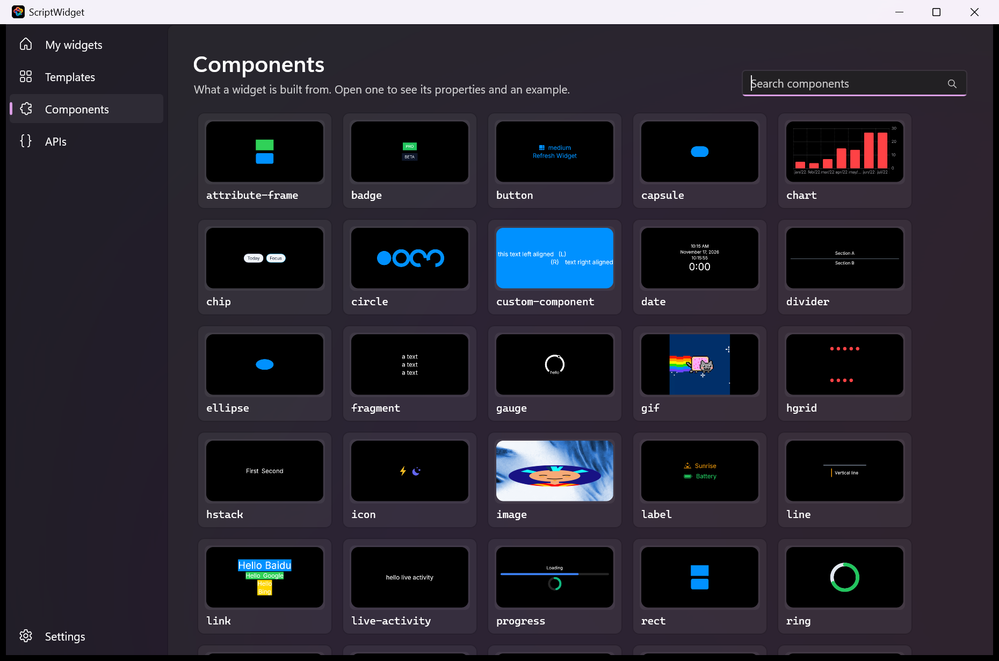

# ScriptWidget for Windows

Status: preview. Published installers are on [GitHub Releases](https://github.com/everettjf/scriptwidget/releases). This document also describes the next working-tree build; it does not mean these features are already published. Store submission evidence is in [testing.md](testing.md). The original plan is in [plan.md](plan.md), and remaining work is in [TODO.md](TODO.md).

ScriptWidget for Windows puts the same Package 2.0 widgets that run on iPhone, iPad, Mac and Android on the Windows 11 desktop. A widget is a small window that the app draws itself: it sits on the desktop below your other windows, shows what its script returns, refreshes on a schedule, and reacts to clicks on buttons, toggles and links.

## What is in the app

| Part | What it does |
| --- | --- |
| Desktop host (`ScriptWidget.exe`) | Runs all the time behind a tray icon. Owns the widget windows, runs the scripts on a schedule, handles clicks |
| Management window (`ScriptWidgetStudio.exe`) | Your widgets, templates, component/API examples, editor and preview, AI conversations, Gallery, Skills and settings. Closing it leaves desktop widgets running |
| Command line (`swcli.exe`) | Checks, runs and draws packages; manages AI conversations, Skills and Gallery. Used by development and CI; not installed with the app |

## Pictures

Widgets on the Windows 11 desktop, captured on 2026-11-17. See [testing.md](testing.md) for the desktop checks and their results.


The management window, as the program drew it on 2026-11-17 (saved by the program itself with `--screenshot`; the editor picture is the window picture with the code editor's own picture laid over the editor area, because a window picture leaves a WebView2 blank).

| | |
| --- | --- |
|  |  |
|  |  |
|  |  |
|  | |

The interface is in English.

## Installing it

Needs Windows 11. Download `ScriptWidget-<version>-x64-setup.exe` (or `-arm64-` for an ARM64 PC) from [GitHub Releases](https://github.com/everettjf/scriptwidget/releases) and run it.

- **The installer is not signed.** Windows SmartScreen says "Windows protected your PC"; choose "More info", then "Run anyway". Each release lists the SHA-256 of its files.
- **It installs for you only**, without administrator rights, into `%LOCALAPPDATA%\Programs\ScriptWidget`, and adds ScriptWidget to the Start menu and to "Installed apps". `.swt` files open in ScriptWidget.
- **Updating.** There is no automatic update. Run the installer of the newer version: it closes the running app, replaces the program and keeps your widgets.
- **Removing it.** Uninstall it in Settings > Apps > Installed apps. The uninstaller asks whether to delete your widgets and settings too; they are in `%LOCALAPPDATA%\ScriptWidget`.
- **Not together with the Store version.** There is one widget host per user, and the two installations keep their widgets in different folders. Use one of them.

## Using it

- **First start.** The app puts one clock widget on the desktop and opens the management window.
- **Add a widget.** In the management window open a template, look at its preview and its code, and choose "Use this template": a copy is added to your widgets, placed on the desktop and opened in the editor. For one of your own widgets choose "Add to desktop", or right-click the tray icon and choose "Add widget".
- **Look things up.** "APIs" is a reference: the globals a widget's code can use on the left (`$storage`, `$device`, `fetch`…), the functions of the chosen one on the right with their arguments, what they return and a sentence each. The search looks through every function. A global Windows does not implement is listed last and says so. "View example" opens the bundled example. "Components" shows one small tile per component; opening one shows its properties beside a preview and the example's code. The reference is generated from the metadata the code editor completes from, and is in English. Opening an example shows what it draws (or prints) beside its code; "Open a copy in the editor" adds an editable copy to your widgets without putting it on the desktop.
- **Move a widget.** Drag it. It snaps to the edges of the screen. "Lock positions" in the tray menu stops accidental drags.
- **Change its size or remove it.** Right-click the widget.
- **Edit it.** Right-click the widget and choose "Edit…". The preview next to the code is drawn by the same renderer as the desktop widget, so what you see there is what the desktop shows.
- **Create with AI.** Configure a provider in Settings, then open "AI assistant" for a new widget or use the same button beside an installed widget's editor. Anthropic and OpenAI-compatible HTTPS endpoints are supported, along with local Ollama/LM Studio presets using loopback HTTP and optional keys. Requests stream, and each candidate must compile, execute and draw locally; a turn can make up to four attempts. Choose versions, inspect their changes and preview different sizes before clicking Apply. New network hosts require approval. Cancellation or a failed request preserves the current version. Requests, code, diagnostics and selected Skills go to the configured provider; API keys stay in Windows Credential Locker. Provider JSON and conversation files contain no API key.
  Saved conversations remember the last observed installed source separately from their selected draft. Reopening preserves unapplied versions; changes made in the editor or outside the app become a manual version before the next AI request. Applying a stale draft is refused until those changes have been included. Returning to an older version remains an explicit choice.
- **Use Skills.** The Skills page includes five built-ins and imports/exports Skills 1.0 archives. Enable defaults there or choose Skills for one conversation. Skills add prompt instructions; they grant no runtime permission or tool.
- **Browse Gallery.** The Gallery page uses the verified shared catalog. Installs check paths, byte counts, SHA-256 and the downloaded manifest before publication. Cached catalog browsing works offline. Updates are explicit and retain the widget's installation identity; existing widgets do not update silently.
- **Move a widget to another device.** Export it as a `.swt` file in the management window and open that file in ScriptWidget on the other device. A `.swt` file from another device is imported the same way.

## How it runs a widget

The runtime is a port of the Android runtime, file by file, with the same tests.

1. **Compile.** The package's JSX is compiled by the Babel bundle the other platforms use, inside QuickJS. The manifest is checked by the shared validator.
2. **Execute.** The script runs in a fresh QuickJS context with a 64 MB memory limit, a stack limit and a 5-second deadline. It has no access to the system: `fetch`, `$storage`, `$file` and the other APIs are calls into the host, which checks the manifest's permissions and network domains first.
3. **Lay out.** The shared renderer from the web preview engine runs in a second QuickJS context, which only ever sees the element tree (data), never package code. Text is measured by the same DirectWrite layout that later draws it.
4. **Draw.** The laid-out tree is painted with Win2D (Direct2D and DirectWrite) into a bitmap with per-pixel transparency, and the bitmap is shown in the widget's window.

Every bundled package that needs no live data produces the same element tree on Windows as on iPhone, byte for byte; the build checks this.

## Differences from the other platforms

`$system.platform()` returns `"windows"`. The table lists everything that behaves differently; anything not listed works as on iPhone.

| Area | On Windows |
| --- | --- |
| Widget sizes | `small` 170×170, `medium` 329×170, `large` 329×345, `extraLarge` 639×345 points, the Mac desktop sizes, multiplied by the display scale. No Lock Screen sizes |
| Where widgets live | On the desktop, in windows the app draws. Not in the Windows Widgets board, which only accepts Adaptive Cards |
| Rendering modes | Always `fullColor` |
| `backgroundMaterial` | The opaque `background` fallback |
| Fonts | Inter and the six display fonts, as on Android. Chinese, Japanese, Korean and emoji use the Windows system fonts |
| Timeline | The script runs again at each transition instead of pre-rendering future entries, as on Android |
| `<date>` | A running timer is redrawn every second and a clock time every minute |
| `<gif>` and `animation` | Play on the desktop from a saved native layout, without rerunning package code. GIFs use up to 24 sampled frames; swings and custom clock intervals repaint at up to 20 fps. Clock hands honor local or declared time zones. CLI and Studio previews show one frame |
| Links | `http`, `https` and `mailto` links open in the default program. Other schemes are refused, because a link comes from untrusted package content |
| Refresh | Every 15 minutes by default (5 minutes to 24 hours in the settings), at timeline transitions, after sleep, after a clock or theme change, and on demand. Paused while the session is locked or a full-screen program is in front |
| Dark mode | Follows the Windows app theme |
| Live Activities, Control Widgets, Siri actions, push refresh | Not available |

### Data APIs

| API | On Windows |
| --- | --- |
| `$device`, `$system`, `$storage`, `$file`, `fetch`, `$http`, `$xml` | Yes, with the same permissions, network-domain declarations, private-address refusal and budgets |
| `$dataSource` (Data Source Plugins) | Yes |
| `$weather` | Yes, the MET Norway forecast for supplied coordinates, as on Android |
| `$calendar`, `$reminders`, `$health`, `$photos`, `$contacts`, `$documents`, `$home`, `$icloud`, `$alarms`, `$maps`, `$services`, `$music`, `$notifications`, `$location` | No. `isAvailable()` returns `false` and calls reject with `[unsupported_platform]` |

Templates that use an API from the last row are left out of the template list.

`$device` and `$system` report what Windows can tell without a permission: `model` is `"PC"`, `name` and `hostName` are the computer name, `brightness` is always `1`, `thermalState` is always `"nominal"`, and a desktop without a battery reports `level` 1 and state `"full"`.

## Security

Scripts, imported archives and network responses are untrusted, as on every platform. The Windows-specific parts:

- **Package paths.** In addition to the shared rules (no traversal, absolute paths, symlinks, backslashes or case collisions), Windows refuses reserved device names such as `CON` and `NUL` with or without an extension, names that end in a dot or a space, colons (alternate data streams and drive letters), UNC and drive-letter forms, and reparse points.
- **Network.** Requests go through `HttpClient` with a connect step that resolves the host itself and refuses private, loopback and link-local addresses before connecting to the address it checked. Redirects are followed by hand with the same checks at every hop, and a redirect to another origin does not receive the `Authorization` or `Cookie` header the script set (the Android transport sends them on; that difference is deliberate). Requests name the client as `ScriptWidget-Windows/<version>` unless the script sets its own `User-Agent`, and do not use the system proxy.
- **Engine isolation.** In this release package code runs inside the host process, as on iPhone and Android: QuickJS exposes no system interface, and memory, stack and time are bounded. A separate restricted process is planned (see [TODO.md](TODO.md)). The build runs the tests of the engine binding a second time with AddressSanitizer in the QuickJS library.
- **Local time.** QuickJS on Windows computed every date's local time from today's UTC offset, which is wrong across a daylight-saving change. The Windows build asks ICU for the offset at the date in question; the vendored QuickJS source is unchanged.
- **The management window's editor** is the only web content in the app. It loads files from the app's own folder under a private host name and cannot navigate, open windows, download or reach the network.
- **The pipe** between the management window and the host is created for the current user only. Requests name packages and widgets; nothing sent over it is run as code.
- **AI and imports.** AI credentials are stored separately in Windows Credential Locker and sent only to the chosen HTTPS provider, with redirects disabled. Model declarations may add only public network hosts, reviewed before application; existing non-network permissions are preserved. Gallery trusts only its configured GitHub raw-content root and checks every downloaded file. Skills are bounded declarative prompt packages. All three use link-refusing, bounded private-file reads and atomic writes.

## Building

Needs Windows 11, Visual Studio 2026 (or the Build Tools) with the C++ workload, the .NET 10 SDK and Node 24 or later.

```
cd Web/studio && npm ci                      # once, for esbuild
node Windows/scripts/build-shared-js.mjs      # shared JavaScript -> Windows/assets
powershell -File Windows/scripts/build-native.ps1 -Arch x64    # swcore.dll (QuickJS)
cd Windows
dotnet build ScriptWidget.slnx -c Debug -p:Platform=x64
dotnet test tests/ScriptWidget.Core.Tests -c Debug
```

`powershell -File Windows/scripts/desktop-check.ps1` starts the host with a scratch data folder and checks the desktop behavior that can be checked without looking at the screen: what the widget windows show, their place in the window order, dragging, clicks and system events.

`powershell -File Windows/scripts/package.ps1` builds the MSIX package into `Windows/artifacts`. For a Store submission pass the identity values from Partner Center (`-IdentityName`, `-Publisher`, `-PublisherDisplayName`) and `-FrameworkDependent`.

`powershell -File Windows/scripts/installer.ps1 -Arch x64 -Version 0.1.0` builds the installer for GitHub Releases, `Windows/artifacts/ScriptWidget-0.1.0-x64-setup.exe`, from the same program folder as the self-contained MSIX package. It needs [NSIS 3](https://nsis.sourceforge.io). `powershell -File Windows/scripts/installer-check.ps1 -Installer <setup.exe>` installs it, starts it, installs it again over the running copy and removes it, checking each step; it refuses to run on a PC where ScriptWidget is installed that way. The "Windows installers" workflow, started by hand, does both for x64 and ARM64 and keeps the installers as artifacts of the run. Releases are tagged `windows-v<version>`.

Run `node Windows/scripts/build-shared-js.mjs` again after changing `Web/preview-engine/src`, the support bundle or `Android/core/src/main/js`. Those sources are shared with Android: a change there needs the Android suites as well.

## Folders

| Folder | Contents |
| --- | --- |
| `Windows/native` | `swcore`: QuickJS-NG (the Android app's sources) and its C binding |
| `Windows/src/ScriptWidget.Core` | The runtime: engine wrapper, compiler, executor, packages, APIs, plugins, renderer. No windows |
| `Windows/src/ScriptWidget.App` | The desktop host |
| `Windows/src/ScriptWidget.Studio` | The management window |
| `Windows/src/ScriptWidget.Cli` | `swcli` |
| `Windows/tests` | xUnit tests, most of them ported from `Android/core` |
| `Windows/package` | MSIX manifest and images |
| `Windows/installer` | NSIS script of the installer for GitHub Releases |
| `Windows/assets`, `Windows/native/out`, `Windows/artifacts` | Generated; not checked in |

User data is in `%LOCALAPPDATA%\ScriptWidget` (`Packages`, `Storage`, `Plugins`, `Skills`, `Gallery`, `AiConversations`, `Cache`, `ai-profiles.json`, `widgets.json`, `settings.json`, `host.log`). `ai-profiles.json` contains provider metadata only. When installed from the Store, app files use `%LOCALAPPDATA%\Packages\<package family>\LocalState\ScriptWidget`, which Windows removes on uninstall.

Examples for the development CLI (use `--data <folder>` to isolate creation tests):

```text
swcli skills list
swcli gallery list
swcli ai configure --provider custom --name MyProvider --base-url https://api.example.com --model my-model
swcli ai key set --stdin
swcli ai models
swcli ai new "An offline focus card" --family medium
swcli ai continue <conversation-id> "Make the accent orange"
swcli ai show <conversation-id>
swcli ai apply <conversation-id> --name "Focus card"
```

`ai list`, `fork`, `select` and `retry` manage saved versions. `ai apply --allow-network` explicitly approves the selected version's requested hosts after review. Keys are never accepted as command-line arguments.

### Ollama and LM Studio

In Settings → AI providers, choose **Ollama (local)** or **LM Studio (local)**. The presets fill `http://localhost:11434` and `http://localhost:1234`. Start the service in its own application, click **Load models**, select an installed chat/instruct model, then **Save and use**. Model discovery works before a model has been chosen. ScriptWidget connects to the server; it does not install the server, download models or manage their lifecycle.

Both presets use the OpenAI-compatible `/v1/chat/completions` and `/v1/models` endpoints, including streaming and cancellation. Entering a base URL ending in `/v1` is also supported. For CLI use:

```text
swcli ai configure --provider ollama
swcli ai models
# Configure an installed chat model using the identifier returned by your server:
swcli ai configure --provider ollama --model my-installed-chat-model
swcli ai new "An offline focus card" --family medium
# LM Studio uses --provider lmstudio instead.
```

API keys are optional only for loopback servers. If the server enables authentication, enter its token in the normal key field (or `swcli ai key set --stdin`); it stays in Credential Locker. Leaving the field blank keeps an existing key; `swcli ai key remove` removes it. Switching endpoints never silently transfers an old endpoint's key.

HTTP is allowed only for `localhost`, `127.0.0.1` and `[::1]`. Local requests bypass system proxies and connect directly to loopback without DNS/hosts-file lookup; redirects are refused. The two local presets stay on this computer. For a remote server use **OpenAI-compatible** with HTTPS and an API key. Widget-package networking restrictions are unchanged. Small local models may fail code validation; choose a chat model capable of following code instructions and accommodating the prompt.

Run `powershell -File Windows/scripts/creation-check.ps1` for isolated offline CLI acceptance. Optional live Gallery/AI modes and a multi-widget animation stress test are documented in [creation-validation.md](creation-validation.md). English release notes, the Windows privacy section and certification notes are prepared in [release-draft.md](release-draft.md) for owner review; they have not been published.
