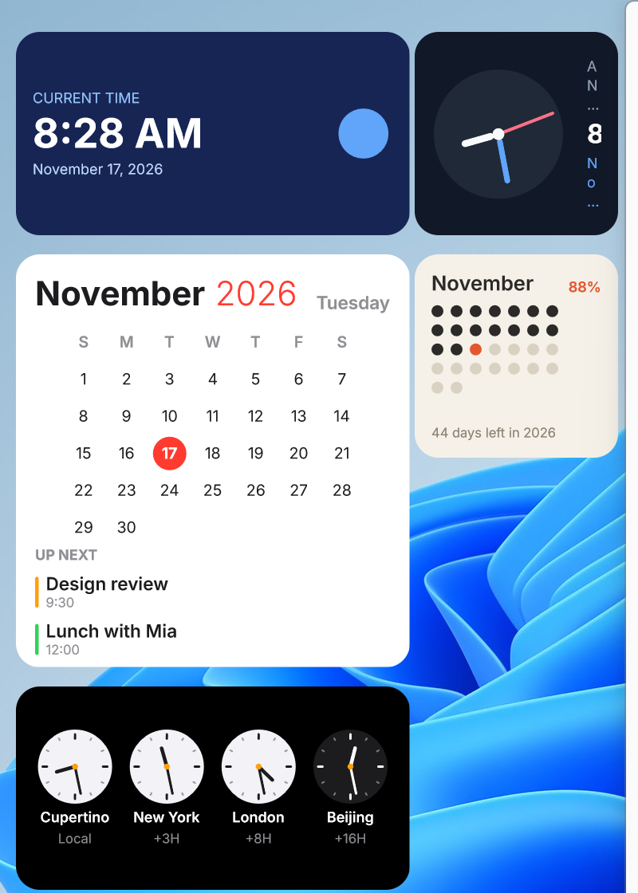

# ScriptWidget for Windows: what was tested

Every entry says what ran, on which machine, and what the result was. A check that did not run is listed as not run; it is never described as passing.

## Machines

| Name | System | Notes |
| --- | --- | --- |
| Dev PC | Windows 11 Home build 26200, x64, one 3840×2160 display at 150% | Visual Studio 2026 (MSVC 14.51), Windows SDK 26100, .NET SDK 10.0.401, Node 26.13.1, Developer Mode on |
| CI x64 | GitHub Actions `windows-2025` (Windows Server 2025), x64 | `.github/workflows/windows.yml` |
| CI ARM64 | GitHub Actions `windows-11-arm` (Windows 11, ARM64) | Same workflow, job "Build and test (ARM64)" |

ARM64 runs on the CI ARM64 machine only; no ARM64 PC was available to a person, and the MSVC ARM64 tools are not installed on the Dev PC.

## 2026-11-18, first Microsoft Store submission (Dev PC)

Built from commit `97d4d51` on the Dev PC (Windows 11 build 26200, x64). No runtime source changes were made for this submission.

| Check | Result |
| --- | --- |
| `powershell -NoProfile -File Windows/scripts/package.ps1 -Arch x64 -Version 0.1.0.0 -FrameworkDependent -IdentityName '20370everettjf.ScriptWidget' -Publisher 'CN=560214DD-F83C-484D-87A6-0E0454EE64B0' -PublisherDisplayName 'AtomSprout'` | Pass; rebuilt shared JavaScript, native engine, host and Studio; produced the unsigned Store package, 57,302,627 bytes |
| `dotnet test tests/ScriptWidget.Core.Tests -c Release -p:Platform=x64 --nologo -v minimal` from `Windows` | 239 passed, 0 failed, 0 skipped |
| Partner Center package processing | `ScriptWidget_0.1.0.0_x64-store.msix`, version `0.1.0.0`, X64, minimum OS `10.0.22000.0`: **Validated** |
| Required submission sections | Pricing, properties, age ratings, packages and Store listings all showed **Complete** before submission |
| Final submission | Partner Center showed **In certification**, with **Submission: Complete**, **Pre-processing: In progress**, and certification/publishing not started |

Package SHA-256: `08A41C495DACB500FB00B94B404D982354213AD5AACC0DA4849F8990457F25C2`.

Store ID: `9MVR97B9C938`; package family: `20370everettjf.ScriptWidget_93hpgtfr9gyfj`; submission ID: `1152921505702441674`. Review the submission in [Partner Center](https://partner.microsoft.com/en-us/dashboard/products/9MVR97B9C938/overview). The public [Store link](https://apps.microsoft.com/detail/9MVR97B9C938) is reserved; successful submission is not evidence that the listing is live.

The submission is free, publicly discoverable, and configured for all 240 markets and publication as soon as certification passes. It targets Windows Desktop only; future device-family availability was disabled. English (United States) and Chinese (China) listings each contain a localized description, six feature bullets, seven keywords, four existing Windows screenshots with localized captions, and the native 300-by-300 app icon. The privacy URL is `https://atomsprout.com/scriptwidget/privacy/` (HTTP 200 checked on this PC). The IARC questionnaire was saved after the owner explicitly accepted its terms and confirmed adulthood; the preview returned ESRB Everyone, PEGI 3 and Microsoft 3+.

Certification notes were saved and verified after reloading. They explain offline testing without credentials, the `runFullTrust` and `internetClient` uses, the opt-in startup task, bounded in-process QuickJS execution, permissions and platform limitations. No AI-generation or external-purchase capability was declared for the Windows preview.

Not run for this submission: ARM64 packaging, installation of the Store-signed package, a fresh desktop smoke suite, and the cross-platform release-readiness gate. Microsoft certification and public availability were still pending when this entry was written. Existing build warnings were emitted by QuickJS C wrappers, Studio C# code and the test analyzer; the build and tests nevertheless exited successfully.

## How to run the automated checks

```
node Windows/scripts/build-shared-js.mjs          # needs `npm ci` in Web/studio once
powershell -File Windows/scripts/build-native.ps1 -Arch x64
cd Windows
dotnet test tests/ScriptWidget.Core.Tests -c Debug
```

`build-native.ps1 -Asan` builds swcore with AddressSanitizer; pass `-p:SwNativeSuffix=-asan --filter "FullyQualifiedName~QuickJs"` to `dotnet test` to run the engine binding tests against it.

## 2026-11-17, Dev PC

**The Dev PC was locked for the whole session.** Programs ran and windows existed on the desktop, but the screen showed the lock screen and no real mouse or keyboard input was possible. The desktop checks below therefore read what the windows themselves show (`PrintWindow`), read the window order (`GetWindow`), post pointer and system messages to the windows, and drive the management window through UI Automation. What that still leaves unchecked is listed under "Not run" and in [TODO.md](TODO.md).

### Automated

| Check | Result |
| --- | --- |
| Preview engine tests on Windows (`npm test` in `Web/preview-engine`) | 199 of 199 pass, after adding `.gitattributes` (a CRLF checkout broke the shared build scripts before) |
| `dotnet test` of `ScriptWidget.Core.Tests`, Debug, x64 | 235 of 235 pass |
| Parity: bundled packages that need no live data, element tree compared byte for byte with the JavaScriptCore reference | 127 of 127 identical |
| Renderer: every parity package drawn at 170×170, 329×170 and 329×345, scale 2 | No exception, no empty bitmap |
| Engine limits: memory limit, deadline, stack limit | Each raises its error (in `QuickJsTests`) |
| Local time across a daylight-saving change | Correct with the ICU-based offset (in `QuickJsTests`); the upstream Windows code returns today's offset for every date |
| Engine binding tests with AddressSanitizer in swcore | 15 of 15 pass |
| The rest of the suite with AddressSanitizer | Not run: the parity test did not finish in 9 minutes with a sanitized QuickJS inside the .NET test host |
| Native AOT: `swcli` published ahead of time, all 140 bundled packages run and drawn at medium size | 137 drawn; 3 hit the 5-second limit waiting for the network; no crash. Two of the three use `api.open-meteo.com`, which this network cannot reach (`curl` times out too); the third (`Daily Quote`) passed on a second run |
| `node Scripts/validate-doc-links.mjs` | Passes (its repository-boundary check assumed `/` separators and failed on Windows before) |

The shared-JavaScript build was refactored into `Scripts/lib/shared-js.mjs`; regenerating the Android assets with it changes one file, `android-apis.js`, by the two lines that take the platform name from the host. `render.js`, `kernel.js`, `prepare.js` and `contract.json` are byte-identical. After the change, in CI: the Android workflow regenerates the assets and finds no difference from the checked-in ones, and `:core:testDebugUnitTest` passes (run 44081171658). The core instrumented suite, which includes the QuickJS parity with JavaScriptCore and the renderer on the parity corpus, passes 30 of 30 on an API 35 x86_64 emulator (run 44094364212, the hand-started job "Device tests on an emulator"), and the app suite (`foss` flavor) passes 63 of 63 there. Not run: the two instrumented suites on a phone.

### Found and fixed by these runs

- **Native AOT broke every layout.** Win2D's array of line metrics cannot be marshalled under native AOT. The text engine now uses a fixed line box and hit-testing instead; the JIT and AOT builds draw the same picture.
- **A packaged program could not install a package.** Windows redirects `%LOCALAPPDATA%` for a packaged program and the redirection does not support moving a directory. Packaged, the data now lives in the package's real local folder.
- **The code editor asked to pair with a phone.** The shared editor bundle tells an embedding app from the Web Studio site by a marker object, which the Windows bridge now provides.
- **Requests without a user agent.** The GitHub API answered 403. Requests now send `ScriptWidget-Windows/<version>` unless the script sets its own.
- **Size names.** `supportedFamilies` uses `systemMedium`; it was compared with `medium`.
- **The taskbar icon of the installed app had an edge in the accent color** (the owner saw it after switching to the dark theme with a pink accent). The package held one plain image per logo, so the taskbar drew the icon on its colored plate, which showed around the rounded corners. The images with their scale, target-size and unplated variants are now part of the management window's project and indexed in its `resources.pri`; a picture of the taskbar afterwards shows the icon without the plate.
- **Show desktop was missed on the real desktop, twice.** See "On the unlocked desktop": the desktop window is raised later than it becomes the foreground window, and lowered later than it stops being it.
- **Bundled network templates could not reach the network** once copied into the library. See the same section.
- **Show desktop was looked for in the wrong window.** Only a WorkerW that takes over the desktop icons was recognized, which is how Windows showed the desktop before 11 24H2. On 24H2 and later (this PC) Progman itself is raised; both are handled now.
- **Widgets were underneath the desktop.** `HWND_BOTTOM` put the widget windows below `Progman` in the window order on this Windows build, where they would be neither seen nor clicked. They are now inserted directly above the desktop window.

### Desktop host (`ScriptWidget.exe`)

`powershell -File Windows/scripts/desktop-check.ps1` runs these checks against a scratch data folder and saves pictures of the widget windows. It passed, 34 of 34, with the debug build and with the native AOT build from the package layout.

| Check | Result |
| --- | --- |
| First start: installs the clock template and places one widget | Yes |
| Windows accepts the tray icon | Yes |
| The actions of the tray menu and of the right-click menu of a widget, run through the host's debugging requests (the popup itself was not shown) | Size changes the window (494 to 255 pixels wide for small); "Lock positions" stops a drag and turns off again; "Add widget" adds one; "Refresh all" redraws; "Remove from desktop" removes the widget and its window; "Quit" ends the host with exit code 0 |
| What each widget window shows, captured from the window | The rendered widget, 494×255 pixels (329×170 points at 150%), with transparent rounded corners; the clock shows the current time |
| Window order with two widgets on the desktop | Both widget windows directly above `Progman` (the desktop) and below every other visible window; a window opened afterwards goes above them |
| Drag (posted pointer messages) | The widget moves by the dragged distance, snaps to the top edge of the screen, and the new place is saved in `widgets.json` |
| A click on a button (posted pointer messages) | "Check in" on Habit Heatmap ran the declared action `checkInRead`; the package storage then held the date of the day and the widget drew "Done today" |
| Import of a `.swt` archive and placing it, requests over the pipe | Work (`swcli pack`, `install`, `add`, `widgets`) |
| Display change, clock change, resume from sleep, session lock and unlock, theme change (the messages posted to the host) | Each is handled and the widgets are redrawn; the widget keeps its place |
| Explorer restart (the `TaskbarCreated` message posted to the host) | Handled: the window order is applied again and the tray icon is added again |
| A real sleep on the Dev PC (Modern Standby, entered with `SetSuspendState` and ended by a wake timer after 107 seconds, native AOT host running) | The host kept running, logged the time change and the resume, redrew the widget within a quarter of a second of the resume, and the widget window was still directly above the desktop window. Nobody saw the screen, so the clock was not read by a person |
| A real Explorer restart on the Dev PC (Explorer ended with the native AOT host running; Windows started it again by itself) | The host kept running, logged the new taskbar and added its tray icon again (Windows accepted it), and the widget window was directly above the new desktop window and still drew its content. Nobody saw the screen |
| A new widget when another sits at the default place | Lands on the next free step instead of exactly on top (it did land on top before) |
| Redraw cost after the first render | Layout 3 to 35 ms, paint 1 to 65 ms |
| Idle cost, native AOT build, two widgets, one of them a clock | 85 MB private memory, 93 MB working set; 0.05 s of processor time in 30 s |
| Idle cost, native AOT build, one widget without dates | 22 MB private memory, 58 MB working set, 10 threads; 0.00 s of processor time in 30 s |
| "Show desktop", acted out with a stand-in for the desktop window (`--selftest-showdesktop`) | 19 of 19 (five were added for the late raise and late drop found on the real desktop). The first 14: a click on the wallpaper is not mistaken for it; when the desktop window is raised and is the foreground window the widget becomes topmost in front of it; afterwards the widget is back directly above the desktop and behind ordinary windows; a second round behaves the same |
| "Show desktop" for real | Done on the unlocked desktop, see "On the unlocked desktop" below |

### Management window (`ScriptWidgetStudio.exe`)

Driven through UI Automation (the real controls are invoked, with no pointer), and checked from captures of the window.

| Check | Result |
| --- | --- |
| Opening the window starts the desktop host | Yes |
| "My widgets": cards with previews drawn by the desktop renderer, "On desktop" count from the host | Drawn correctly |
| "New widget": name dialog, the package is created, the editor opens on it | Works; the starter widget is drawn in the preview |
| Editor: file list, code editor with the file loaded and highlighted, preview, output | Drawn correctly; the editor reported ready and returned the text of the file |
| "Add to desktop" with a size from its menu | The host shows one more widget |
| "Save" | Works |
| "Templates": groups, search box, previews; "Use this template" | Drawn correctly, 130 templates; the template is installed, placed on the desktop and opened in the editor |
| "Settings": "Lock positions" | Written to `settings.json` |
| The interface in Simplified Chinese (`SCRIPTWIDGET_LANGUAGE=zh`) | "My widgets", the editor and "Settings" are drawn correctly; nothing is cut off |
| Accessible names | The back button, the "more actions" button, the switches and the inputs had none; they have now |
| Typing in the code editor, file pickers (import, export), rename, duplicate, delete | Not run |

### MSIX package

Both forms were built, registered from their layout folder in Developer Mode, tried, and removed again.

| Check | Result |
| --- | --- |
| `package.ps1 -Arch x64` | `ScriptWidget_0.1.0.0_x64.msix`, 74.7 MB, with the Windows App SDK and the .NET runtime inside |
| `package.ps1 -Arch x64 -FrameworkDependent` (the Store form) | `ScriptWidget_0.1.0.0_x64-store.msix`, 54.3 MB, depends on the Windows App Runtime 1.6 framework package |
| Store form started the way the Start menu starts it (`shell:AppsFolder\<family>!ScriptWidget`) | The management window opens and starts the host; both have the package identity; data in `…\Packages\<family>\LocalState\ScriptWidget`; the first start installs and places the clock widget |
| Opening a `.swt` file (file association) | Goes to the running management window, which asks for confirmation; "Import" installs the package |
| "Start when I sign in" in the packaged app | Turns the startup task on and off. Signing out and in was not done |
| Signed install, install from the Store, upgrade | Not run: needs the Partner Center identity |

The Store form at first showed "This application could not be started": the bootstrapper for unpackaged programs ran inside the package. It is switched off for that form now.

### Installer for GitHub Releases (Dev PC, 17 November 2026)

`installer.ps1` built `ScriptWidget-0.1.0-x64-setup.exe` (51.1 MB) with NSIS 3.12, and `installer-check.ps1` ran it on the Dev PC, where the copy registered from the MSIX layout was quit first. All 26 checks passed:

| Step | What was checked |
| --- | --- |
| Silent install (`/S`) | Exit code 0; host, management window and `resources.pri` in `%LOCALAPPDATA%ProgramsScriptWidget`; no `AppxManifest.xml`; the uninstaller; the Start menu shortcut; the entry in Installed apps with version and folder; `.swt` opens the management window |
| The installed program | The host starts and logs `packaged False`; the first start puts the clock widget on the desktop; the management window opens and draws the Templates page (a picture was saved) |
| Installing again over the running host | Exit code 0; the host was asked to quit and logged `host stopped`; the files are there; the widgets are kept |
| Silent uninstall while the host runs | The host is stopped; the program files, the shortcut, the entry in Installed apps, the file type and the start-at-sign-in value are gone; a file the installer did not put into the folder is left alone; the widgets are kept |

Three mistakes in the installer script were found by this check and fixed before anything was published: the command that closes the running copy was cut off at its first single quote; a script text longer than 1024 characters is cut off by NSIS; and the 32-bit installer started a 32-bit PowerShell, which cannot read the path of a 64-bit process and so did not find the running host.

Not run: the pages of the installer on screen (a picture of the window came out black), the question about deleting the widgets in a non-silent uninstall, a double-click on a `.swt` file with this installation, signing out and in with its start-at-sign-in value, a PC that never had the development tools, and the ARM64 installer on a PC (it runs in the "Windows installers" workflow only).

The "Windows installers" workflow then built both installers from commit `0bbec5a` and ran the same 26 checks on the CI x64 and CI ARM64 machines; all passed on both. Those two files are the ones attached to the release `windows-v0.1.0`: `ScriptWidget-0.1.0-x64-setup.exe` (51.1 MB) and `ScriptWidget-0.1.0-arm64-setup.exe` (46.6 MB). The files of the release were not installed again on a PC after downloading them from the release page.

## 2026-11-17, CI

GitHub Actions run 44076023162 on `windows-2025` (Windows Server 2025, x64, 100% scale, no graphics card).

| Check | Result |
| --- | --- |
| Build of swcore, the shared JavaScript and the solution for x64; build for ARM64 | Pass |
| Preview engine tests on Windows | Pass |
| `dotnet test`, Release, x64 | Pass |
| Engine binding tests with AddressSanitizer in swcore | Pass |
| `desktop-check.ps1` on the build agent's desktop | 24 of 24, with the 14 show-desktop stand-in checks: the widgets were drawn (329×170 pixels), sat directly above the desktop window, were dragged and clicked, and Windows accepted the tray icon. The uploaded pictures show the clock and the habit widget drawn correctly |

This is a second machine and another Windows version, but nobody looked at its screen either.

Run 44077877354 added the ARM64 machine (`windows-11-arm`, image `windows-11-vs2026-arm64`): swcore and the solution were built natively for ARM64, `dotnet test` passed 235 of 235 (the parity packages and the renderer included), and `desktop-check.ps1` passed with both widgets drawn correctly in the uploaded pictures.

### On the unlocked desktop (Dev PC, 17 November 2026)

The owner signed in and the desktop was unlocked, so the host ran on the real desktop with nine widgets (Datetime Current, Month Calendar, World Clock Faces, Animation Clock, Year in Dots, Daily Quote, Day Rhythm, Portfolio Pulse, Habit Heatmap) placed between the desktop icons and an open window. Pictures were taken from the screen, and the keyboard and mouse input was real input (`keybd_event`, `SetCursorPos`, `mouse_event`), not posted messages. The pictures were sent to the owner; this section records what the pictures and the window order showed, not a person's judgement.



| Check | Result |
| --- | --- |
| The widgets against the wallpaper and icons | Drawn with rounded corners and no border or halo against the wallpaper; text is sharp at 150% |
| Widgets stay behind ordinary windows | Yes: a widget dragged under an open window is covered by it |
| Win+D, first try | **Failed.** The widgets disappeared until Win+D was pressed again. Windows made the desktop the foreground window first and raised it later, after the host had stopped looking at the window order. Fixed: the order is looked at again for as long as the desktop is the foreground window |
| Leaving Win+D, after that fix | **Failed.** The widgets were left above ordinary windows that were not in front, because the desktop window was still raised when they were put "directly above the desktop". Fixed: the placing is repeated for two seconds after the desktop is left |
| Win+D, with both fixes (debug build, then the rebuilt native AOT build) | All widgets visible and topmost while the desktop is shown; afterwards directly above the desktop window again, below every other window |
| Dragging with the mouse | The widget moved by exactly the distance the pointer moved (37, 290 pixels) and the new position was saved |
| Right-click on a widget | The menu opened at the pointer (Refresh, Size, Edit…, Lock positions, Remove from desktop) and closed with Esc |
| Pointer shape | An arrow over the widget, a hand over the "Check in" button |
| Clicking a button | "Check in" of Habit Heatmap ran its action: the widget showed "Done today", "1 day", "1 total" |
| A template that uses the network, copied into the library | **Failed** for Daily Quote: "Network host is not declared in widget.json". A bundled template without `widget.json` got a manifest without the `network` permission when it was copied into the library. Nine bundled templates were affected. Fixed in `Library.BundledManifest`: the hosts the template names in its own source are declared. With the host declared, Daily Quote showed the quote of the day |

Not seen there: the tray icon's own menu (the same menu class as the right-click menu), a link opening the browser, a full-screen program in front, a scale change.

### Templates and examples in the management window (Dev PC, 17 November 2026)

The templates page was split after the owner tried it, in three rounds: the sidebar has "Templates" (the widgets, as cards the size of a widget), "Components" (one example per component, as small tiles) and "APIs" (a reference: globals on the left, the functions of the chosen one on the right). A template or example opens a page with the preview and the read-only code, and the one button that copies it is on that page. Driven through UI Automation on the unlocked desktop, with pictures of the window:

| Check | Result |
| --- | --- |
| Templates page | Widgets only, no group tabs, no button on the cards |
| Clicking a card | Opens the template: preview, size and dark switch, read-only code, "Connects to …" with the hosts the copy will declare, "Use this template" |
| Back, and clicking the selected sidebar entry | Returns to the list it was opened from |
| APIs | 111 functions in 24 globals from the editor's metadata. Choosing `$device` lists its 9 functions with arguments and return types; `$xml`, which has no bundled example, shows no "View example"; `console`, which has only an example, says so; `$health` is listed last and says it is not available on Windows. "View example" opens the example and Back returns with the same global chosen. Searching "battery" lists `$device.battery() → json` |
| Components | Small tiles, five to a row at the default window size. Opening `toggle` shows its description, its four properties with their types (`on` is marked required), the attributes every component takes, a preview and the example's code. `attribute-frame` shows the `frame` attribute |
| An example that draws nothing | Shows what it printed instead of "#UI Not Found#" |
| "Copy code" | The clipboard holds the example's code |
| "Open a copy in the editor" | A copy named after the example is in the library and open in the editor; nothing is added to the desktop |
| Chinese interface | The new pages and buttons are in Chinese |

Two things seen while doing this, neither changed:

- **Daily Quote's preview said "Script exceeded the 5-second execution limit" four times in a row** in the management window while the command line ran the same template in 0.3 seconds, and then worked every time. Timing added to the request and to the run showed nothing wrong once it worked. The cause was not found.
- **The Weather templates time out** because `api.open-meteo.com` did not answer from this PC at the time (a plain request from PowerShell timed out after 20 seconds too). The message is the same "5-second execution limit"; it does not say that a request is what was slow.

### Not run on any machine

- Watching the desktop over time for flicker; the pictures above are single moments.
- The tray icon's menu on screen.
- Signing out and in, a second display, a scale change, a full-screen program in front.
- ARM64 in a person's hands: it ran on the CI ARM64 machine only.
- The Android instrumented suites on a phone after the shared-JavaScript refactor. The JVM tests and both suites on an emulator pass in CI.
